# Road Viewer for Home Assistant

[한국어](README.md) · English

Feature reference: **1.0.30**

Upload openpilot driving logs and front/wide camera recordings to **replay video, road views and vehicle information graphs on the same timeline inside Home Assistant**.

**Camera overlay and vehicle graphs**

Compare lanes, vehicle boxes and blind-spot indications over the front video with vehicle graphs at the same instant. Seeking moves the video and graphs together.

<picture><source media="(prefers-color-scheme: dark)" srcset="docs/images/roadviewer-overview-dark.png">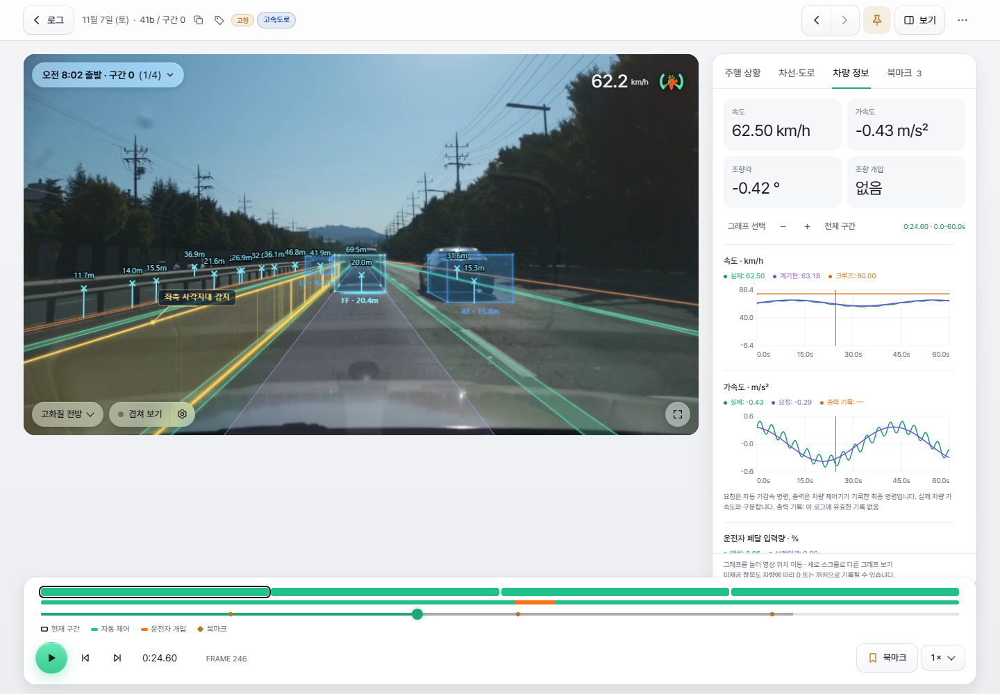</picture>

**Camera overlay and road view**

Switch the right panel to the road view to compare a top-down view of lanes, paths and radar detections with the video. The tables below expose individual radarState and liveTracks values. These screenshots demonstrate the two panel choices; graph selection and display items are configurable.

<picture><source media="(prefers-color-scheme: dark)" srcset="docs/images/roadviewer-driving-view-dark.png">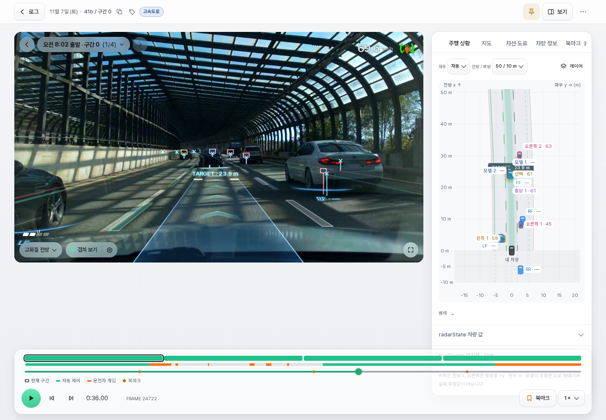</picture>

## Getting started

1. Add `https://github.com/Qualified4/roadviewer-ha` under Home Assistant **Settings → Apps → App store → ⋮ → Repositories**. Some versions call apps “add-ons.”
2. Install **Road Viewer**, start it and open its web UI.
3. On the **업로드** (Upload) tab, select files with **파일 추가** (Add files) or drag them into the upload area, then press **업로드** (Upload). Uploads keep running when you switch tabs; the header shows progress.
4. When conversion finishes, press **재생** (Play) on the **로그** (Logs) tab. If automatic conversion is disabled, first press **변환** (Convert).

The screen is split into **로그 · 업로드 · 저장공간 · 장치 · 설정** (Logs, Upload, Storage, Devices, Settings) tabs, shown as a bottom tab bar on phones. **화면 모드** (display mode) on the Settings tab chooses Auto, Light or Dark; the replay video area always stays dark.

This is an **app-store repository, not a HACS integration**. The web UI uses Home Assistant Ingress, including your existing remote Home Assistant address; no separate external port is needed. Home Assistant Container has no Supervisor app store.

## Platforms and installation

| Home Assistant architecture | Image platform | Devices |
|---|---|---|
| `amd64` | `linux/amd64` | 64-bit Intel/AMD PCs, mini PCs and servers |
| `aarch64` | `linux/arm64` | 64-bit ARM Home Assistant devices |

Installation downloads **only the matching prebuilt GHCR image**, not every published architecture. ARM 32-bit and i386 are unsupported. Prebuilt images avoid compiling the application on your device. Home Assistant may show download/extraction progress; its presentation depends on Supervisor and is not an exact percentage of total installation time.

## Supported uploads

**Local files and direct device uploads**

The **업로드** tab accepts selected or dropped files; the **장치** (Devices) tab configures HTTPS and its port and pairs or manages devices. Ports and device identifiers are masked in this screenshot. Browser file uploads do not require enabling external device access.

<picture><source media="(prefers-color-scheme: dark)" srcset="docs/images/roadviewer-library-upload-dark.png">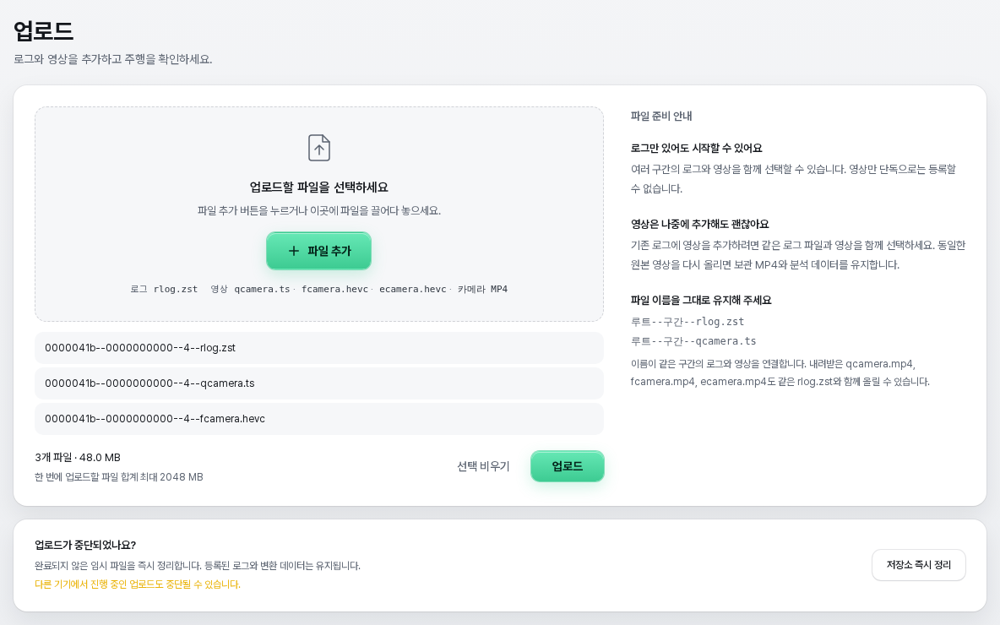</picture>

The log is required; include whichever cameras you need from the same segment.

| File | Purpose |
|---|---|
| `rlog.zst` | Driving log |
| `qcamera.ts` | Low-bandwidth front video |
| `fcamera.hevc` | High-quality front video |
| `ecamera.hevc` | Wide video |
| `camera.mp4` / `qcamera.mp4` | Low-resolution H.264 MP4 for re-upload |
| `fcamera.mp4` / `ecamera.mp4` | High-quality front / wide HEVC MP4 for re-upload |

For one segment, bare filenames work. For multiple segments, retain their identifiers:

```text
00000395--0d0eda17c5--7--rlog.zst
00000395--0d0eda17c5--7--qcamera.ts
00000395--0d0eda17c5--7--fcamera.hevc
00000395--0d0eda17c5--7--ecamera.hevc
00000395--0d0eda17c5--8--rlog.zst
00000395--0d0eda17c5--8--qcamera.ts
```

- Logs alone support road views and vehicle graphs. Video-only registration is unsupported.
- Downloaded camera MP4s can be re-uploaded with the same segment’s log. Segment/camera names and codecs must match. Select one format per camera rather than its original and MP4 together; existing retained videos are not overwritten.
- Add a camera later by uploading it with the identical log; it attaches to the existing recording.
- Re-uploading the same source video checks its saved hash and preserves the retained MP4 and replay data without storing another original copy. Use the download modal for original-format files.
- Compressed-log SHA-256 identifies duplicates at registration, after transfer.
- Browser uploads default to **512 MiB per batch**, configurable through `max_upload_mb` from 16–2048. This is separate from the storage budget. Device uploads support 8 GiB per batch, 50 segments, 200 files and 2 GiB per video; each log must fit `max_upload_mb`.

## Connecting a comma device

Use the [Device API documentation](docs/device-api.en.md) to build a client that connects an external device to Road Viewer and uploads logs and videos directly. It covers HTTPS connections, pairing and authentication, file uploads, and resuming interrupted transfers.

For direct device uploads, enable HTTPS on the **장치** (Devices) tab, save a port and apply it with **지금 재시작** (Restart now). A valid certificate under `/ssl` is required. External access defaults to off and is not needed for the Ingress UI.

Pairing supports code copy, remaining time and reissue. Codes last five minutes and work once; a replacement invalidates the old code. The API uses HMAC authentication and resumable chunk uploads. A compatible Carrot Web uploader can include optional high-quality front/wide files alongside the log/qcamera, skipping missing cameras. Video conversion runs on Road Viewer, not the driving device.

**Pairing a comma device**

**Add device** opens this dialog. Copy the highlighted one-time code into the device connection screen and check its remaining lifetime and pairing status. The pictured code is illustrative; generate a new code for an actual connection. Unlike the HTTPS port settings, this dialog authenticates and registers a device.

<picture><source media="(prefers-color-scheme: dark)" srcset="docs/images/roadviewer-device-pairing-dark.png">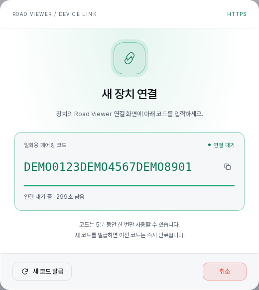</picture>

## AI agent access (MCP)

[roadviewer-mcp](https://github.com/Qualified4/roadviewer-mcp) is a local MCP server that lets clients such as Codex or Claude Code work with Road Viewer recordings. It signs in through the existing Home Assistant Ingress flow with a long-lived token and calls only the add-on's existing API, so nothing changes in the add-on and no port is opened or exposed. It supports searching and inspecting logs, bookmarks and storage status, time-window queries of replay data and vehicle telemetry, and video/log downloads (saved to a local directory, path returned). Writes are limited to adding or updating bookmarks and adding or removing tags; it never deletes, converts or changes settings. See that repository's README for installation and client registration.

## Playback and analysis

| Feature | Capabilities |
|---|---|
| Synchronized playback | Video with road view or vehicle graphs, up to 4× speed |
| Layout | Automatic, side-by-side or stacked; adjustable width for phone, tablet and desktop |
| Road view | Lanes, road edges, model paths, leads and radar detections |
| Vehicle information | 24 selectable, reorderable graphs, including separate LATERAL command and restored yRel values |
| Tags | Name and color segments, filter the library, and add/remove tags in bulk |
| Scene bookmarks | Save a log timestamp with a title/note on the **북마크** analysis tab and jump back from seek-bar markers or the list |
| Navigation and pins | The app-bar title (start time · 구간 k (i/N)) opens the segment chooser; previous/next buttons, the segment strip and per-segment pins |
| Playback bar | Floating bar with a segment strip (centred on the current segment on long drives), automatic-control/takeover track, seek bar with bookmark markers, frame step, current/total time toggle, bookmark and speed |
| Over the video | Camera/quality chooser, overlay toggle with ⚙ settings, speed, steering-wheel state with an **개입** (takeover) ring, fullscreen |

**Forward and rear road view**

Choose paired **front/rear ranges of 25/5m, 50/10m or 80/20m**. **후방 표시 · LR / RR** shows rear targets behind the ego vehicle and 0m line; switching it off restores the full forward view. Rear dashed lines are position guides rather than extrapolated lanes. Reconvert an older recording to populate LR/RR values if they are missing. Camera overlays retain BSD instead of adding rear targets.

**Wide-camera playback and overlays**

Upload `ecamera.hevc` with the log to select **와이드** (Wide) in the camera chooser over the video. This example shows lanes, road edges, the model path, a vehicle box, radar detections and a turn signal over the wider field of view. The overlay uses the wide camera's sensor and calibration; switching back to the front video preserves the log position.

<picture><source media="(prefers-color-scheme: dark)" srcset="docs/images/roadviewer-wide-camera-dark.png">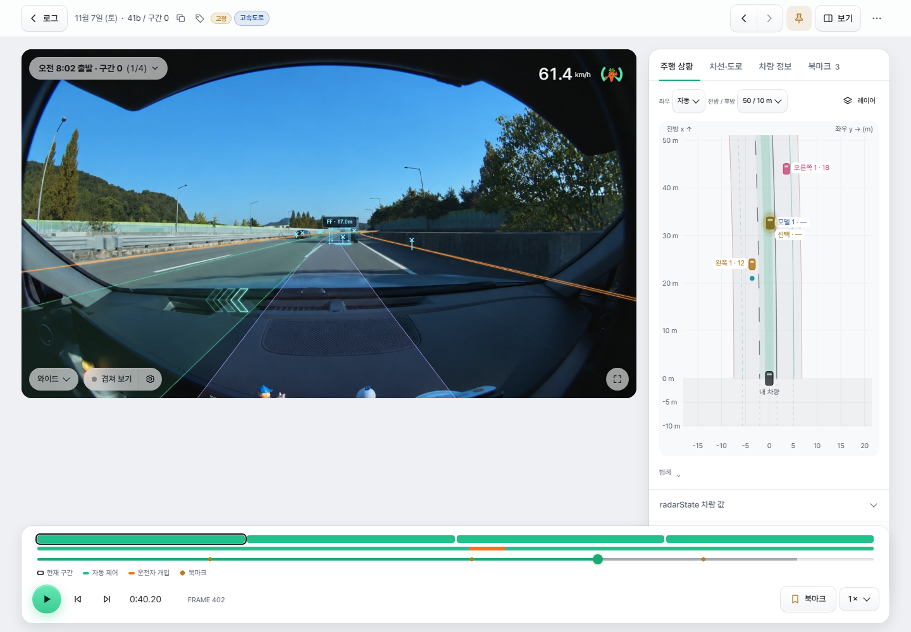</picture>

A video opens on the **기본 화질** (default quality) chosen per connection: the small front video (qcamera) on mobile data and the high-quality front on Wi-Fi/wired by default. Change it with **기본 화질** beside 닫기 (close) in the camera list over the video; the choice is kept per browser. Where the browser does not report the connection type (iPhone, iPad, desktop browsers and others), phones and tablets follow the mobile-data choice and other devices the Wi-Fi/wired one. If that video is missing, the other front video is used, then wide. Switching preserves log time and playing/paused state. A failing video triggers an attempt to use another available source. Wide overlays use the wide sensor/calibration; missing information produces an explanation. Older prepared logs may need reanalysis to obtain wide calibration.

Overlay settings control box height/opacity, path width, BSD wall height and individual labels. LF/FF/RF boxes reconstruct supported CCNC display commands recorded in the log. BSD, turn signals and target distance appear when the corresponding data is available. Camera overlays are independent of the road panel's 25/50/80m range; BSD walls retain a 40m limit.

Display mode, layout, display selections, graph order and collapsed sections are remembered in the current browser. Library and playback pins share the same per-segment setting.

### Current UI details

Open the ⚙ settings beside the **겹쳐 보기** overlay switch over the video to adjust individual box/BSD/TARGET labels, dimensions, and opacity. The ground-anchor and estimated-size explanation is inside this dialog.

<picture><source media="(prefers-color-scheme: dark)" srcset="docs/images/roadviewer-overlay-settings-dark.png">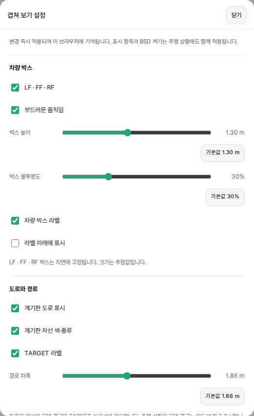</picture>

Lane probability and lateral y[0] distance share the same layout alongside road-edge and lead information.

<picture><source media="(prefers-color-scheme: dark)" srcset="docs/images/roadviewer-boundaries-probability-dark.png">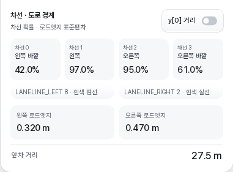</picture>

![Lateral y[0] values in the same layout](docs/images/roadviewer-boundaries-distance.png)

## Organize segments with tags

Tags **classify a whole segment**. Use labels such as “Lane change”, “Rain” or “Needs review” to describe driving conditions and follow-up work, then choose a tag filter chip on the Logs tab to narrow the library. Colored badges appear next to the recording name/pin and are also visible during playback.

The following tag and bookmark screenshots use **synthetic examples in the actual Korean UI**, without personal driving logs.

<picture><source media="(prefers-color-scheme: dark)" srcset="docs/images/roadviewer-tags-library-dark.png">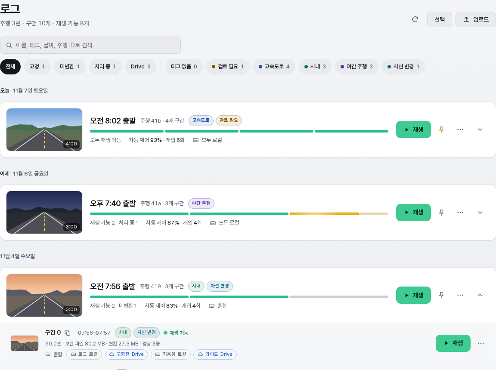</picture>

1. Choose **태그 편집** (Edit tags) in a segment's ⋯ menu (**전체 구간 태그 편집** in a route card's ⋯ menu) or **태그** (Tags) in playback.
2. Enter a name, select a color, then choose **추가 → 저장** (Add → Save). Select an existing tag without raising the mobile keyboard, or click a badge in the editor to change its name/color.
3. To tag several segments together, press **선택** (Select) on the Logs tab (or long-press a segment on touch screens), select the segments and use **태그** in the bottom action bar.

Tags support 12 colors, names up to 32 characters and up to 100 tags per segment. Saving tags does not reconvert logs or videos.

<picture><source media="(prefers-color-scheme: dark)" srcset="docs/images/roadviewer-tags-editor-dark.png">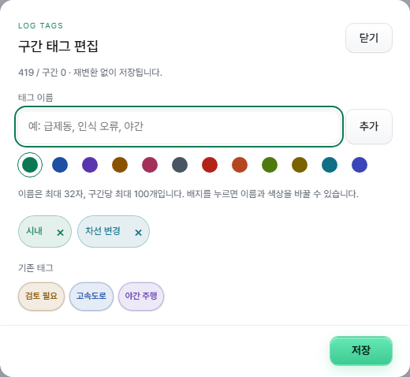</picture>

## Return to a moment with scene bookmarks

A bookmark stores **a specific log timestamp within one segment**. Mark a lane change, a lead-distance check or the start of deceleration to return directly to that moment later.

1. Play or seek to the desired time, then click **북마크** (Bookmark) in the floating playback bar. A recording popup captures that time without switching the current analysis view.
2. Check the captured timestamp and choose **저장** (Save). The title and note are optional; an empty title defaults to the scene time. **현재 시각으로** (Use current time) updates the editor’s timestamp to the current playback position.
3. Click a saved **time/title** in the bookmark tab or a **seek-bar marker** to move the video, road view and graphs together, preserving the playing/paused state.

<picture><source media="(prefers-color-scheme: dark)" srcset="docs/images/roadviewer-bookmarks-editor-dark.png">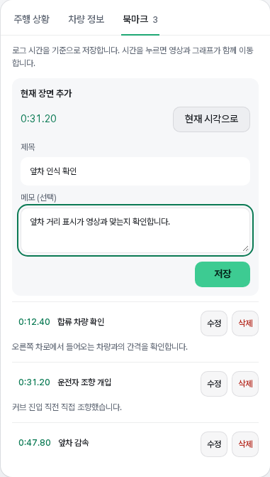</picture>

Saved bookmarks also appear as small timeline markers. Hover over a marker to see its time and title.

<picture><source media="(prefers-color-scheme: dark)" srcset="docs/images/roadviewer-bookmarks-timeline-dark.png">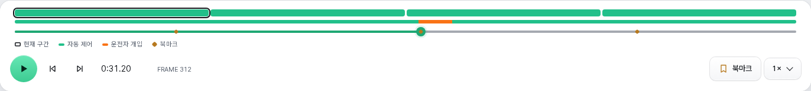</picture>

Bookmarks use log time rather than a camera file’s timestamp, so changing cameras still leads to the same moment. Each segment supports 100 bookmarks, with titles up to 80 characters and notes up to 1000 characters; entries can be edited or deleted in the bookmark tab. Tags and bookmarks survive reconversion and removal of prepared data, but are removed when the segment is **completely deleted**.

**Tags and bookmarks do not protect recordings from automatic deletion.** Pin a segment separately when it needs to be retained.

## Conversion and file management

**Conversion behavior and storage policy**

Set automatic conversion, concurrent jobs and display mode on the **설정** (Settings) tab. The **저장공간** (Storage) tab controls the budget and full-storage policy.

<picture><source media="(prefers-color-scheme: dark)" srcset="docs/images/roadviewer-storage-overview-dark.png">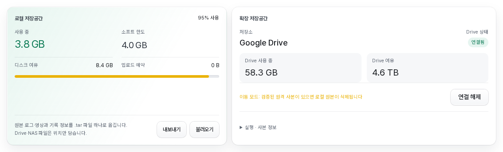</picture>

Newly completed conversions remux qcamera H.264 and front/wide HEVC into MP4 without re-encoding. Verification compares SHA-256 hashes of compressed pictures and headers, packet counts and timestamps without decoding every frame; it does not screen the source for every possible decoding error. Originals are removed only after compressed-picture, decoder-header, packet-count and log-clock verification; failed sources and rlog.zst are preserved. With automatic conversion off, uploads remain in their uploaded form until manual conversion. HEVC playback requires browser/device support; playback failure switches to the low-resolution camera when available.

The bar stays visible from preparation until the large compressed files have been saved. With video, stage weights are preparation/decompression 0–4%, log reading 4–45%, frame analysis 45–60%, camera reading/remuxing/verification 60–80%, and graph generation, JSON encoding, compression/writes and replay compaction 80–100%. Log-only recordings redistribute the video share across reading, analysis and saving. Updates use consumed bytes, processed frames/samples and written bytes, with smooth transitions at roughly one-second intervals. Labels name the actual operation and show overall progress. Atomic completion of the large writes reaches 100%; the brief summary/registration phase hides the bar and keeps only the sweep effect. Heavy conversion work is completed before that final phase. These are work-based stage weights, not a remaining-time estimate.

| Action | Effect |
|---|---|
| Remove prepared data | Preserve original logs/videos and each camera's sole MP4; remove analysis/graphs and reproducible MP4s. Cancel queued work; reject removal while processing |
| Completely delete | Delete all originals and prepared files for the segment |
| Clean storage now | Preserve registered recordings and clean incomplete browser-upload temporary files |

**Segment status and file management**

The **로그** tab narrows segments with search and filter chips (All, Pinned, Unconverted, Processing, Drive, NAS and one per tag) and groups each route's segments into a **route card** under date headings. A card shows a thumbnail and total length, the start time (`HH:MM 출발`, or `업로드 HH:MM` when unknown), a segment status bar and **자동 제어 N% · 개입 N회** (automatic control ratio and takeover count). Cards start folded; only routes opened by hand are remembered as open. Each segment row shows processing status, video availability and retained/prepared file sizes, and chips under each segment show where the log and each camera video (high-quality, low-resolution, wide) are kept: **로컬** (local), **Drive** or **NAS**. Ready entries offer **Play**, while entries needing preparation offer **Convert**. Each segment's ⋯ menu offers remove, download, edit tags, copy log name, pin and complete deletion.

Thumbnails and start times are generated during conversion and backfilled in the background for older and archived logs: local/NAS files are read in place, Drive files only through ranged requests for the first ~2 MB, and backfill pauses during uploads, conversions, archive runs and Drive playback. The control ratio and takeover count are computed from telemetry.

<picture><source media="(prefers-color-scheme: dark)" srcset="docs/images/roadviewer-library-logs-dark.png">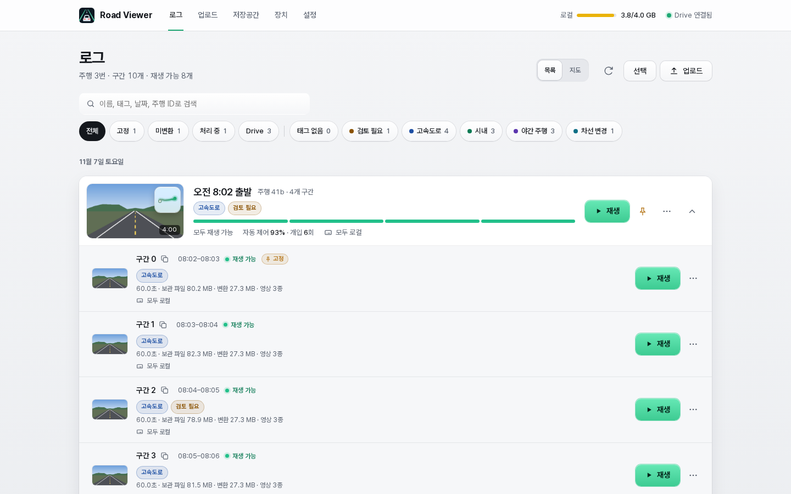</picture>

**Download logs and camera videos**

Open **다운로드** (Download) from a segment’s ⋯ menu or the replay ⋯ menu. Choose the format and included files, then download individual files or a ZIP. On the replay screen, the app bar’s ⋯ menu offers the same **제거** (Remove), **다운로드** (Download) and **완전 삭제** (Completely delete) as the library; confirming a removal or deletion returns to the library.

- **MP4:** Download the retained camera video as stored. HEVC front/wide playback requires codec support in the browser/device.
- **Original format:** Remux f/e to HEVC and q to TS without re-encoding. Quality is preserved, but the bytes and hashes may differ from the original upload.
- **Select all / Clear selection:** Choose the ZIP contents. **받기** (Get) beside a file downloads it individually without ZIP.
- **Several segments:** Selection mode uses the same popup for up to 150 selected segments. Expand **개별 받기** (Individual downloads) to choose a segment’s file, or download the selected files as a ZIP. Missing cameras are omitted.

For several segments, press **선택** (Select) on the Logs tab, or long-press a segment on touch screens, to enter the in-list **selection mode**. Route-card checkboxes select a whole route and segment checkboxes single segments; a minus marks a partial selection. The bottom action bar offers **태그**, **다운로드**, **변환**, **변환 데이터 제거**, **완전 삭제**, **고정 포함** (Include pinned) and **취소** (Cancel).

<picture><source media="(prefers-color-scheme: dark)" srcset="docs/images/roadviewer-download-options-dark.png">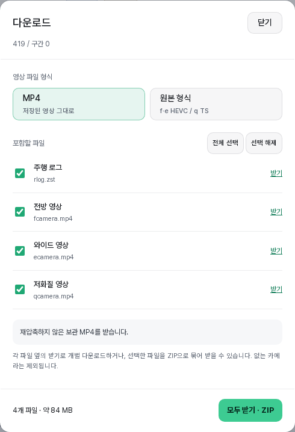</picture>

ZIPs stream without retaining a download copy on the server. Each camera’s sole MP4 is a retained video, so removing prepared data preserves it.

Selection mode handles bulk conversion/removal/deletion. Pinned segments are excluded from bulk removal/deletion by default. **고정 포함** explicitly includes them for that selection session; starting selection mode again restores protection. Individual ⋯ menus allow explicit deletion of pinned recordings.

<picture><source media="(prefers-color-scheme: dark)" srcset="docs/images/roadviewer-bulk-selection-dark.png">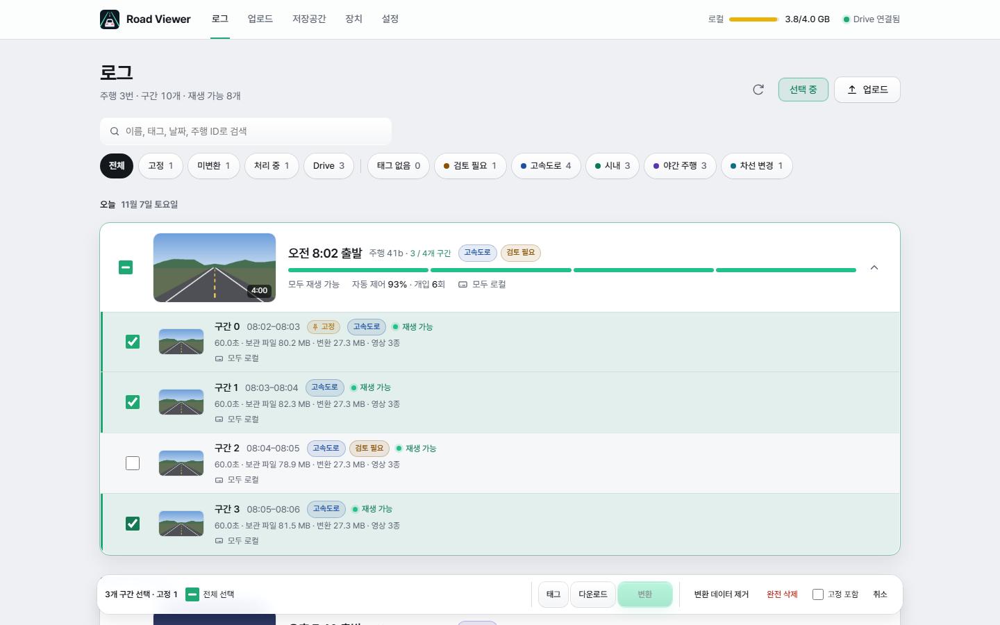</picture>

The **저장공간** tab follows four steps: status and connections, archiving basics, execution/advanced settings, and a live behavior summary. Choose presets or custom values, review the summary, and save together. Manual archiving is disabled while settings are unsaved.

**Google Drive MOVE is extension storage for local data.** With Drive MOVE and permission to delete local originals configured, the local maximum is a **soft limit**. When archiving is enabled, reaching that limit or the archive start threshold requests a background move through the existing archiver; when both are positive, the lower value is used. Uploads can temporarily exceed the limit while physical disk space covers other uploads’ outstanding reservations, temporary files, and a **100 MiB safety margin**. Admission does not wait for a Drive transfer to finish.

MOVE deletes only the corresponding local file after remote transfer, integrity verification, and index commit. Minimum age, pin/in-use protection, batch limits, and the shared cycle lock remain enforced. Drive outages and verification failures preserve originals and records. Uploads continue while physical headroom is sufficient; otherwise new uploads are rejected without deleting existing records. Disabling archiving prevents moves; configured Drive MOVE still uses the soft limit, with physical disk headroom controlling upload admission.

Moved recordings **remain listed, playable, and downloadable**. Automatic local reclamation never deletes Drive files or recordings referencing them, including COPY references. Only explicit **Completely delete** can enqueue remote deletion. Unattributed deletion intents from older versions are retained without automatic execution.

Outside Drive MOVE, the existing policy offers upload rejection or deletion of old unpinned segments after receipt and validation, never at reservation creation. Pins, active routes, and recordings referencing Drive are protected. See the [settings walkthrough](roadviewer/DOCS.en.md#reading-the-storage-screen). Manual move/copy-all first shows target files, size, and exclusions for confirmation; see the [manual-run safeguards](roadviewer/DOCS.en.md#manually-move-or-copy-all-eligible-data).


## Storage, backups and updates

Files reside under `/data/roadviewer` inside the app container. **Home Assistant app backups exclude original logs, videos and prepared data.** Keep originals separately. Processing/storage policies and device authentication configuration are included.

An update that changes the analysis format may clear prepared data and reprocess recordings. Rendering-only updates do not inherently require reconversion.

The experimental **NAS archiving** option, enabled on the **저장공간** (Storage) tab, moves original videos and logs of converted recordings to network storage attached to Home Assistant with usage Share, freeing local space. It is off by default. Scheduled archiving moves pinned segments too (a manual move-all keeps them local), but NAS cleanup never removes them. The library and converted data stay local, an unreachable NAS never causes deletions, and there is no restore back to local storage. Files on the NAS are not part of Home Assistant backups. See [NAS archiving](roadviewer/DOCS.en.md#nas-archiving-experimental) for setup.

**Google Drive** can be used as the archive instead of a NAS (experimental, off by default). Enter the ID and secret of an OAuth client of your own in the app options, then press **Google Drive 연결** (Connect Google Drive) on the Storage tab and enter the displayed code on Google's device sign-in page. **연결 해제** (Disconnect) removes only this installation's token; records, local files and Drive files are unchanged. It defaults to copy (COPY) mode: verified copies go to Drive and local files are never deleted. Move (MOVE) mode, which deletes local originals, applies only when the Storage tab sets MOVE together with **검증 후 로컬 원본 삭제 허용** (allow deleting local originals after verification); there is no automatic Drive cleanup. Videos moved to Drive play through the app, which holds only the video being watched (up to 256 MB) in memory so seeks stay quick; nothing is written to disk, and it is freed after 10 minutes unwatched. The sign-in token is part of Home Assistant backups, so keep backups safe. See [Google Drive archiving](roadviewer/DOCS.en.md#google-drive-archiving-experimental).

## Documentation and validation

Screenshots were captured on 2026-11-07 from version 1.0.11 using example data, in light and dark mode; the one matching your theme is shown. The three driving/wide introduction photos composite the earlier footage's video area into the new UI. Device, capacity, and pairing values are synthetic; the displayed code cannot connect a device. See the [screenshot guide](docs/images/README.en.md).

- [User guide](roadviewer/DOCS.en.md) · [한국어](roadviewer/DOCS.md): installation, playback, conversion, storage, backups and troubleshooting
- [roadviewer-mcp](https://github.com/Qualified4/roadviewer-mcp): MCP server for AI agents, using only the existing Ingress login and API
- [Device API v1](docs/device-api.en.md) · [한국어](docs/device-api.md): HTTPS, pairing/signing, upload recovery and tests without openpilot
- [AppArmor security](docs/apparmor-security.en.md) · [한국어](docs/apparmor-security.md)
- [Historical Android picker analysis](docs/android-multiple-file-fix/README.en.md) · [한국어](docs/android-multiple-file-fix/README.md)
- [Current release notes](roadviewer/CHANGELOG.en.md) · [Full Korean history](roadviewer/CHANGELOG.md)

`roadviewer/` is the Docker build context. GitHub Actions checks both architectures, Python dependencies, container vulnerabilities, real container HTTPS isolation, uploads, conversion and browser behavior. Actual Home Assistant devices and Android's native file picker may behave differently from browser tests.

### Prebuilt release workflow

**Do not add `[skip ci]` to merge commits.** Main must run image verification and cache warming so subsequent PRs can use current caches.

The version comes from `roadviewer/config.yaml`. Full validation runs on the PR. Successful Python/browser/security/container tests produce both tested images as artifacts. Manual publication reuses these images without rebuilding. Ordinary branch pushes do not duplicate testing; `main` verifies the published image/source match and separately warms both platform build caches, Trivy databases, and browser caches. Warming is not another full PR test run or release-image publication.

1. Update the app version, Dockerfile default, UI version and changelog on a release branch. Never reuse a published version.
2. Push and open a PR against `main`. After full validation succeeds, manually run **Build, test and publish app** on that branch. It requires the latest successful PR validation for the current commit and uses that run/attempt's image artifacts.
3. Ensure the GHCR package is public under **Packages → roadviewer-ha → Package settings → Change visibility → Public**. If public-access verification fails on a new package, make it public and rerun the failed publish job. Home Assistant does not need registry credentials.
4. After publication and anonymous access/platform checks succeed, squash-merge the tested changes unchanged. Main verifies both image versions and source trees; a different squash commit ID is acceptable when file contents match. Publishing the version on main before the images exist can break installation/update checks.

Artifacts expire after seven days. If missing or the latest validation failed/cancelled, use **Re-run all jobs** on the PR. Rerunning only failed jobs can leave the new attempt without both image artifacts. If the tested PR merge tree differs from the release branch, synchronize with main and validate again. New commits cancel superseded PR validation.

Temporary tags use `build-<validation-run>-<attempt>-amd64` / `arm64`. Release assembly references image digests; Home Assistant uses version tags. Existing versions are verified, not overwritten. For local source builds, follow the user guide's instructions to remove `image:` from the local app configuration.

Road Viewer is distributed under the [MIT license](LICENSE). Raw driving logs/videos are not included in the repository; the introduction uses selected public screenshots. See [OPENPILOT-LICENSE](roadviewer/schema/OPENPILOT-LICENSE) for bundled schema and UI-resource licensing.
