# Road Viewer for Home Assistant

[한국어](README.md) · English

Feature reference: **0.12.2**

Upload openpilot driving logs and front/wide camera recordings to **replay video, road views and vehicle information graphs on the same timeline inside Home Assistant**.

**Camera overlay and vehicle graphs**

Compare lanes, vehicle boxes and blind-spot indications over the front video with vehicle graphs at the same instant. Seeking moves the video and graphs together.

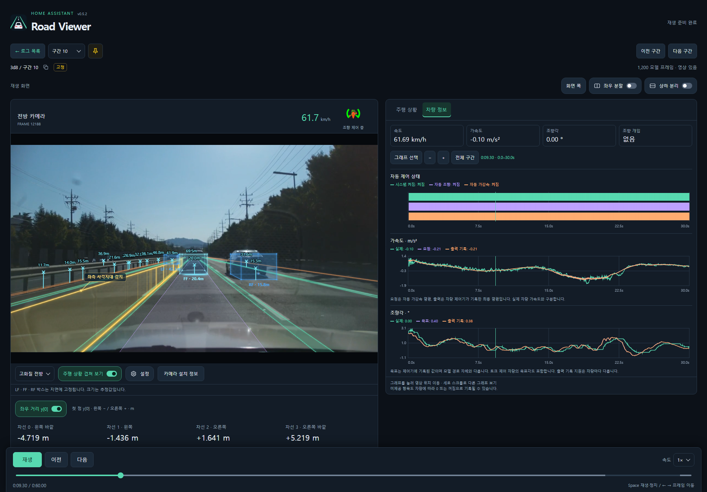

**Camera overlay and road view**

Switch the right panel to the road view to compare a top-down view of lanes, paths and radar detections with the video. The tables below expose individual radarState and liveTracks values. These screenshots demonstrate the two panel choices; graph selection and display items are configurable.

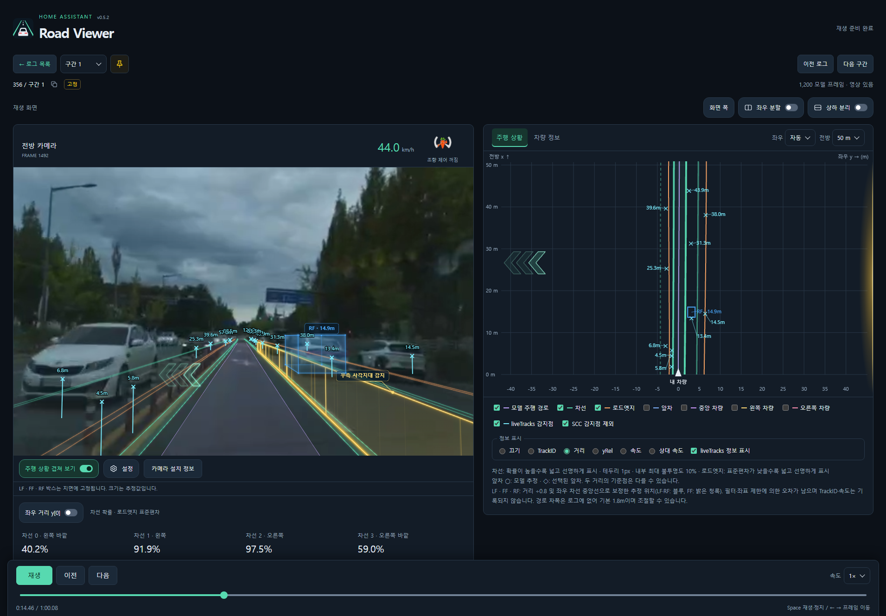

## Getting started

1. Add `https://github.com/Qualified4/roadviewer-ha` under Home Assistant **Settings → Apps → App store → ⋮ → Repositories**. Some versions call apps “add-ons.”
2. Install **Road Viewer**, start it and open its web UI.
3. Select files with **파일 추가** (Add files) or drag them into the upload area, then press **업로드** (Upload).
4. When conversion finishes, press **재생** (Play). If automatic conversion is disabled, first press **변환** (Convert).

This is an **app-store repository, not a HACS integration**. The web UI uses Home Assistant Ingress, including your existing remote Home Assistant address; no separate external port is needed. Home Assistant Container has no Supervisor app store.

## Platforms and installation

| Home Assistant architecture | Image platform | Devices |
|---|---|---|
| `amd64` | `linux/amd64` | 64-bit Intel/AMD PCs, mini PCs and servers |
| `aarch64` | `linux/arm64` | 64-bit ARM Home Assistant devices |

Installation downloads **only the matching prebuilt GHCR image**, not every published architecture. ARM 32-bit and i386 are unsupported. Prebuilt images avoid compiling the application on your device. Home Assistant may show download/extraction progress; its presentation depends on Supervisor and is not an exact percentage of total installation time.

## Supported uploads

**Local files and direct device uploads**

The upper area accepts selected or dropped files. Below it, **External device connection** is expanded: configure HTTPS and its port on the left, then pair or manage devices on the right. Ports and device identifiers are masked in this screenshot. Browser file uploads do not require enabling external device access.

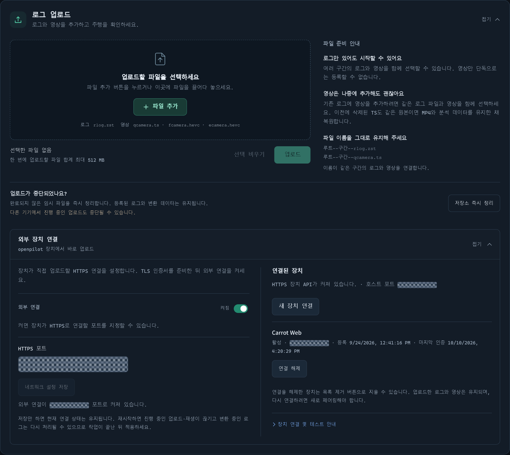

The log is required; include whichever cameras you need from the same segment.

| File | Purpose |
|---|---|
| `rlog.zst` | Driving log |
| `qcamera.ts` | Low-bandwidth front video |
| `fcamera.hevc` | High-quality front video |
| `ecamera.hevc` | Wide video |
| `camera.mp4` / `qcamera.mp4` | Low-resolution H.264 MP4 for re-upload |
| `fcamera.mp4` / `ecamera.mp4` | High-quality front / wide HEVC MP4 for re-upload |

For one segment, bare filenames work. For multiple segments, retain their identifiers:

```text
00000395--0d0eda17c5--7--rlog.zst
00000395--0d0eda17c5--7--qcamera.ts
00000395--0d0eda17c5--7--fcamera.hevc
00000395--0d0eda17c5--7--ecamera.hevc
00000395--0d0eda17c5--8--rlog.zst
00000395--0d0eda17c5--8--qcamera.ts
```

- Logs alone support road views and vehicle graphs. Video-only registration is unsupported.
- Downloaded camera MP4s can be re-uploaded with the same segment’s log. Segment/camera names and codecs must match. Select one format per camera rather than its original and MP4 together; existing retained videos are not overwritten.
- Add a camera later by uploading it with the identical log; it attaches to the existing recording.
- Re-uploading the same source video checks its saved hash and preserves the retained MP4 and replay data without storing another original copy. Use the download modal for original-format files.
- Compressed-log SHA-256 identifies duplicates at registration, after transfer.
- Browser uploads default to **512 MiB per batch**, configurable through `max_upload_mb` from 16–2048. This is separate from the storage budget. Device uploads support 8 GiB per batch, 50 segments, 200 files and 2 GiB per video; each log must fit `max_upload_mb`.

## Connecting a comma device

Use the [Device API documentation](docs/device-api.en.md) to build a client that connects an external device to Road Viewer and uploads logs and videos directly. It covers HTTPS connections, pairing and authentication, file uploads, and resuming interrupted transfers.

For direct device uploads, enable HTTPS in **로그 업로드 → 외부 장치 연결**, save a port and apply it with **지금 재시작** (Restart now). A valid certificate under `/ssl` is required. External access defaults to off and is not needed for the Ingress UI.

Pairing supports code copy, remaining time and reissue. Codes last five minutes and work once; a replacement invalidates the old code. The API uses HMAC authentication and resumable chunk uploads. A compatible Carrot Web uploader can include optional high-quality front/wide files alongside the log/qcamera, skipping missing cameras. Video conversion runs on Road Viewer, not the driving device.

**Pairing a comma device**

**Add device** opens this dialog. Copy the highlighted one-time code into the device connection screen and check its remaining lifetime and pairing status. The pictured code is illustrative; generate a new code for an actual connection. Unlike the HTTPS port settings, this dialog authenticates and registers a device.

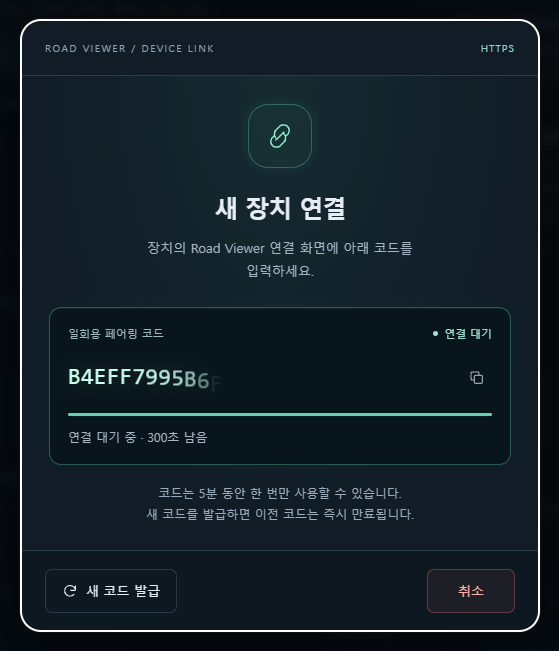

## Playback and analysis

| Feature | Capabilities |
|---|---|
| Synchronized playback | Video with road view or vehicle graphs, up to 4× speed |
| Layout | Automatic, side-by-side or stacked; adjustable width for phone, tablet and desktop |
| Road view | Lanes, road edges, model paths, leads and radar detections |
| Vehicle information | 24 selectable, reorderable graphs, including separate LATERAL command and restored yRel values |
| Tags | Name and color segments, filter the library, and add/remove tags in bulk |
| Scene bookmarks | Save a log timestamp with a title/note and jump back from the timeline or bookmark list |
| Navigation and pins | Segment selector, previous/next recording and per-segment pins |
| Scrolling | Sticky navigation and playback controls; collapsible navigation buttons |

**Forward and rear road view**

Choose paired **front/rear ranges of 25/5m, 50/10m or 80/20m**. **후방 표시 · LR / RR** shows rear targets behind the ego vehicle and 0m line; switching it off restores the full forward view. Rear dashed lines are position guides rather than extrapolated lanes. Reconvert an older recording to populate LR/RR values if they are missing. Camera overlays retain BSD instead of adding rear targets.

**Wide-camera playback and overlays**

Upload `ecamera.hevc` with the log to select **와이드** (Wide) below the video. This example shows lanes, road edges, the model path, a vehicle box, radar detections and a turn signal over the wider field of view. The overlay uses the wide camera's sensor and calibration; switching back to the front video preserves the log position.

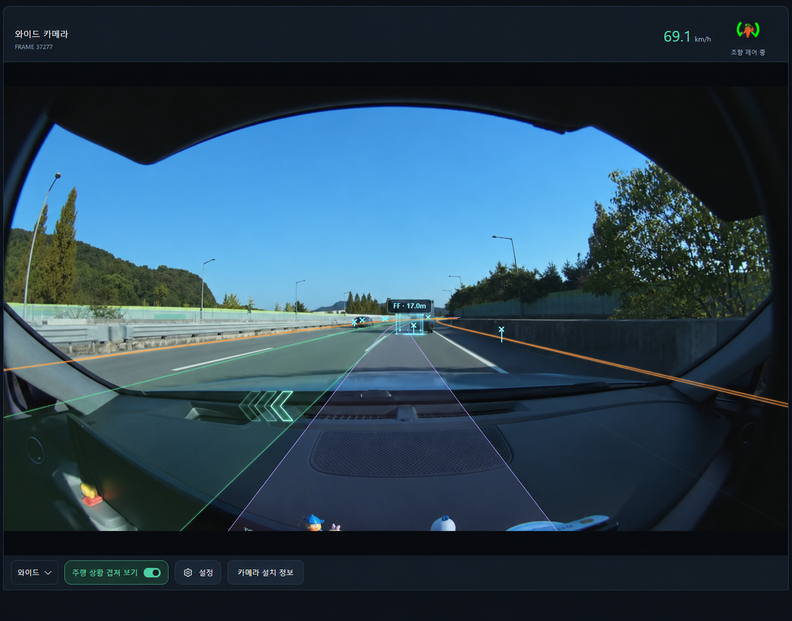

The default camera preference is high-quality front → qcamera → wide. Switching preserves log time and playing/paused state. A failing video triggers an attempt to use another available source. Wide overlays use the wide sensor/calibration; missing information produces an explanation. Older prepared logs may need reanalysis to obtain wide calibration.

Overlay settings control box height/opacity, path width, BSD wall height and individual labels. LF/FF/RF boxes reconstruct supported CCNC display commands recorded in the log. BSD, turn signals and target distance appear when the corresponding data is available. Camera overlays are independent of the road panel's 25/50/80m range; BSD walls retain a 40m limit.

Layout, display selections, graph order and collapsed sections are remembered in the current browser. Library and playback pins share the same per-segment setting.

## Organize segments with tags

Tags **classify a whole segment**. Use labels such as “Lane change”, “Rain” or “Needs review” to describe driving conditions and follow-up work, then choose the **tag filter** above the saved recordings to narrow the library. Colored badges appear next to the recording name/pin and are also visible during playback.

The following tag and bookmark screenshots use **synthetic examples in the actual Korean UI**, without personal driving logs.

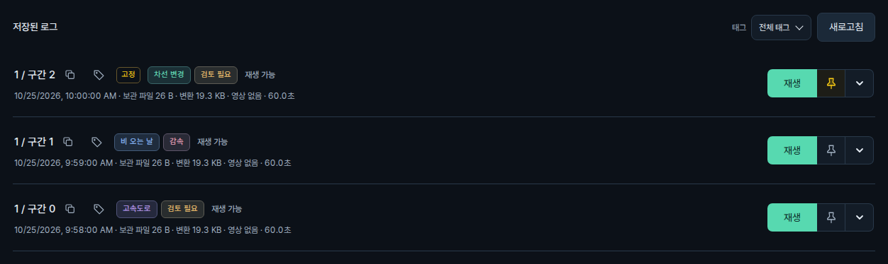

1. Click the **tag icon** next to a recording name or **태그** (Tags) in playback.
2. Enter a name, select a color, then choose **추가 → 저장** (Add → Save). Reuse an existing tag or click a badge in the editor to change its name/color.
3. To tag several segments together, open **로그 선택** (Select logs), select the segments and add/remove tags in bulk.

Tags support 12 colors, names up to 32 characters and up to 100 tags per segment. Saving tags does not reconvert logs or videos.

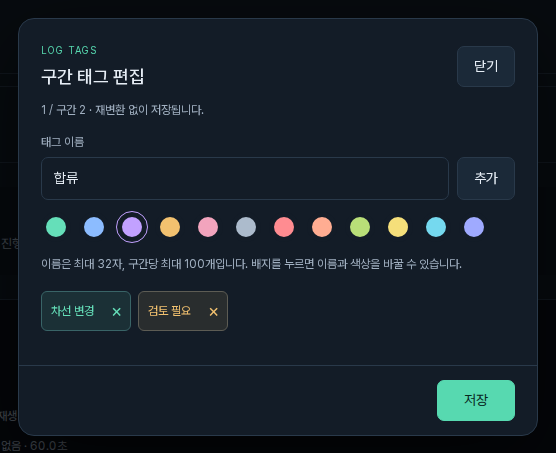

## Return to a moment with scene bookmarks

A bookmark stores **a specific log timestamp within one segment**. Mark a lane change, a lead-distance check or the start of deceleration to return directly to that moment later.

1. Play or seek to the desired time, then click **북마크** (Bookmark) in the fixed playback bar.
2. Check the captured timestamp, add a title and optional note, and **저장** (Save). **현재 시각으로** (Use current time) updates the editor’s timestamp to the current playback position.
3. Click a saved **time/title** or a **timeline marker** to move the video, road view and graphs together, preserving the playing/paused state.

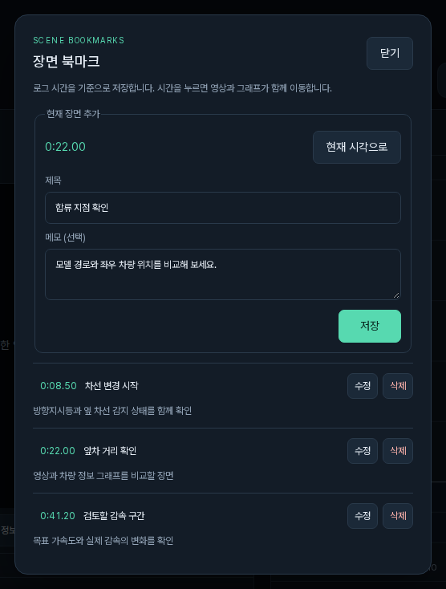

Saved bookmarks also appear as small timeline markers. Hover over a marker to see its time and title.

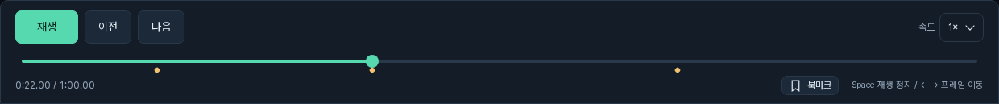

Bookmarks use log time rather than a camera file’s timestamp, so changing cameras still leads to the same moment. Each segment supports 100 bookmarks, with titles up to 80 characters and notes up to 1000 characters; entries can be edited or deleted. Tags and bookmarks survive reconversion and removal of prepared data, but are removed when the segment is **completely deleted**.

**Tags and bookmarks do not protect recordings from automatic deletion.** Pin a segment separately when it needs to be retained.

## Conversion and file management

**Conversion behavior and storage policy**

Set automatic conversion and concurrent jobs in **Conversion and storage settings**. Storage management controls the budget and full-storage policy.

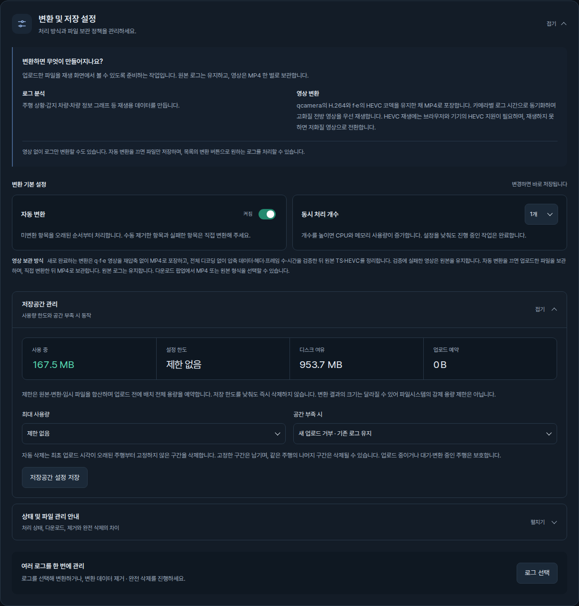

Newly completed conversions remux qcamera H.264 and front/wide HEVC into MP4 without re-encoding. Verification compares SHA-256 hashes of compressed pictures and headers, packet counts and timestamps without decoding every frame; it does not screen the source for every possible decoding error. Originals are removed only after compressed-picture, decoder-header, packet-count and log-clock verification; failed sources and rlog.zst are preserved. With automatic conversion off, uploads remain in their uploaded form until manual conversion. HEVC playback requires browser/device support; playback failure switches to the low-resolution camera when available.

The bar stays visible from preparation until the large compressed files have been saved. With video, stage weights are preparation/decompression 0–4%, log reading 4–45%, frame analysis 45–60%, camera reading/remuxing/verification 60–80%, and graph generation, JSON encoding, compression/writes and replay compaction 80–100%. Log-only recordings redistribute the video share across reading, analysis and saving. Updates use consumed bytes, processed frames/samples and written bytes, with smooth transitions at roughly one-second intervals. Labels name the actual operation and show overall progress. Atomic completion of the large writes reaches 100%; the brief summary/registration phase hides the bar and keeps only the sweep effect. Heavy conversion work is completed before that final phase. These are work-based stage weights, not a remaining-time estimate.

| Action | Effect |
|---|---|
| Remove prepared data | Preserve original logs/videos and each camera's sole MP4; remove analysis/graphs and reproducible MP4s. Cancel queued work; reject removal while processing |
| Completely delete | Delete all originals and prepared files for the segment |
| Clean storage now | Preserve registered recordings and clean incomplete browser-upload temporary files |

**Segment status and file management**

The library is sorted by route counter and segment number descending. Each row shows processing status, video availability and retained/prepared file sizes. Ready entries offer **Play**, while entries needing preparation offer **Convert**. Pin individual segments and use the adjacent dropdown for downloads, removal and complete deletion.

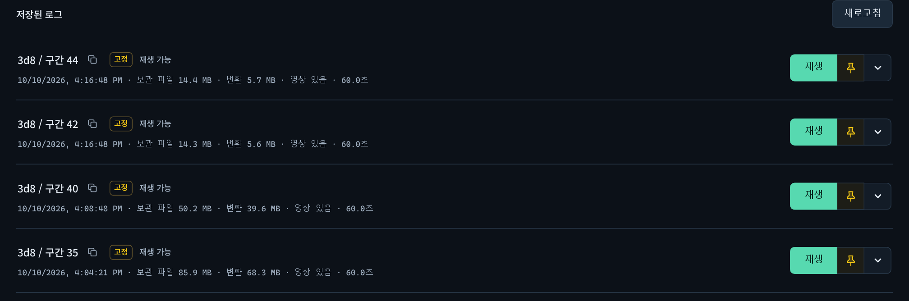

**Download logs and camera videos**

Open **다운로드** (Download) from a recording’s dropdown or the replay screen. Choose the format and included files, then download individual files or a ZIP.

- **MP4:** Download the retained camera video as stored. HEVC front/wide playback requires codec support in the browser/device.
- **Original format:** Remux f/e to HEVC and q to TS without re-encoding. Quality is preserved, but the bytes and hashes may differ from the original upload.
- **Select all / Clear selection:** Choose the ZIP contents. **받기** (Get) beside a file downloads it individually without ZIP.
- **Several segments:** Bulk management uses the same popup for up to 150 selected segments. Expand **개별 받기** (Individual downloads) to choose a segment’s file, or download the selected files as a ZIP. Missing cameras are omitted.

Choose **로그 선택** (Select logs) at the bottom of settings. The first **로그 일괄 관리** (Bulk log management) dialog groups recordings by route, with route-level select-all and individual segment checkboxes. A minus indicates a partial selection; the top select-all/count and bottom action buttons stay visible while scrolling. Then choose **다운로드** (Download) to select files and format. Individual library and replay downloads keep the compact file/format popup for the current segment.

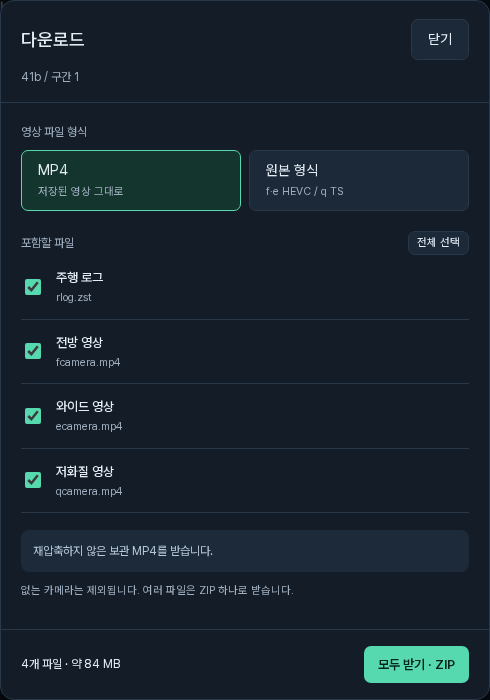

ZIPs stream without retaining a download copy on the server. Each camera’s sole MP4 is a retained video, so removing prepared data preserves it.

Use **로그 선택** (Select logs) at the bottom of settings for bulk conversion/removal/deletion. Pinned segments are excluded from bulk removal/deletion by default. **고정 항목도 삭제** explicitly includes them for that dialog session; reopening restores protection. Individual menus allow explicit deletion of pinned recordings.

Storage management sets a budget and chooses rejection of new uploads or deletion of old unpinned segments. Automatic deletion groups by original route and orders by upload time. Reservations alone never delete recordings: eviction happens only after receipt and validation, during registration. Pins, queued/processing routes and other protected data remain excluded. Actual disk headroom is still required. The budget is an upload admission check, not a hard filesystem quota for subsequent conversion output.

## Storage, backups and updates

Files reside under `/data/roadviewer` inside the app container. **Home Assistant app backups exclude original logs, videos and prepared data.** Keep originals separately. Processing/storage policies and device authentication configuration are included.

An update that changes the analysis format may clear prepared data and reprocess recordings. Rendering-only updates do not inherently require reconversion.

## Documentation and validation

- [User guide](roadviewer/DOCS.en.md) · [한국어](roadviewer/DOCS.md): installation, playback, conversion, storage, backups and troubleshooting
- [Device API v1](docs/device-api.en.md) · [한국어](docs/device-api.md): HTTPS, pairing/signing, upload recovery and tests without openpilot
- [Changelog (Korean)](roadviewer/CHANGELOG.md)

`roadviewer/` is the Docker build context. GitHub Actions checks both architectures, Python dependencies, container vulnerabilities, real container HTTPS isolation, uploads, conversion and browser behavior. Actual Home Assistant devices and Android's native file picker may behave differently from browser tests.

### Prebuilt release workflow

The version comes from `roadviewer/config.yaml`. Full validation runs on the PR. Successful Python/browser/security/container tests produce both tested images as artifacts. Manual publication reuses these images without rebuilding. Ordinary branch pushes do not duplicate testing; `main` verifies the published image/source match instead of rebuilding or publishing again.

1. Update the app version, Dockerfile default, UI version and changelog on a release branch. Never reuse a published version.
2. Push and open a PR against `main`. After full validation succeeds, manually run **Build, test and publish app** on that branch. It requires the latest successful PR validation for the current commit and uses that run/attempt's image artifacts.
3. Ensure the GHCR package is public under **Packages → roadviewer-ha → Package settings → Change visibility → Public**. If public-access verification fails on a new package, make it public and rerun the failed publish job. Home Assistant does not need registry credentials.
4. After publication and anonymous access/platform checks succeed, squash-merge the tested changes unchanged. Main verifies both image versions and source trees; a different squash commit ID is acceptable when file contents match. Publishing the version on main before the images exist can break installation/update checks.

Artifacts expire after seven days. If missing or the latest validation failed/cancelled, use **Re-run all jobs** on the PR. Rerunning only failed jobs can leave the new attempt without both image artifacts. If the tested PR merge tree differs from the release branch, synchronize with main and validate again. New commits cancel superseded PR validation.

Temporary tags use `build-<validation-run>-<attempt>-amd64` / `arm64`. Release assembly references image digests; Home Assistant uses version tags. Existing versions are verified, not overwritten. For local source builds, follow the user guide's instructions to remove `image:` from the local app configuration.

Road Viewer is distributed under the [MIT license](LICENSE). Raw driving logs/videos are not included in the repository; the introduction uses selected public screenshots. See [OPENPILOT-LICENSE](roadviewer/schema/OPENPILOT-LICENSE) for bundled schema and UI-resource licensing.
