# Road Viewer for Home Assistant

한국어 · [English](README.en.md)

현재 기능 안내: **1.2.18**

openpilot 주행 로그와 전방·와이드 카메라 영상을 올리고, **영상·주행 상황·차량 정보 그래프를 같은 시간축으로 확인하는 Home Assistant 앱**입니다.

**영상 겹쳐보기와 차량 정보 그래프**

전방 영상 위에 차선·차량 박스·사각지대 표시를 겹쳐 보고, 오른쪽 그래프에서 같은 시점의 차량 상태를 확인합니다. 재생바로 시간을 이동하면 영상과 그래프가 함께 움직입니다.

<picture><source media="(prefers-color-scheme: dark)" srcset="docs/images/roadviewer-overview-dark.png">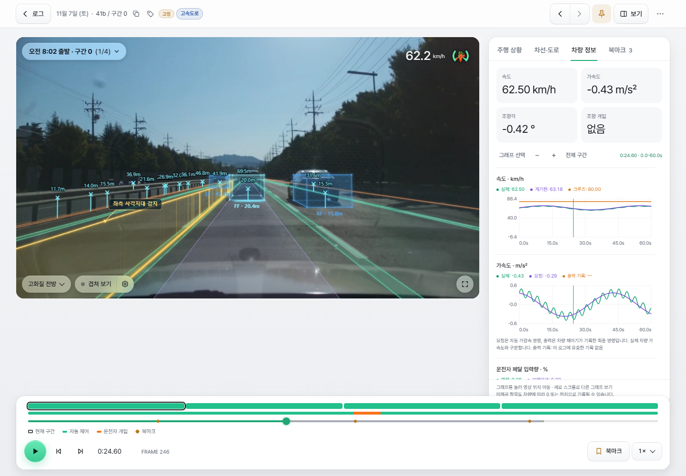</picture>

**영상 겹쳐보기와 주행 상황**

오른쪽 패널을 주행 상황으로 전환하면 위에서 내려다본 차선·경로·레이더 감지점을 영상과 비교할 수 있습니다. 아래 표에서는 radarState와 liveTracks의 개별 값을 확인합니다. 두 화면은 패널 전환 예시이며, 그래프 종류와 표시 항목은 직접 선택할 수 있습니다.

<picture><source media="(prefers-color-scheme: dark)" srcset="docs/images/roadviewer-driving-view-dark.png">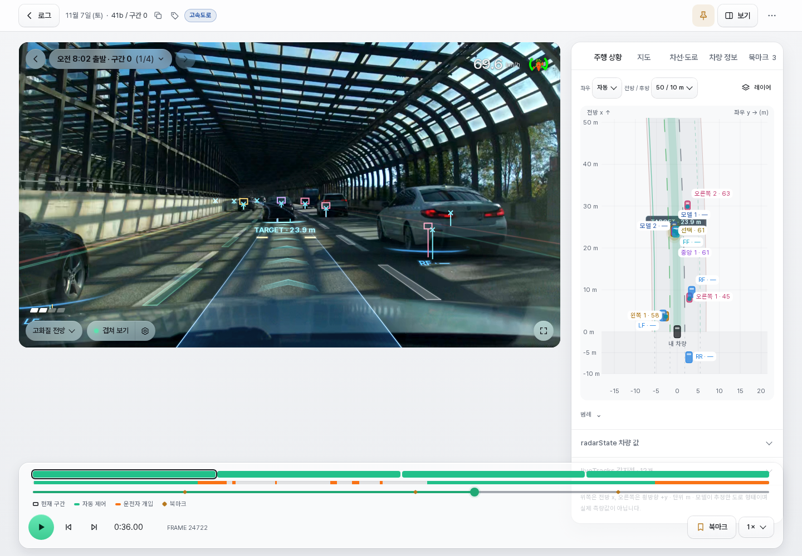</picture>

## 시작하기

1. Home Assistant의 **설정 → 앱 → 앱 스토어 → ⋮ → 저장소**에서 `https://github.com/Qualified4/roadviewer-ha`를 추가합니다. 버전에 따라 ‘앱’이 ‘애드온’으로 표시됩니다.
2. **Road Viewer**를 설치하고 시작한 뒤 **웹 UI 열기**를 누릅니다.
3. **업로드** 탭에서 **파일 추가** 또는 드래그 앤 드롭으로 파일을 선택하고 **업로드**합니다. 다른 탭으로 옮겨도 업로드는 계속되며 헤더에 진행률이 표시됩니다.
4. 변환이 끝나면 **로그** 탭에서 **재생**을 누릅니다. 자동 변환을 껐다면 목록에서 먼저 **변환**을 누릅니다.

화면은 **로그 · 업로드 · 저장공간 · 장치 · 설정** 탭으로 나뉘며 휴대폰에서는 하단 탭 바로 표시합니다. **설정** 탭의 **화면 모드**에서 자동·라이트·다크를 고를 수 있고, 재생 화면의 영상 영역은 항상 어두운 배경입니다.

**HACS용 통합이 아닌 앱 스토어 저장소입니다.** 웹 UI는 Home Assistant Ingress를 사용하므로 별도 외부 포트를 열 필요가 없습니다. 원격에서도 기존 Home Assistant 주소로 접속합니다. Home Assistant Container 설치에는 Supervisor 앱 스토어가 없습니다.

## 지원 플랫폼과 설치 방식

| Home Assistant 플랫폼 | 이미지 플랫폼 | 대상 |
|---|---|---|
| `amd64` | `linux/amd64` | Intel/AMD 64비트 PC·미니 PC·서버 |
| `aarch64` | `linux/arm64` | ARM 64비트 Home Assistant 기기 |

설치 시 GHCR의 프리빌드 이미지 중 **기기에 맞는 하나만 다운로드**합니다. 플랫폼별 이미지를 함께 배포해도 사용자의 다운로드 용량이 합산되지 않습니다. 32비트 ARM·i386은 지원하지 않습니다.

기기에서 패키지를 설치하고 이미지를 빌드하는 과정을 줄이며, Home Assistant의 다운로드·압축 해제 진행률을 활용합니다. 표시 방식은 Home Assistant/Supervisor 버전에 따라 다르고, 전체 설치 시간의 정확한 백분율을 의미하지는 않습니다.

## 업로드할 파일

**파일 업로드와 장치 직접 전송**

**업로드** 탭에서 파일을 선택하거나 끌어다 놓고, **장치** 탭에서 HTTPS 연결과 포트를 설정하거나 페어링할 장치를 추가·관리합니다. 스크린샷의 포트와 장치 식별 정보는 가렸습니다. 브라우저에서 파일을 업로드할 때는 외부 장치 연결을 켤 필요가 없습니다.

<picture><source media="(prefers-color-scheme: dark)" srcset="docs/images/roadviewer-library-upload-dark.png">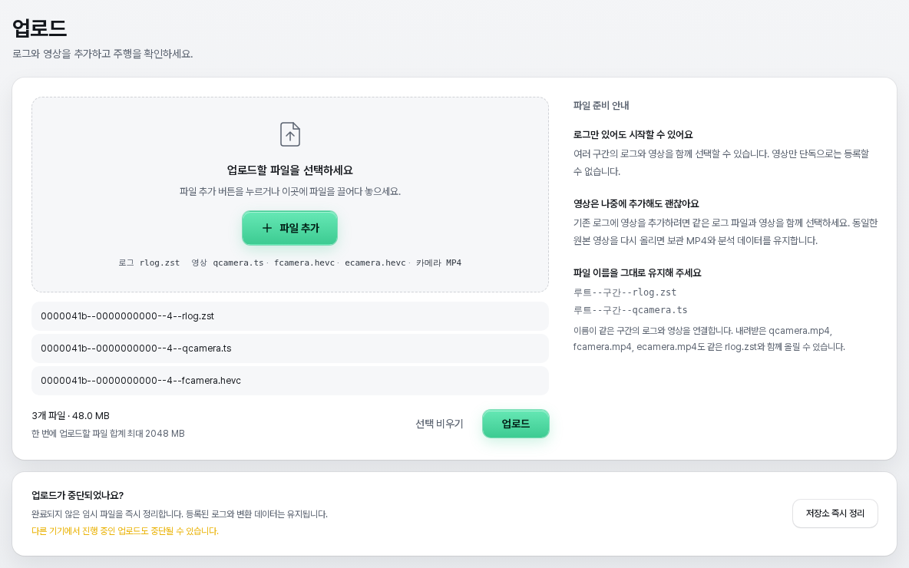</picture>

`rlog.zst` 로그는 필수이며, 같은 구간의 영상은 필요한 것만 함께 선택합니다.

| 파일 | 용도 |
|---|---|
| `rlog.zst` | 주행 로그 |
| `qcamera.ts` | 저용량 전방 영상 |
| `fcamera.hevc` | 고화질 전방 영상 |
| `ecamera.hevc` | 와이드 영상 |
| `camera.mp4` / `qcamera.mp4` | 다시 업로드하는 저용량 전방 MP4(H.264) |
| `fcamera.mp4` / `ecamera.mp4` | 다시 업로드하는 고화질 전방·와이드 MP4(HEVC) |

한 구간은 위 파일명을 그대로 사용할 수 있습니다. 여러 구간은 다음처럼 원래 식별자를 포함합니다.

```text
00000395--0d0eda17c5--7--rlog.zst
00000395--0d0eda17c5--7--qcamera.ts
00000395--0d0eda17c5--7--fcamera.hevc
00000395--0d0eda17c5--7--ecamera.hevc
00000395--0d0eda17c5--8--rlog.zst
00000395--0d0eda17c5--8--qcamera.ts
```

- 로그만 올려도 주행 상황과 차량 정보를 볼 수 있습니다. 영상만 단독으로 등록할 수는 없습니다.
- 내려받은 카메라 MP4도 같은 구간의 로그와 함께 다시 업로드할 수 있습니다. 파일 이름의 구간·카메라 종류와 코덱이 맞아야 하며, 같은 카메라의 원본과 MP4를 한 번에 중복 선택하지 마세요. 기존에 보관 중인 영상은 덮어쓰지 않습니다.
- 영상은 나중에 같은 로그와 함께 올려 기존 항목에 추가할 수 있습니다.
- 같은 원본 영상을 다시 올려도 저장된 해시로 중복을 판별해 보관 MP4와 분석 결과를 유지합니다. 원본 형식 파일은 다운로드 팝업에서 만들 수 있습니다.
- 중복 로그는 파일 내용의 SHA-256으로 판정합니다. 전송 후 등록 단계에서 중복을 건너뜁니다.
- 브라우저의 기본 512 MB는 **업로드 한 번의 파일 합계 제한**입니다. 앱 설정에서 16~2048 MB로 조절하며 전체 저장 한도와는 별개입니다. 장치 API는 배치당 8 GiB·50구간·200파일, 영상당 2 GiB를 지원합니다. 장치 로그 한 개에는 `max_upload_mb` 제한을 적용합니다.

## 외부 장치 연결

[Device API 문서](docs/device-api.md)를 참고하면 외부 장치를 Road Viewer에 연결하고 로그와 영상을 직접 업로드하는 클라이언트를 구현할 수 있습니다. 문서에는 HTTPS 연결, 페어링·인증, 파일 업로드와 중단된 전송 이어올리기 방법이 설명되어 있습니다.

장치에서 직접 업로드하려면 **장치** 탭에서 HTTPS 연결을 켜고 포트를 저장한 뒤 **지금 재시작**으로 적용합니다. 유효한 `/ssl` 인증서가 필요하며 기본값은 꺼짐입니다. 웹 UI 접속에는 이 설정이 필요하지 않습니다.

페어링 팝업에서 코드 복사·남은 시간 확인·새 코드 발급을 할 수 있습니다. 코드는 5분간 한 번 사용할 수 있고 재발급하면 이전 코드는 무효가 됩니다. 장치 API는 HMAC 인증과 조각 전송·이어올리기를 지원합니다. 호환 Carrot Web 업로더에서 고화질 전방·와이드를 선택하면 로그·qcamera와 함께 보낼 수 있습니다. 없는 영상은 건너뛰며 영상 변환은 Road Viewer 서버에서 수행합니다.

**comma 장치 페어링**

**새 장치 연결**을 누르면 아래 팝업이 열립니다. 강조된 일회용 코드를 복사해 장치의 연결 화면에 입력하고, 남은 유효시간과 연결 상태를 확인합니다. 이미지 속 코드는 사용 안내용이며 실제 연결에는 새로 발급한 코드가 필요합니다. HTTPS 포트 설정 화면과 달리, 이 팝업은 장치를 인증해 등록하는 단계입니다.

<picture><source media="(prefers-color-scheme: dark)" srcset="docs/images/roadviewer-device-pairing-dark.png">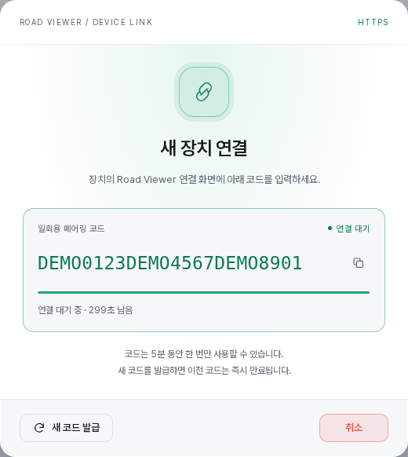</picture>

## AI 에이전트 연동 (MCP)

[roadviewer-mcp](https://github.com/Qualified4/roadviewer-mcp)는 Codex·Claude Code 같은 MCP 클라이언트가 Road Viewer의 주행 로그를 다룰 수 있게 하는 로컬 서버입니다. Home Assistant 장기 토큰으로 기존 Ingress 인증을 그대로 통과해 애드온의 기존 API만 호출하므로 애드온 변경, 새 포트, 외부 공개가 없습니다. 로그 검색·상세·북마크·저장 공간 조회, 리플레이 데이터와 차량 정보의 구간 조회, 영상·로그 다운로드(로컬 디스크에 저장 후 경로 반환)를 지원하고, 쓰기는 북마크 추가·수정과 태그 추가·제거만 합니다. 삭제·변환·설정 변경은 하지 않습니다. 설치와 등록 방법은 해당 저장소의 README를 참고하세요.

## 재생과 분석

| 기능 | 사용 방법 |
|---|---|
| 함께 보기 | 영상과 주행 상황 또는 차량 정보 그래프를 최대 4배속으로 동기 재생합니다. |
| 화면 배치 | 자동 배치·좌우 분할·상하 분리, 모바일·태블릿·PC별 화면 폭 조절을 지원합니다. |
| 주행 상황 | 차선·도로 경계·모델 경로·앞차·레이더 감지점을 표시하고 영상에 겹쳐 볼 수 있습니다. |
| 차량 정보 | 그래프 24종 중 표시할 항목을 고르고 드래그해 순서를 바꿉니다. LATERAL 송신값과 보정 후 yRel도 각각 비교할 수 있습니다. |
| 태그 | 구간별 이름·색상으로 분류하고 목록을 필터링합니다. 여러 구간에 한 번에 추가·제거할 수 있습니다. |
| 지도 | GPS가 있는 구간은 분석 패널의 **지도** 탭에서 지나온 길과 현재 위치를 보고, 영상 오른쪽 위에 작은 지도를 띄울 수 있습니다. [주행 경로 지도](#주행-경로-지도)를 참고하세요. |
| 장면 북마크 | 분석 패널의 **북마크** 탭에서 특정 로그 시점에 제목·메모를 저장하고, 탐색 바 마커나 목록에서 다시 이동합니다. |
| 로그 이동·고정 | 앱 바의 제목(출발 시각 · 구간 k (i/N))을 눌러 같은 주행의 구간을 고르고, 이전·다음 버튼과 하단 구간 띠로 이동하며, 핀으로 구간을 고정합니다. |
| 재생 바 | 하단에 떠 있는 재생 바에 구간 띠(긴 주행은 현재 구간을 가운데로 스크롤), 자동 제어·운전자 개입 트랙, 북마크 마커가 있는 탐색 바, 프레임 이동, 현재 시각/전체 길이 전환, 북마크, 속도가 있습니다. |
| 영상 위 컨트롤 | 카메라·화질 선택, 겹쳐 보기와 ⚙ 설정, 속도, 조향 핸들 상태(운전자 개입 시 **개입** 링), 전체 화면 |

**전후방 주행 상황**

주행 상황의 범위는 **전방/후방 25/5m · 50/10m · 80/20m**로 선택합니다. **후방 표시 · LR / RR**을 켜면 내 차와 0m 선 뒤에 후방 차량을 표시하고, 끄면 전방 화면을 넓게 사용합니다. 후방 점선은 실제 차선을 연장한 것이 아닌 상대 위치 참고선입니다. 예전에 변환한 로그에서 LR·RR이 보이지 않으면 해당 로그를 다시 변환하세요. 카메라 겹쳐보기는 기존 BSD를 사용합니다.

**와이드 카메라와 주행 상황 겹쳐보기**

와이드 영상(`ecamera.hevc`)을 함께 업로드하면 영상 위 카메라 선택에서 **와이드**로 전환할 수 있습니다. 아래는 넓은 시야의 영상 위에 차선·도로 경계·모델 경로와 차량 박스·레이더 감지점·방향지시등을 표시한 예시입니다. 와이드 카메라 전용 센서·보정 정보를 사용해 겹쳐 그리며, 전방 영상으로 돌아가도 같은 로그 시점에서 확인할 수 있습니다.

<picture><source media="(prefers-color-scheme: dark)" srcset="docs/images/roadviewer-wide-camera-dark.png">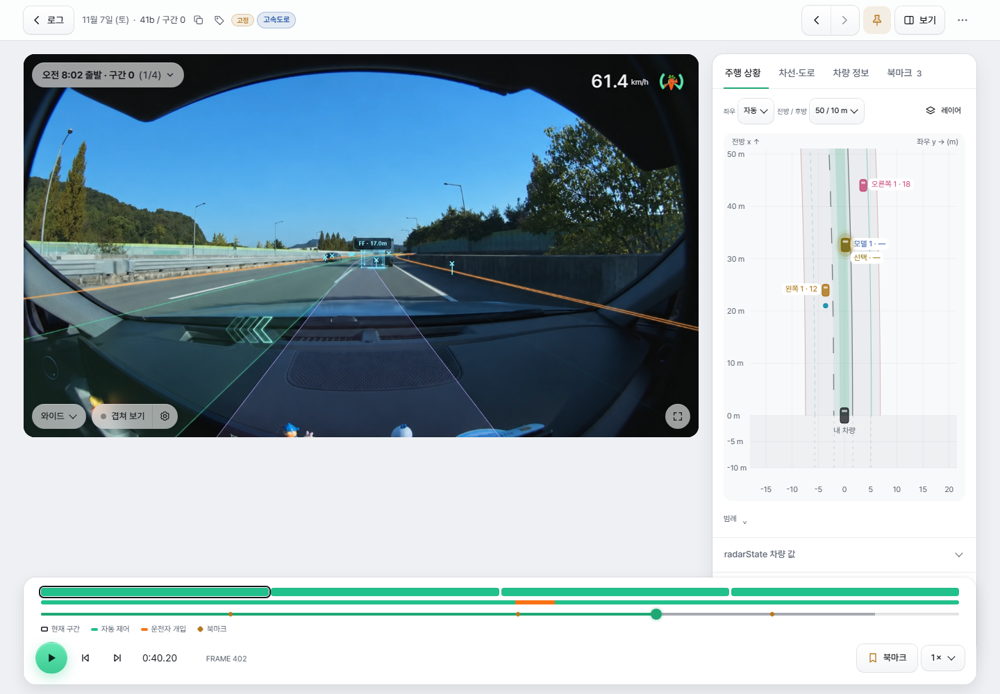</picture>

영상을 열면 연결별 **기본 화질**을 먼저 재생합니다. 기본값은 모바일 데이터에서 저용량 전방(qcamera), 와이파이·유선에서 고화질 전방이며, 영상 위 카메라 선택 목록의 **기본 화질**(닫기 버튼 옆)에서 바꾸고 브라우저마다 저장됩니다. 브라우저가 연결 종류를 알려 주지 않으면(iPhone·iPad·데스크톱 등) 휴대폰·태블릿은 모바일 데이터, 그 밖의 기기는 와이파이·유선 설정을 따릅니다. 해당 영상이 없으면 다른 전방 영상, 그마저 없으면 와이드를 사용합니다. 영상 선택을 바꿔도 로그 시간과 재생 상태를 유지하고, 재생에 실패하면 다른 영상을 시도합니다. 와이드 겹쳐보기는 해당 센서와 보정값을 사용하며, 필요한 정보가 없으면 안내를 표시합니다. 기존 변환 데이터에 와이드 보정 정보가 없다면 로그를 다시 분석해야 합니다.

겹쳐보기 설정에서 차량 박스 높이·불투명도, 경로 차폭, BSD 벽 높이와 라벨 등을 조절합니다. LF·FF·RF 박스는 지원 로그에 기록된 CCNC 차량 표시값을 복원해 그립니다. BSD·방향지시등·목표 거리도 관련 로그가 있을 때 표시합니다. 카메라 겹쳐보기에는 우측 주행 상황의 25/50/80m 범위 제한을 적용하지 않으며 BSD 벽은 최대 40m입니다.

화면 모드·화면 배치·표시 항목·그래프 순서·접힘 상태는 사용 중인 브라우저에 저장됩니다. 재생 화면의 핀과 로그 목록의 핀은 같은 구간별 고정 설정입니다.


### 최신 UI 상세 화면

겹쳐보기 옵션은 영상 위 **겹쳐 보기** 옆의 ⚙ 설정에서 바꿉니다. 박스·BSD·TARGET 라벨, 높이·너비·불투명도 등을 조절하며, 박스의 지면 고정·추정 크기 안내도 이 팝업에 있습니다.

<picture><source media="(prefers-color-scheme: dark)" srcset="docs/images/roadviewer-overlay-settings-dark.png">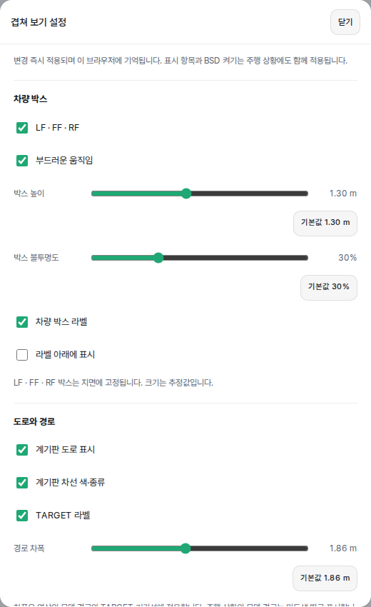</picture>

차선 확률과 좌우 거리 y[0]는 같은 위치에서 전환하며 로드엣지·앞차 정보를 함께 확인합니다.

<picture><source media="(prefers-color-scheme: dark)" srcset="docs/images/roadviewer-boundaries-probability-dark.png">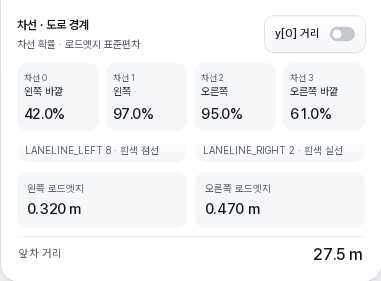</picture>

![같은 레이아웃의 좌우 거리 y[0] 모드](docs/images/roadviewer-boundaries-distance.png)

## 주행 경로 지도

로그를 변환할 때 주행 위치를 1초에 한 점씩 함께 저장해(1분에 약 1KB) 주행 경로를 지도에 그립니다. 위치는 기기 GPS가 잡혔으면 그것을, 아니면 차량이 CAN으로 보내는 차량 GPS(`carState.vehicleGps`)를, 둘 다 없으면 carrot의 추정 위치를 씁니다. 이전 버전에서 변환한 로그는 백그라운드에서 채우며, Google Drive에만 있는 로그는 저장공간 탭의 **Drive 로그 지도 채우기**를 켜거나 **한 번 실행**을 눌러 채웁니다.

**전체 지도**: 로그 탭 오른쪽 위 **목록 | 지도**에서 지도를 고르면 지금 검색·필터 조건에 걸린 주행을 파스텔 색 선으로 함께 보여 줍니다. 오른쪽 유리 카드 목록에서 주행을 고르면 그 주행으로 지도를 맞추고 **재생 · 주행 지도 · 목록에서 보기**가 카드 안에 펼쳐집니다. 목록은 오른쪽 위 버튼으로 접고 펼칠 수 있으며, 접고 펼쳐도 지도는 움직이지 않습니다.

<picture><source media="(prefers-color-scheme: dark)" srcset="docs/images/roadviewer-library-map-dark.png">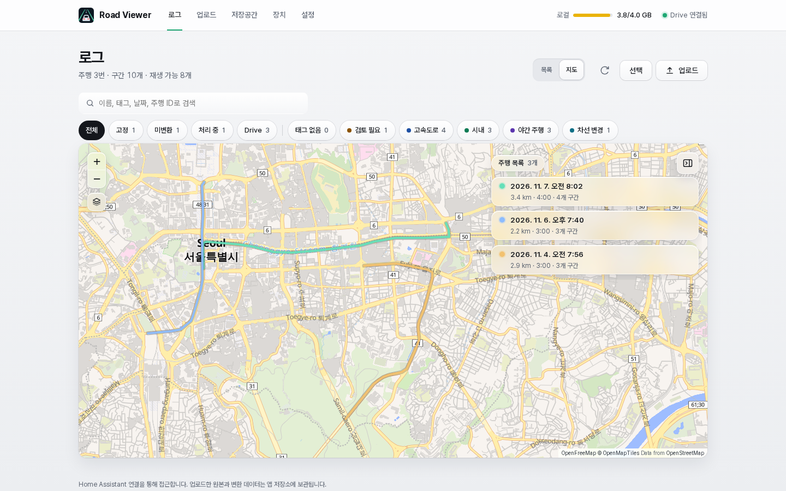</picture>

**주행 지도**: 주행 카드의 경로 그림(PC는 마우스를 올리면 정사각형 지도로 펼쳐짐, 휴대폰은 재생 옆 **지도** 버튼), 구간 ⋯ 메뉴의 **지도에서 보기**, 전체 지도 카드의 **주행 지도**로 엽니다. 구간 카드와 지도의 구간 선이 서로 강조되고, 목록을 접은 상태(휴대폰은 목록 시트를 내린 상태)에서는 고른 구간이 아래 알약 카드로 나와 바로 재생할 수 있습니다.

<picture><source media="(prefers-color-scheme: dark)" srcset="docs/images/roadviewer-drive-map-dark.png">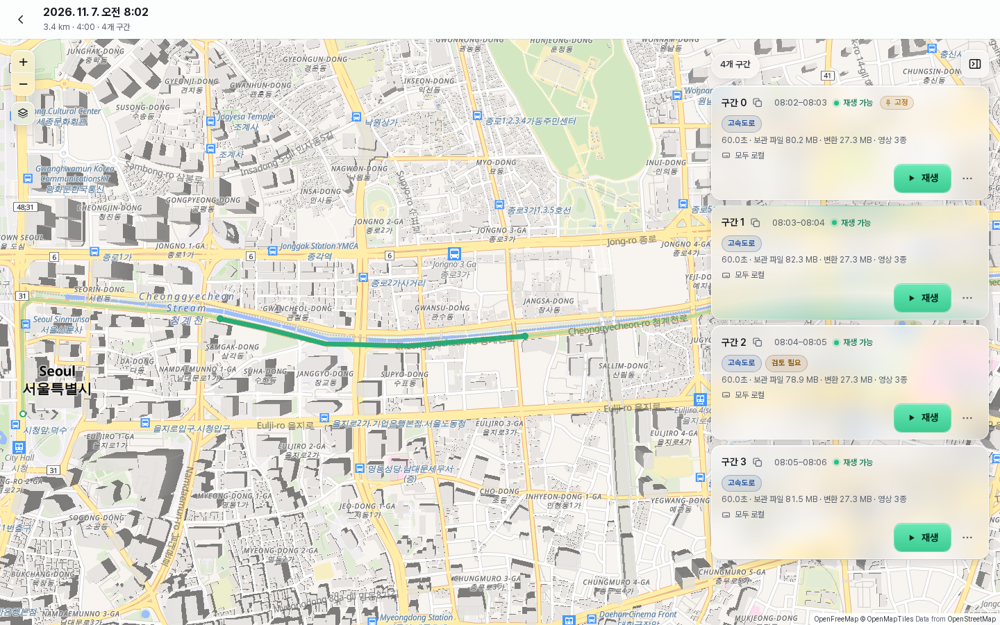</picture>

<picture><source media="(prefers-color-scheme: dark)" srcset="docs/images/roadviewer-drive-map-mobile-dark.png">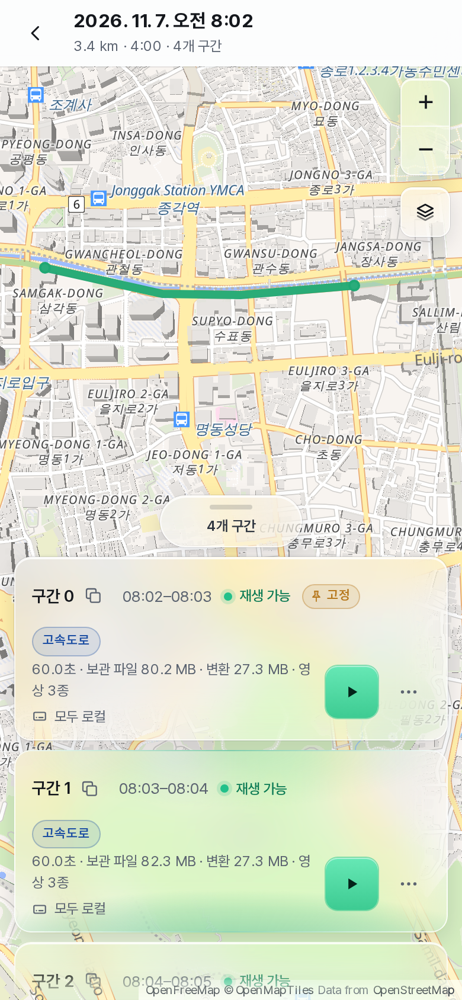</picture>

**재생 화면의 지도**: 분석 패널의 **지도** 탭은 지나온 길을 진하게, 남은 길을 흐리게 그리고 차 표시가 재생 위치를 따라갑니다. 경로를 누르면 그 시점으로 이동합니다. 겹쳐 보기 설정 › 지도에서 **영상 위 작은 지도**를 켜면 영상 오른쪽 위에 작은 지도가 나와 차를 늘 가운데 조금 아래에 두고 따라갑니다. 색상(자동·라이트·다크)과 **글자 숨기기**·**회색으로**(지도 표시 팝업과 같은 두 가지)를 고를 수 있고, 왼쪽 아래 모서리를 끌어 크기를 바꿀 수 있습니다.

<picture><source media="(prefers-color-scheme: dark)" srcset="docs/images/roadviewer-replay-map-dark.png">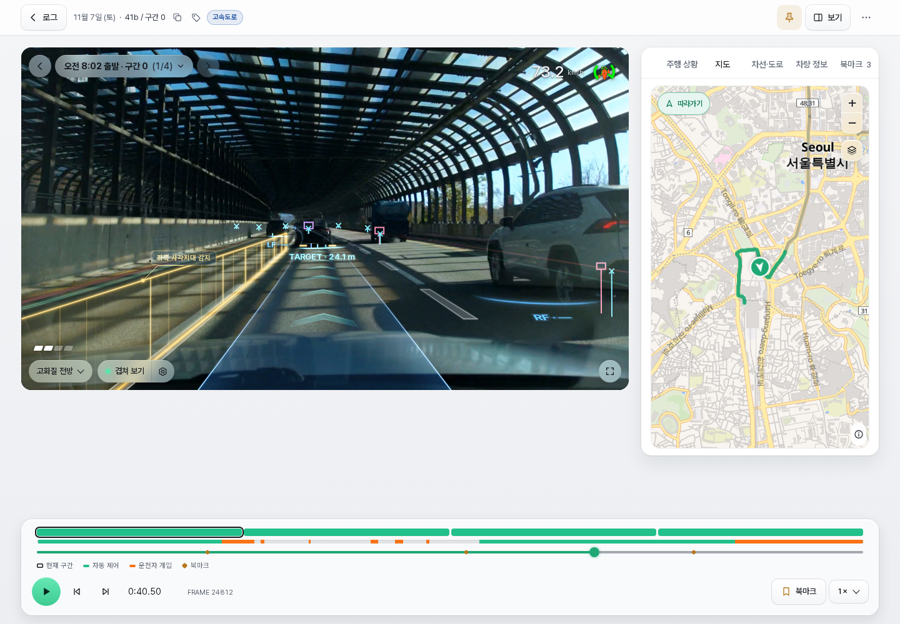</picture>

<picture><source media="(prefers-color-scheme: dark)" srcset="docs/images/roadviewer-video-minimap-dark.png">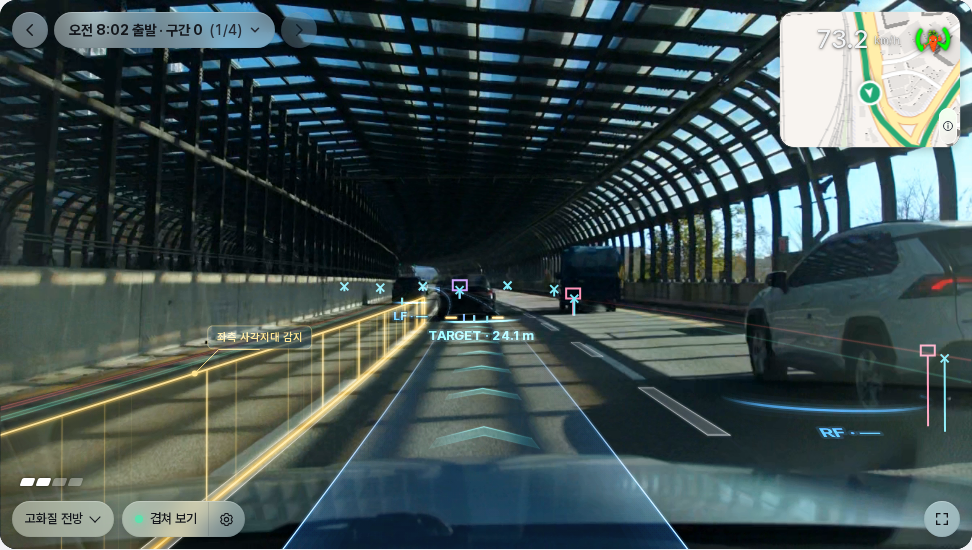</picture>

지도 바탕은 OpenStreetMap 데이터로 만든 [OpenFreeMap](https://openfreemap.org) 벡터 지도이며 API 키가 필요 없습니다. 확대·축소 버튼 아래 레이어 버튼을 누르면 **지도 표시** 팝업이 열리고, 두 가지를 따로 켜고 끕니다. **글자 숨기기**는 지도 색(라이트 모드의 노란 큰길 등)은 그대로 두고 지명·도로 이름·장소 아이콘·도로 번호·일방통행 화살표를 지웁니다. **회색 지도**는 차분한 회색 스타일로 바꾸고 3D 건물·장소 아이콘·도로 번호·화살표를 빼며 글자는 남깁니다. 둘 다 켜면 주행 선만 또렷하게 남습니다. 지도 조각은 보는 브라우저가 OpenFreeMap에서 직접 받으므로, 보는 지역의 지도 요청이 OpenFreeMap으로 갑니다. 위치 좌표는 앱 화면의 지도에만 쓰고 다운로드·내보내기·장치 API·아카이브에는 넣지 않습니다. 스크린샷의 경로는 공개 지명 사이 도로를 따라 만든 예시 경로입니다. 자세한 동작은 [사용 설명서](roadviewer/DOCS.md#주행-경로-지도)를 참고하세요.

## 태그로 구간 분류하기

태그는 **구간 전체에 붙이는 분류**입니다. 예를 들어 `차선 변경`, `비 오는 날`, `검토 필요`처럼 주행 조건이나 확인할 내용을 표시해 두고, 로그 탭의 태그 필터 칩으로 원하는 구간만 모아 볼 수 있습니다. 태그 배지는 로그 이름·고정 표시 옆에 나타나며 재생 화면에서도 확인할 수 있습니다.

아래 태그·북마크 화면은 **개인 주행 로그 대신 예시 데이터로 실제 앱을 캡처**한 것입니다.

<picture><source media="(prefers-color-scheme: dark)" srcset="docs/images/roadviewer-tags-library-dark.png">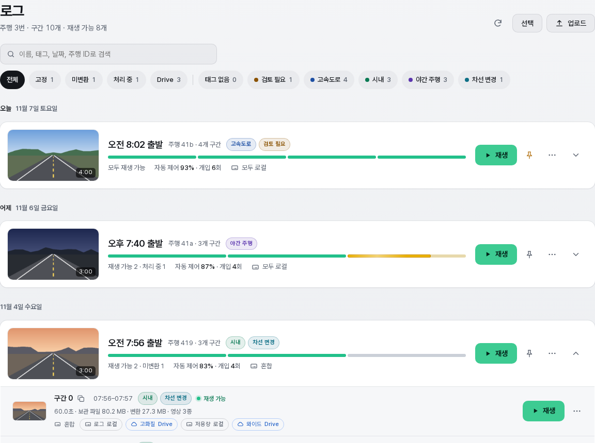</picture>

1. 구간 ⋯ 메뉴의 **태그 편집**(주행 카드의 ⋯ 메뉴는 **전체 구간 태그 편집**)이나 재생 화면의 **태그** 버튼을 누릅니다.
2. 이름과 색상을 고르고 **추가 → 저장**합니다. 기존 태그를 누르면 키보드를 띄우지 않고 선택할 수 있고, 배지를 눌러 이름·색상을 수정할 수 있습니다.
3. 여러 구간에 같은 태그를 적용하려면 로그 탭의 **선택**(터치 화면은 길게 누르기)으로 구간을 고른 뒤 하단 작업 바의 **태그**에서 추가·제거합니다.

이름은 최대 32자, 색상은 12종이며 구간당 최대 100개를 저장합니다. 태그를 저장해도 로그나 영상을 다시 변환하지 않습니다.

<picture><source media="(prefers-color-scheme: dark)" srcset="docs/images/roadviewer-tags-editor-dark.png">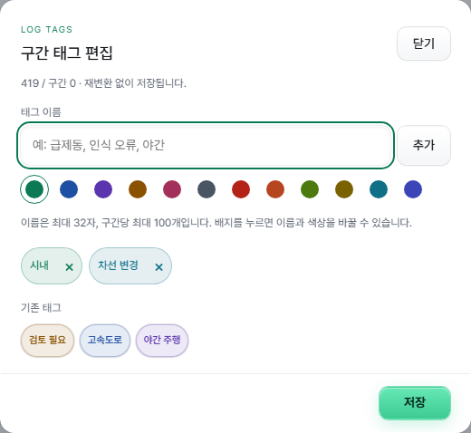</picture>

## 장면 북마크로 특정 시점 다시 찾기

북마크는 **한 구간 안의 특정 로그 시점**을 저장합니다. 예를 들어 차선 변경 시작, 앞차 거리 확인, 감속이 시작된 순간을 남겨 두면 나중에 해당 장면을 바로 다시 볼 수 있습니다.

1. 재생하거나 탐색해 원하는 시점으로 이동한 뒤, 하단 재생 바의 **북마크**를 누릅니다. 현재 화면을 유지한 채 누른 시각이 선택된 기록 팝업이 열립니다.
2. 표시된 시각을 확인하고 **저장**합니다. 제목과 메모는 선택 사항이며, 제목 없이 저장하면 장면 시각으로 이름을 붙입니다. **현재 시각으로**를 누르면 편집 중인 시각을 현재 재생 위치로 맞춥니다.
3. 북마크 탭 목록의 **시간·제목**이나 탐색 바의 **북마크 마커**를 누르면 영상·주행 상황·그래프가 함께 이동합니다. 기존 재생/일시정지 상태도 유지합니다.

<picture><source media="(prefers-color-scheme: dark)" srcset="docs/images/roadviewer-bookmarks-editor-dark.png">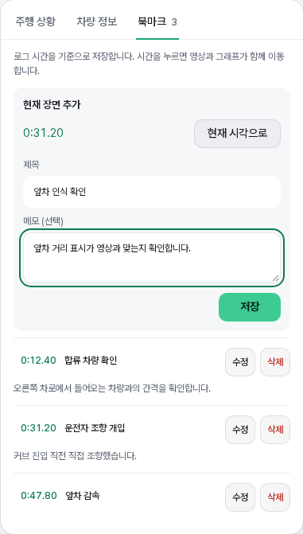</picture>

<picture><source media="(prefers-color-scheme: dark)" srcset="docs/images/roadviewer-bookmarks-list-dark.png">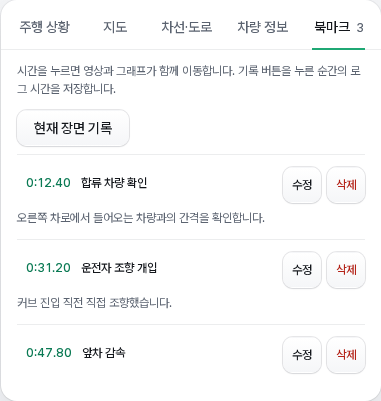</picture>

저장된 북마크는 탐색 바 위 작은 마커로도 나타납니다. 각 마커에 마우스를 올리면 시간과 제목을 확인할 수 있습니다.

<picture><source media="(prefers-color-scheme: dark)" srcset="docs/images/roadviewer-bookmarks-timeline-dark.png">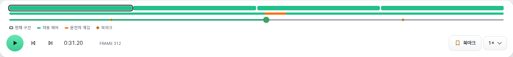</picture>

북마크는 영상 파일의 시간이 아닌 로그 시간을 기준으로 저장하므로 카메라를 바꿔도 같은 시점으로 이동합니다. 제목은 80자, 메모는 1000자, 구간당 최대 100개이며 북마크 탭 목록에서 수정·삭제할 수 있습니다. 태그와 북마크는 재변환하거나 변환 데이터를 제거해도 유지되고, 구간을 **완전 삭제**하면 함께 삭제됩니다.

**태그·북마크는 자동 삭제 보호 기능이 아닙니다.** 보관할 구간은 별도로 핀을 고정하세요.

## 변환과 파일 관리

**변환 방식과 저장공간 정책**

**설정** 탭에서 자동 변환·동시 처리 개수·화면 모드를 조절합니다. **저장공간** 탭에서 사용량·한도와 공간 부족 시 동작을 정합니다.

<picture><source media="(prefers-color-scheme: dark)" srcset="docs/images/roadviewer-storage-overview-dark.png">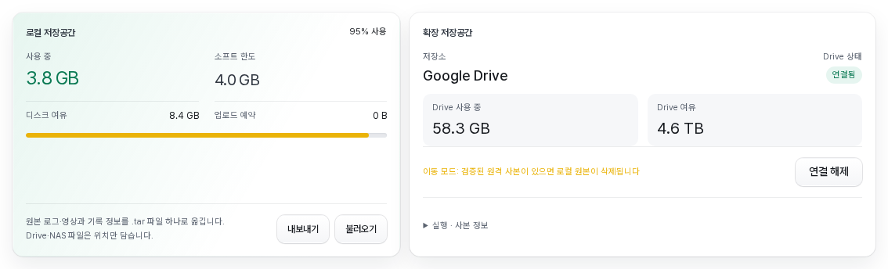</picture>

새로 완료하는 변환은 qcamera의 H.264와 f·e의 HEVC를 재압축 없이 MP4로 포장하고, 압축 프레임·디코더 헤더·프레임 수·로그 시간 검증 후 원본 TS·HEVC를 정리합니다. 실패한 영상은 원본을 유지합니다. rlog.zst는 그대로 보관합니다. 자동 변환을 끄면 업로드 파일을 보관하고 수동 변환 후 MP4로 저장합니다. HEVC 재생에는 브라우저·기기의 지원이 필요하며 재생 실패 시 저화질 영상으로 전환합니다. 검증은 압축 데이터와 헤더의 SHA-256 및 패킷 시간·수를 비교하며, 전체 영상을 디코딩하지 않습니다. 원본 자체의 모든 디코딩 오류를 검사하는 방식은 아닙니다.

진행 막대는 준비부터 큰 압축·저장이 끝날 때까지 표시됩니다. 영상이 있는 로그는 준비·압축 해제 0~4%, 로그 읽기 4~45%, 프레임 분석 45~60%, 카메라 읽기·포장·검증 60~80%, 그래프 생성·JSON 변환·압축 저장·재생 데이터 정리 80~100%로 나눕니다. 영상이 없으면 그 비중을 읽기·분석·저장에 재분배합니다. 읽은 바이트, 처리한 프레임·샘플, 저장한 바이트에 따라 약 1초마다 갱신하며 막대는 부드럽게 이어집니다. 각 작업의 실제 이름과 전체 진행률을 표시합니다. 큰 파일의 압축·원자적 저장이 끝나면 100%가 되고, 마지막 요약 저장·결과 등록에서는 막대를 숨기고 빛 효과만 유지합니다. 이 마지막 구간에는 무거운 변환 작업을 남기지 않습니다. 이 비율은 작업량 기준 단계 가중치이며 남은 시간의 백분율은 아닙니다.

| 작업 | 남는 파일 |
|---|---|
| 제거 | 원본 로그·TS·HEVC와 각 카메라의 유일한 MP4를 유지합니다. 분석·그래프와 원본으로 다시 만들 수 있는 MP4를 삭제합니다. 대기 작업은 취소하며 처리 중에는 제거할 수 없습니다. |
| 완전 삭제 | 해당 구간의 원본·영상·변환 결과를 모두 삭제합니다. |
| 저장소 즉시 정리 | 등록된 로그를 유지하고 미완료 브라우저 업로드의 임시 파일을 정리합니다. |

**구간별 상태 확인과 파일 관리**

**로그** 탭은 오른쪽 위 **목록 | 지도** 전환([주행 경로 지도](#주행-경로-지도)), 검색창과 필터 칩(전체·고정·미변환·처리 중·Drive·NAS, 태그별 칩)으로 구간을 좁히고, 같은 주행의 구간을 날짜별 **주행 카드**로 묶어 보여 줍니다. 카드에는 썸네일·전체 길이, GPS가 있으면 경로 그림, 출발 시각(`HH:MM 출발`, 알 수 없으면 `업로드 HH:MM`), 구간 상태 막대, **자동 제어 N% · 개입 N회**가 표시되며, 기본으로 접혀 있고 직접 펼친 주행만 기억합니다. 각 구간의 처리 상태·영상 유무·보관 및 변환 데이터 용량을 확인할 수 있고, 구간 아래에는 로그와 카메라 영상(고화질·저용량·와이드)이 저장된 위치를 **로컬**·**Drive**·**NAS**로 표시합니다. 준비된 항목은 **재생**, 변환이 필요한 항목은 **변환**으로 이어집니다. 구간별 ⋯ 메뉴에는 제거·다운로드·태그 편집·로그 이름 복사·고정·완전 삭제가 있습니다.

썸네일과 출발 시각은 변환할 때 만들고, 이전에 변환했거나 아카이빙한 로그는 백그라운드에서 채웁니다. 로컬·NAS 파일은 앞부분만 읽고 Drive 파일은 범위 요청으로 앞쪽 약 2 MB만 받으며, 업로드·변환·아카이빙 실행·Drive 재생 중에는 잠시 멈춥니다. 자동 제어 비율과 개입 횟수는 텔레메트리로 계산합니다.

<picture><source media="(prefers-color-scheme: dark)" srcset="docs/images/roadviewer-library-logs-dark.png">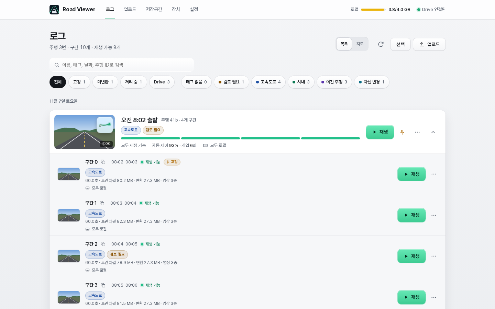</picture>

**로그·영상 다운로드**

구간 ⋯ 메뉴나 재생 화면 ⋯ 메뉴에서 **다운로드**를 누르면 아래 팝업이 열립니다. 먼저 영상 형식과 포함할 파일을 고른 뒤 개별 파일 또는 ZIP으로 받을 수 있습니다. 재생 화면 앱 바의 ⋯ 메뉴에는 로그 목록과 같은 **제거**·**다운로드**·**완전 삭제**가 있으며, 제거나 완전 삭제를 확인하면 로그 목록으로 돌아갑니다.

여러 구간은 로그 탭의 **선택** 버튼(터치 화면은 구간 길게 누르기)으로 시작하는 목록 안 **선택 모드**에서 고릅니다. 주행 카드의 체크박스로 주행 전체를, 구간 체크박스로 개별 구간을 선택하며 일부 선택은 −로 표시합니다. 하단 작업 바에서 **태그**·**다운로드**·**변환**·**변환 데이터 제거**·**완전 삭제**·**고정 포함**·**취소**를 사용합니다.

- **MP4:** 저장된 카메라 영상을 그대로 받습니다. f·e의 HEVC 재생에는 브라우저·기기의 코덱 지원이 필요합니다.
- **원본 형식:** f·e는 HEVC, q는 TS로 재압축 없이 다시 포장합니다. 화질은 같지만 처음 업로드한 파일과 바이트·해시까지 같지는 않습니다.
- **전체 선택·선택 해제:** ZIP에 포함할 파일을 조절합니다. 각 파일 옆의 **받기**는 ZIP 없이 해당 파일만 받습니다.
- **여러 구간:** 선택 모드에서도 같은 팝업을 사용합니다. 최대 150구간을 선택하고 **개별 받기**를 펼쳐 파일별로 받거나 선택한 파일을 ZIP으로 받을 수 있습니다. 없는 카메라는 제외합니다.

<picture><source media="(prefers-color-scheme: dark)" srcset="docs/images/roadviewer-download-options-dark.png">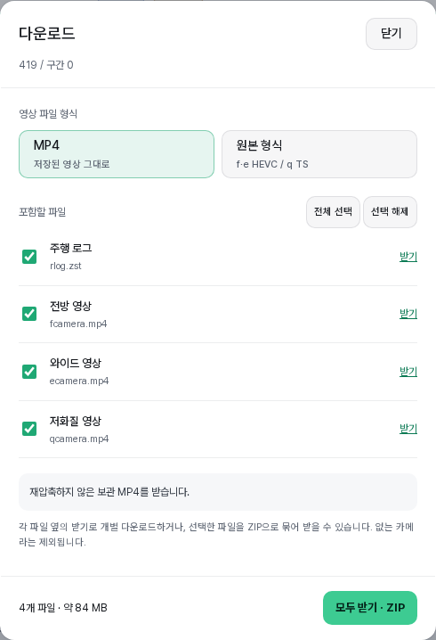</picture>

선택 파일은 ZIP으로 스트리밍하며 다운로드용 복사본을 서버에 계속 보관하지 않습니다. 각 카메라의 유일한 MP4는 보관 영상이므로 **변환 데이터 제거**로 삭제하지 않습니다.

선택 모드에서는 여러 항목을 한 번에 변환·제거·완전 삭제할 수 있습니다. 고정된 구간은 일괄 제거·완전 삭제에서 기본적으로 제외됩니다. **고정 포함**을 켜면 포함되며, 선택 모드를 다시 시작하면 꺼집니다. 구간 ⋯ 메뉴에서는 고정 여부와 관계없이 직접 제거·완전 삭제할 수 있습니다.

<picture><source media="(prefers-color-scheme: dark)" srcset="docs/images/roadviewer-bulk-selection-dark.png">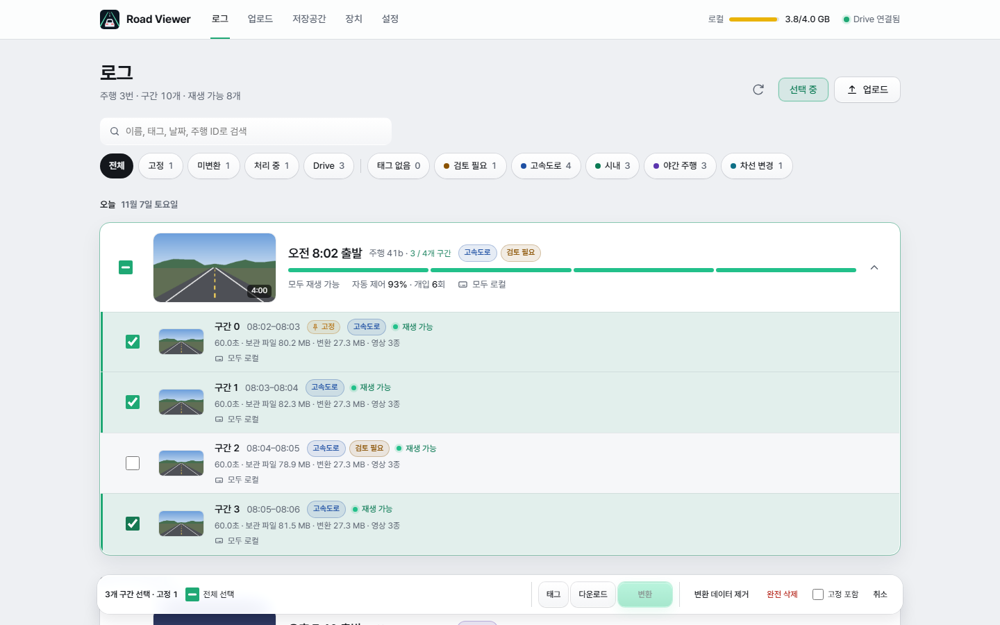</picture>

**저장공간** 탭은 ① 사용량·연결 상태 → ② 아카이빙 기본 설정 → ③ 실행·고급 설정 → ④ 현재 설정 요약 순서로 구성됩니다. 보관 기간과 실행 간격은 선택지 또는 직접 입력을 사용하며, 변경한 동작은 요약에서 확인한 뒤 한 번에 저장합니다. 미저장 변경이 있으면 수동 전체 이동·복사를 실행할 수 없습니다.

**Google Drive MOVE는 로컬 확장 저장공간입니다.** Drive MOVE와 로컬 원본 삭제 허용을 함께 설정하면 로컬 최대 사용량은 **소프트 리밋**으로 동작합니다. 아카이빙이 켜져 있을 때 한도 또는 아카이빙 시작 기준에 도달하면 기존 아카이버에 백그라운드 이동을 요청합니다. 둘 다 설정한 경우 더 낮은 값을 기준으로 합니다. 다른 업로드의 남은 예약, 임시 파일과 **100 MiB 안전 여유**를 확보할 수 있으면 한도를 일시적으로 넘어도 업로드를 받습니다. 업로드 요청이 Drive 전송 완료를 기다리지는 않습니다.

MOVE는 원격 전송·무결성 검증·저장 기록 확정 후 해당 로컬 파일만 지웁니다. 최소 보관 기간·고정·사용 중 보호·배치 제한을 유지하며 중복 실행하지 않습니다. Drive 장애나 검증 실패가 있어도 원본과 기록을 보존하고, 물리적 여유가 충분하면 업로드를 계속 받습니다. 공간이 실제로 부족하면 기존 기록을 지우지 않고 신규 업로드를 거부합니다. 아카이빙을 끄면 이동하지 않습니다. 이 경우에도 Drive MOVE 설정의 소프트 한도는 유지되며 물리적 디스크 여유가 업로드 허용 기준입니다.

Drive로 옮긴 기록은 **목록·재생·다운로드에 그대로 남습니다.** 자동 로컬 정리는 Drive 파일이나 Drive 파일이 연결된 기록을 삭제하지 않습니다(COPY 사본도 보호). 원격 삭제는 사용자가 **완전 삭제**를 명시한 경우에만 예약합니다. 출처를 확인할 수 없는 이전 버전의 원격 삭제 대기는 자동 실행하지 않습니다.

Drive MOVE가 아닌 기존 저장 정책에서는 업로드 거부 또는 오래된 미고정 구간 삭제를 선택합니다. 삭제는 예약만으로 실행하지 않고 파일 수신·검증 후 등록할 때 수행하며, 고정·처리 중·Drive 파일이 연결된 기록 등은 보호합니다. [전체 설정 안내](roadviewer/DOCS.md#저장공간-화면-읽기)를 참고하세요. 수동 전체 이동·복사는 대상 파일·용량·제외 사유를 먼저 확인한 뒤 실행합니다. [수동 실행 확인창과 보호 조건](roadviewer/DOCS.md#수동으로-적격-데이터-모두-이동복사)도 확인하세요.


## 저장·백업·업데이트

데이터는 앱 컨테이너의 `/data/roadviewer`에 저장됩니다. **원본 로그·영상·변환 결과는 Home Assistant 앱 백업에서 제외**되므로 보관할 원본은 별도로 유지하세요. 처리·저장 정책·장치 인증 설정은 백업에 포함됩니다.

업데이트에서 분석 형식이 바뀌면 기존 변환 결과를 정리하고 다시 처리할 수 있습니다. 모든 업데이트가 재변환을 요구하는 것은 아닙니다.

실험 기능인 **NAS 아카이빙**을 **저장공간** 탭에서 켜면 변환을 마친 로그의 원본 영상과 로그를 Home Assistant에 Share 용도로 연결한 네트워크 저장소로 옮겨 로컬 공간을 확보합니다. 기본값은 꺼짐이며, 자동 아카이빙은 고정한 구간도 옮기지만(수동 전체 이동은 고정 구간을 로컬에 둡니다) NAS 정리에서는 지우지 않습니다. 목록·변환 데이터는 로컬에 남고 NAS에 연결할 수 없어도 파일을 지우지 않으며, 로컬로 되돌리는 복원 기능은 없습니다. NAS의 파일은 Home Assistant 백업 대상이 아닙니다. 설정 방법은 [NAS 아카이빙 안내](roadviewer/DOCS.md#nas-아카이빙-실험-기능)를 참고하세요.

NAS 대신 **Google Drive**를 아카이브 저장소로 쓸 수도 있습니다(실험 기능, 기본값 꺼짐). 직접 만든 OAuth 클라이언트의 ID·보안 비밀을 앱 옵션에 넣은 뒤, **저장공간** 탭에서 **Google Drive 연결**을 누르고 표시된 코드를 Google 기기 인증 페이지에 입력합니다. **연결 해제**는 이 기기의 토큰만 지우며 저장 기록·로컬 파일·Drive 파일은 바꾸지 않습니다. 기본은 로컬 파일을 지우지 않고 검증된 사본만 Drive에 두는 복제(COPY) 모드입니다. 로컬 원본을 지우는 이동(MOVE) 모드는 저장공간 탭에서 MOVE와 **검증 후 로컬 원본 삭제 허용**을 함께 켜야 적용되며, Drive 자동 정리는 없습니다. Drive로 옮긴 영상은 앱을 거쳐 재생하고, 시크가 빠르도록 지금 보는 영상 하나(256MB 이하)만 메모리에 받아 둡니다. 디스크에는 쓰지 않으며 10분 동안 보지 않으면 비웁니다. 인증 토큰은 Home Assistant 백업에 포함되므로 백업을 안전하게 보관하세요. 자세한 내용은 [Google Drive 아카이빙 안내](roadviewer/DOCS.md#google-drive-아카이빙-실험-기능)를 참고하세요.

## 문서와 검증

스크린샷은 2026-11-07에 1.0.11 버전 코드에 예시 데이터를 넣어 라이트·다크 모드로 촬영했으며, 보는 환경의 테마에 맞는 이미지를 보여 줍니다. 주행·와이드 소개 사진 3장은 기존 사진의 영상 영역을 새 UI에 합성했습니다. 페어링 코드·장치·저장공간 수치는 모두 예시이며 실제 연결에 쓸 수 없습니다. [스크린샷 안내](docs/images/README.md)를 참고하세요.

- [설치 및 사용 설명](roadviewer/DOCS.md) · [English](roadviewer/DOCS.en.md): 업로드, 변환, 재생, 주행 경로 지도, 선택 모드(일괄 관리), 저장 정책, 백업과 문제 해결
- [AppArmor 보안 정책](docs/apparmor-security.md) · [English](docs/apparmor-security.en.md)
- [Android 다중 파일 선택 분석 기록](docs/android-multiple-file-fix/README.md) · [English](docs/android-multiple-file-fix/README.en.md)
- [변경 이력](roadviewer/CHANGELOG.md): 버전별 변경 내용
- [roadviewer-mcp](https://github.com/Qualified4/roadviewer-mcp): AI 에이전트용 MCP 서버. 기존 Ingress 인증과 API만 사용
- [장치 API v1](docs/device-api.md) · [English](docs/device-api.en.md): HTTPS 구성, 페어링·서명, 업로드·이어올리기와 openpilot 없이 테스트하는 방법

`roadviewer/`가 Docker 빌드 컨텍스트입니다. GitHub Actions에서 amd64/aarch64 이미지 빌드와 API·변환·브라우저 검사를 실행합니다. 브라우저 검사는 반응형 배치, 설정 저장, 마우스·터치 피드백 등을 확인하며 실제 Home Assistant 기기와 Android 파일 선택창은 환경에 따라 다를 수 있습니다.

### 프리빌드 배포 순서

병합 커밋에 **`[skip ci]`를 넣지 마세요.** main의 이미지 확인과 캐시 예열이 실행되어야 다음 PR도 최신 캐시를 사용할 수 있습니다.

버전은 `roadviewer/config.yaml`에서 읽습니다. 전체 검증은 **PR에서 한 번** 수행합니다. 모든 브라우저·API 테스트, dependency audit, 두 플랫폼의 Trivy·컨테이너 검사를 통과한 이미지를 GitHub Actions 산출물로 보관하고, 수동 배포에서는 그 이미지를 그대로 사용합니다. 일반 브랜치 push는 중복 검사를 실행하지 않습니다. `main` push는 이미 배포된 이미지와 소스의 일치를 확인하고, 별도 작업에서 양쪽 플랫폼 빌드·Trivy DB·브라우저 캐시를 예열합니다. 이 캐시 예열은 전체 PR 검증을 반복하거나 릴리스 이미지를 다시 발행하는 단계가 아닙니다.

1. 릴리스 브랜치에서 앱 버전·Dockerfile 기본 버전·화면 버전·변경 이력을 함께 갱신합니다. 이미 배포한 버전은 재사용하지 않습니다.
2. 해당 브랜치를 push하고 `main` 대상 PR을 만듭니다. PR의 전체 검증이 성공한 뒤 **Actions → Build, test and publish app → Run workflow**에서 같은 브랜치를 선택합니다. 수동 실행은 현재 커밋의 최신 PR 검증 성공 여부를 확인하고, 해당 실행·재시도 번호의 산출물 ID로 이미지를 가져옵니다. 다시 빌드하지 않습니다.
3. 최초 GHCR 패키지는 비공개일 수 있습니다. GitHub의 **Packages → roadviewer-ha → Package settings → Change visibility → Public**을 확인합니다. 공개 접근 검사에서 실패했다면 공개로 변경한 뒤 실패한 `publish` 작업을 다시 실행합니다. Home Assistant에 레지스트리 자격 증명을 넣는 방식은 사용하지 않습니다.
4. 모든 작업과 익명 다운로드·플랫폼 검증이 성공한 뒤 **테스트한 변경을 그대로 squash merge로 `main`에 반영**합니다. `main`에서는 두 플랫폼 이미지의 버전·전체 소스 트리와 병합된 파일 내용을 비교합니다. squash로 커밋 ID가 바뀌어도 파일 내용이 같으면 통과합니다. 이미지가 만들어지기 전에 새 버전을 `main`에 올리면 이 검사와 설치·업데이트가 실패할 수 있습니다.

이미지 산출물은 7일간 보관합니다. 만료·삭제됐거나 최신 검증이 실패/취소됐으면 배포하지 않습니다. **Re-run all jobs**로 전체 PR 검증을 다시 실행하세요. 실패한 작업만 재실행하면 이번 재시도 번호에 두 이미지가 없을 수 있습니다. PR에서 테스트한 병합 결과와 릴리스 브랜치의 파일 내용이 다르면 역시 배포를 차단하므로, 브랜치를 최신 `main`에 맞춘 뒤 다시 검증해야 합니다. 새 커밋을 push하면 이전 PR 검증은 취소하고 새 커밋을 검증합니다.

수동 배포의 `build-<검증 실행 번호>-<재시도 번호>-amd64` / `arm64` 태그는 검증한 플랫폼별 이미지입니다. 릴리스는 변경 가능한 태그 대신 이미지 digest를 참조해 구성하며 Home Assistant는 버전 태그를 사용합니다. 이미 있는 버전 태그는 덮어쓰지 않고 소스 일치를 확인합니다. 수정본을 배포하려면 반드시 새 버전을 사용합니다. 로컬 소스를 직접 빌드하려면 [설치 설명](roadviewer/DOCS.md#설치와-접속)의 `image:` 제거 안내를 따르세요.

Road Viewer는 [MIT 라이선스](LICENSE)로 배포합니다.

원본 주행 로그·영상은 저장소에 포함하지 않습니다. 위 소개 화면은 공개용으로 선택한 스크린샷입니다. 포함된 openpilot 스키마와 UI 리소스의 라이선스는 [OPENPILOT-LICENSE](roadviewer/schema/OPENPILOT-LICENSE)를 참고하세요.
