# Installation and use

This guide describes **1.3.9**.

[한국어](DOCS.md) · English

Start with **업로드 tab → Add files → Upload → Convert → Play**. The application currently uses Korean UI labels; their English meanings are given below.

## Installation and access

Add `https://github.com/Qualified4/roadviewer-ha` to the Home Assistant app store repositories, install **Road Viewer**, start it, then open its web UI. Some Home Assistant versions call apps “add-ons.” This is not a HACS integration. Home Assistant Container does not provide the Supervisor app store.

Supported platforms are **amd64** (64-bit Intel/AMD) and **aarch64** (64-bit ARM). Installation downloads only the matching prebuilt GHCR image. ARM 32-bit and i386 are unsupported. Home Assistant may display download/extraction progress; it is not a reliable estimate of total startup time.

The UI uses Home Assistant Ingress, including remote access through your existing Home Assistant address. It needs no separate public Road Viewer port. External device HTTPS is optional and separate.

For local source builds, copy `roadviewer` to `/addons/roadviewer` and remove `image:` from that copy's `config.yaml`. Keeping it selects the published image instead of the local source.

## Screen layout

The library is split into five in-page tabs, shown at the top on wide screens and as a bottom tab bar on phones.

| Tab | Contents |
|---|---|
| 로그 (Logs) | Search, filter chips, route cards grouped by date, per-segment ⋯ menu, selection mode (bulk actions), storage summary |
| 업로드 (Upload) | Add files/drag and drop, upload progress, immediate storage cleanup |
| 저장공간 (Storage) | Usage, budget and policy, NAS/Google Drive archiving |
| 장치 (Devices) | External comma device HTTPS and pairing |
| 설정 (Settings) | Automatic conversion, concurrency, display mode, conversion/file help, version |

**화면 모드** (Display mode) is **자동 / 라이트 / 다크** (Auto/Light/Dark). Auto follows the device's light/dark setting; the choice is stored in this browser only. The replay video area stays dark in every mode. The replay ⋯ menu offers the same control.

## Uploading files

On the **업로드** tab, use **파일 추가** (Add files), or drag files onto the upload area, then press **업로드** (Upload). Selection does not start transmission. Uploads keep running when you switch tabs; the header's progress pill (`업로드 N%`) shows progress. Uploads from a device or another browser show in the same pill (updated every 3 s). Files can be added together or one at a time. **선택 비우기** clears the selection; adding a selected filename again replaces that selection. Folder selection is unsupported.

| File | Purpose |
|---|---|
| `rlog.zst` | Required driving log |
| `qcamera.ts` | Optional low-bandwidth front video |
| `fcamera.hevc` | Optional high-quality front video |
| `ecamera.hevc` | Optional wide video |

Downloaded `qcamera.mp4` (or `camera.mp4`), `fcamera.mp4`, and `ecamera.mp4` can be uploaded again with the matching `rlog.zst`. Low-resolution front MP4 uses H.264; front/wide MP4 uses HEVC. Select one format per camera; existing camera files are not overwritten. Driver-camera uploads remain unsupported. One segment may use the bare filenames above. Multiple segments use their original route/segment identifiers:

```text
0000035f--b513269850--0--rlog.zst
0000035f--b513269850--0--qcamera.ts
0000035f--b513269850--0--fcamera.hevc
0000035f--b513269850--0--ecamera.hevc
0000035f--b513269850--5--rlog.zst
```

Mixed routes and nonconsecutive segments are supported.

- **Log only:** conversion produces road and vehicle information without video.
- **Add video later:** send the same log with the additional video. It attaches to the existing recording rather than creating another log.
- **Video only:** rejected; include the matching log.
- Re-uploading the same source video checks its saved hash and preserves the retained MP4 and replay data without storing another original copy. Use the download modal for original-format files.
- **Different video:** existing camera data is not overwritten. To replace it, completely delete that recording and upload it again.

Duplicates are detected using the compressed rlog's SHA-256. Renaming identical content does not create another recording; recompression may change the hash. Browser deduplication happens after transfer, so it saves storage/conversion rather than transfer bandwidth. Missing-video attachment are exceptions to ordinary duplicate skipping.

### Limits and recovery

| Item | Limit |
|---|---|
| Browser selection | 100 files |
| Browser batch total | Default 512 MiB; `max_upload_mb` supports 16–2048 |
| Decompressed log | 512 MiB |
| Conversion worker | 10 minutes per job |
| Transfer chunk | 256 KiB |
| Device batch | 50 segments, 200 files, 8 GiB total |
| Device video file | 2 GiB; each rlog must fit `max_upload_mb` |

The UI's MB/GB settings use powers of 1024. The upload limit is distinct from the storage budget. Device limits do not bypass available disk space or storage policy.

If Android's native file picker cannot return multiple files, add one at a time. Closing the app or losing access to a selected file can interrupt uploads; after reopening, select the files again. An unchanged browser session can retry interrupted chunks. No-progress transfers are aborted after 15 seconds and retried up to five times, with delays starting at one second and capped at four seconds. Slow but progressing transfers are retained.

## Library and conversion

The **로그** tab starts with a search box and filter chips. Search matches log names, tags and dates (start/upload). Chips are **전체** (All), **고정** (Pinned), **미변환** (Unconverted, including failed), **처리 중** (Processing, including queued), **Drive**, **NAS**, plus one chip per tag (and **태그 없음**, Untagged), each with its segment count. Drive/NAS chips appear only when some segment has files there. Search, the built-in chip and the tag chips combine (AND). Several tag chips can be selected; only segments carrying every selected tag are shown (**태그 없음** is selected alone). Filters apply to individual segments and hide routes with no matches. On tablets and desktops chips beyond two rows fold behind **+N개 더보기** (show more) at the end of the second row, which unfolds them all (**접기** folds them again); a selected tag is moved forward so it stays visible. On phones the chips scroll sideways in one row.

Segments with the same full route ID share one **route card**, and cards are grouped by date (today, yesterday, date). A card shows a thumbnail with the total length, the start time, a segment status bar (one block per segment, coloured by state; past 20 segments it shows the first 20 blocks and a **+** coloured by the most urgent state among the rest), **자동 제어 N% · 개입 N회** (automatic control ratio and driver takeover count), and pin/tag badges. The start time comes from the log's real clock and reads **`HH:MM 출발`** (departed). When the log has no usable clock it falls back to **`업로드 HH:MM`**, the upload time, which is not the driving time. The control ratio and takeover count are computed from the prepared telemetry (control state and driver intervention).

Cards are collapsed by default; the chevron expands or collapses the segment list. Expansion is not remembered: every card starts collapsed each time the log list opens. The card's **재생** (Play) opens the first playable segment (or shows the first segment's Convert button). A yellow background and pin mean all pinned, a yellow pin without highlighted background means partially pinned, and a neutral pin means none. The card pin applies to every currently stored segment in that route (later uploads do not inherit it): a partial selection becomes fully pinned, and a fully pinned route becomes unpinned. The card's ⋯ menu offers **전체 구간 다운로드** (Download all segments) and **전체 구간 태그 편집** (Edit tags of all segments).

An expanded segment row shows its thumbnail, name, state, storage chips, a **재생** or **변환** button and a per-segment ⋯ menu: **제거** (Remove, when ready or queued), **다운로드** (Download), **태그 편집** (Edit tags), **로그 이름 복사** (Copy log name), **구간 고정 / 해제** (Pin/unpin) and **완전 삭제** (Delete permanently).

`00000395--0d0eda17c5--7` is displayed as **395 / 구간 7**. The copy icon, or **로그 이름 복사**, copies the full original identifier, including leading zeros and the hash.

**새로고침** refreshes the list, state, sizes and conversion settings; it does not reload the page or restart conversion. The list refreshes about every three seconds, and active conversion progress about every second.

The Logs tab's storage summary reports Road Viewer file usage, including originals, prepared data and temporary uploads—not whole-disk utilization. When space runs short it shows a warning with a **정리** (Clean up) button leading to the Storage tab. Each recording separately reports retained files and removable prepared data. **영상 있음** indicates that any supported original or MP4 exists, not that conversion is complete. A log-only recording can also become playable.

Choose **다운로드** (Download) in the segment's ⋯ menu to select files and MP4/original format in a modal. **전체 선택** (Select all) and **선택 해제** (Clear selection) control the ZIP contents. Use **받기** beside a file to download it individually without ZIP; for multiple segments, expand **개별 받기** to choose a segment’s file. Original-format downloads remux f/e to HEVC and q to TS without re-encoding: quality is preserved, but bytes and hashes may differ from the uploaded file. Selected files stream as one ZIP without a persistent download copy. Selection-mode download uses the same modal for up to 150 selected segments, omitting absent cameras. Removing prepared data preserves each camera’s sole retained MP4.

### Thumbnails and start time

Thumbnails and the start time are generated during conversion. A thumbnail is the best-exposed of the frames at 1-5 s of the smallest front video, with its brightness levelled (right after the start the camera's exposure is often still settling and dark); a route card shows its first segment's thumbnail. Thumbnails made the older way are made again once in the background, and the old one stays shown until the new one is ready. Logs converted before this feature, and logs archived to a NAS or Google Drive, are backfilled in the background one at a time. Local and NAS files are read in place (only their first part); Drive files are read with ranged requests for only the first ~2 MB, never downloaded whole. Backfill pauses while an upload is being received, a conversion is running, or a video (local or Drive) is being played; it runs alongside archiving. An unreachable archive or Drive error is retried later. Logs without a readable clock show the upload time; logs without a decodable frame show a placeholder. No reconversion is needed.

### Conversion and storage settings

Newly completed conversions remux qcamera H.264 and front/wide HEVC into MP4 without re-encoding. Verification compares SHA-256 hashes of compressed pictures and headers, packet counts and timestamps without decoding every frame; it does not screen the source for every possible decoding error. Originals are removed only after compressed-picture, decoder-header, packet-count and log-clock verification; failed sources and rlog.zst are preserved. With automatic conversion off, uploads remain in their uploaded form until manual conversion. HEVC playback requires browser/device support; playback failure switches to the low-resolution camera when available.

These options are on the **설정** (Settings) tab, together with **화면 모드** (display mode), the **처리 상태, 다운로드, 제거와 완전 삭제의 차이** help section and the app version.

- **자동 변환:** enabled by default. Eligible recordings are queued oldest-upload first. Disabling clears automatic queued work; running and manually requested work continue.
- **동시 처리 개수:** 1–4, default 1. Lowering the limit does not interrupt running jobs. Settings survive restart; parallel jobs may finish out of order.

Settings-tab options save immediately; storage budget/policy on the **저장공간** tab have their own Save button. Failed videos retain their uploaded originals.

| State | Meaning |
|---|---|
| 미변환 | Originals retained; manual conversion is available |
| 대기 중 | Queued; removal cancels this queued conversion |
| 처리 중 | Reading, analysis, video preparation/verification or finalization |
| 재생 가능 | Playback data is ready, including log-only recordings |
| 변환 실패 | Inspect the error, then retry conversion |

The bar stays visible from preparation until the large compressed files have been saved. With video, stage weights are preparation/decompression 0–4%, log reading 4–45%, frame analysis 45–60%, camera reading/remuxing/verification 60–80%, and graph generation, JSON encoding, compression/writes and replay compaction 80–100%. Log-only recordings redistribute the video share across reading, analysis and saving. Updates use consumed bytes, processed frames/samples and written bytes, with smooth transitions at roughly one-second intervals. Labels name the actual operation and show overall progress. Atomic completion of the large writes reaches 100%; the brief summary/registration phase hides the bar and keeps only the sweep effect. Heavy conversion work is completed before that final phase. These are work-based stage weights, not a remaining-time estimate.

### Individual and bulk actions

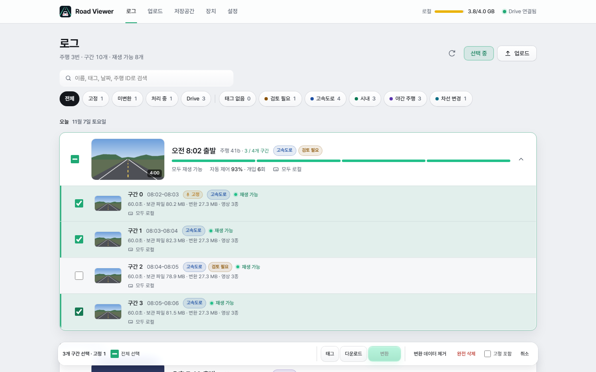

The primary action is Play or Convert. The adjacent ⋯ menu contains removal, download, tag editing, name copy, pin and complete deletion when applicable.

| Action | Effect |
|---|---|
| 변환 | Build replay data; use originals or a retained sole MP4 |
| 제거 / 변환 데이터 제거 | Delete analysis/graphs and MP4s that can be recreated from their originals. Preserve originals and a camera's sole MP4. Cancel queued work; reject removal of actively processing work |
| 완전 삭제 | Permanently delete the segment's originals and prepared data; cancel its work |

Manually removed recordings are excluded from automatic conversion until Convert is requested.

Bulk actions use an in-list **selection mode**; there is no separate dialog.

1. Press **선택** (Select) on the Logs tab, or long-press a segment (about 0.5 s) on a touch screen; the pressed segment is selected immediately.
2. Tick segment checkboxes or a route card's select-all checkbox. A minus marks a partially selected route, which shows `selected / total`. Selected items hidden by a filter are still counted and reported.
3. Use the bottom action bar: **태그** (Tags), **다운로드** (Download), **변환** (Convert); on narrow screens **더보기** (More) reveals **내보내기** (Export: the selected segments as one `.tar`, see [Export and import](#export-and-import); up to 150 segments, or every recording when all are selected), **변환 데이터 제거** (Remove prepared data), **완전 삭제** (Delete permanently) and **고정 포함** (Include pinned). **전체 선택** selects all visible segments and **취소** (Cancel) leaves selection mode.

**고정 포함** is off whenever selection mode starts: pinned segments are protected from bulk removal/deletion unless explicitly included. This does not affect bulk conversion. Individual ⋯ menu actions can explicitly delete pinned recordings.

Below each segment, chips show where the log and each camera video (high-quality, low-res, wide) are kept: **로컬** (local), **Drive** or **NAS**. Only files moved by archiving show Drive or NAS; everything else is local. A file removed by NAS cleanup shows **삭제됨** (removed). Recordings still uploading show no chips.

The ⋯ menu in the replay app bar offers the same **제거** (Remove), **다운로드** (Download) and **완전 삭제** (Delete permanently) as the list; a confirmed remove returns to the log list; a confirmed delete opens the previous segment of the same drive, else the next one, and returns to the log list only when there is neither.

During a bulk operation selection, **고정 포함** and **취소** are locked. Results show completed, skipped and incomplete counts; failed items remain selected.

## Segment tags

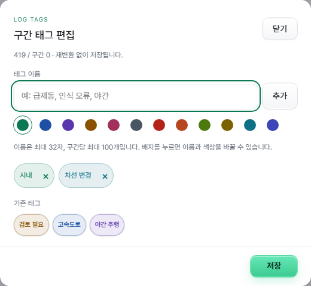

Use **태그 편집** (Edit tags) in a segment's ⋯ menu, **전체 구간 태그 편집** in a route card's ⋯ menu for every segment of the route, or the tag button on the replay screen. A segment supports up to 100 tags, each up to 32 characters, with 12 colors and suggestions from existing tags. Click a selected tag to edit its name or color. Whitespace is normalized and names differing only by letter case are deduplicated.

Use the tag filter chips on the Logs tab to show a particular tag or **태그 없음** (Untagged). For bulk editing, press **선택**, select segments, then choose **태그** in the action bar and Add or Remove. Only the selected tags change; unrelated tags and pins remain intact. Partial failures retain successful changes, and retry targets only the failed segments.

Tags are stored in server-side segment metadata and survive conversion, reconversion and prepared-data removal. Complete deletion removes them with the recording. These are segment tags, not camera-specific tags or timeline bookmarks.

The web UI bundles Pretendard Variable 1.3.9 for Korean text without contacting an external CDN. The initial font transfer is approximately 1.96 MiB; subsequent loads use the browser cache. Its SIL Open Font License is included with the [official release](https://github.com/orioncactus/pretendard/releases/tag/v1.3.9).

## Scene bookmarks

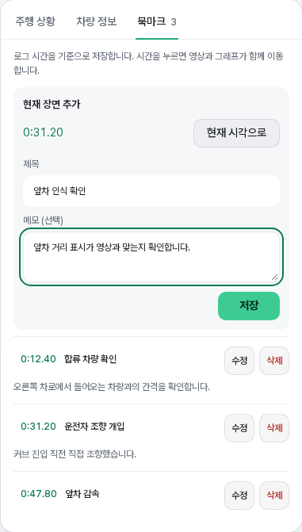

Choose **현재 장면 기록** (Record current scene) in the bookmark tab or **북마크** in the playback bar to open a popup without switching the current replay view. The captured log time stays fixed during playback; **현재 시각으로** updates it to the current playhead. The title (up to 80 characters) and note (up to 1,000 characters) are optional; an empty title defaults to the scene time. Closing the popup preserves the unfinished draft in that segment. On mobile, the editor and save button stay above the keyboard, and playback controls are hidden during text entry. Each segment supports up to 100 bookmarks; use the bookmark tab to list, edit or delete them.

Click a gold seek-bar marker or an entry in the tab's chronological list to seek video, road view and graphs together, preserving playing or paused state. **수정** (Edit) and **삭제** (Delete) change or remove an entry.

Bookmarks use log time rather than camera time and are stored in segment metadata. They survive camera switching, reconversion and prepared-data removal; complete recording deletion removes them. No reanalysis is required.

## Video playback and layout

A video opens on the quality chosen under **기본 화질** (default quality; the **기본 재생 화질** window), beside 닫기 in the list opened by the camera/quality chooser over the video, qcamera or high-quality front, then the other front video, then wide. The choice is made separately for mobile data (default qcamera) and Wi-Fi/wired (default high-quality), kept per browser, and applied from the next video opened. The connection is told apart only where the browser reports it (Chromium browsers on Android); elsewhere phones and tablets follow the mobile-data choice and other devices the Wi-Fi/wired one. When multiple sources are available, switch with the same chooser. Switching preserves log time and playing/paused state using each camera's time offset. A failing source triggers an attempt to use another available video.

Before playback is ready, the control area shows a message instead of active playback controls. The seek bar shows buffered video ranges. Errors provide a refresh action.

The replay page has a compact app bar, controls over the video, a floating playback bar at the bottom and analysis tabs.

**App bar**

| Item | Behavior |
|---|---|
| Back | Returns to the library. |
| Date · log name | One line with the date, log name (copy button), **태그** button, tags and the **고정** badge. The title (segment chooser) sits at the top left of the video. |
| Previous / next | **이전 구간 / 다음 구간** within the same route, otherwise **이전 로그 / 다음 로그**. They are the ‹ › buttons beside the title at the top left of the video. |
| Pin | Pins/unpins the current segment, shared with the library; yellow when pinned. |
| 보기 (View) | **좌우 분할**, **상하 분리**, **화면 폭…**, and under **재생** (playback) two switches kept in this browser: **끝나면 다음 구간 재생** (off by default: when a segment plays to its end, the drive's next playable segment plays on) and **구간을 옮기면 일시정지** (on by default: off, moving to another segment while playing keeps playing). On phones it sits inside the ⋯ menu. |
| ⋯ | **제거**, **다운로드**, **카메라 설치 정보**, **화면 모드**, log details/version, **완전 삭제** |

**Over the video**

- **Top left, title:** drive start time · 구간 k with the position `(i/N)` within the route; falls back to `업로드 …` when the start time is unknown. Opens the route's **구간 선택** (segment chooser).
- **Bottom left:** camera/quality chooser, the **겹쳐 보기** (overlay) toggle and its ⚙ settings button.
- **Top right:** vehicle speed (`carState.vEgo`) and the steering-wheel state; when the driver intervenes in steering, an **개입** (takeover) ring surrounds the wheel.
- **Bottom right:** fullscreen. Phones and tablets open it in landscape: where the browser can lock the orientation (Android Chrome, Samsung Internet) the screen turns even with the device held upright; where it cannot (the Android Home Assistant app, iPad), the picture is turned a quarter turn, so hold the device on its left side. With the device already in landscape nothing is turned.

While playing, the title, the bottom-left controls and fullscreen fade out; touching the video or moving the mouse shows them for a few seconds, and touching the video again while they show hides them at once. On touch or short screens the app bar also folds away while playing and returns on pause. The video is sized to the screen height so the floating playback bar never covers it.

The **playback bar** floats at the bottom while scrolling.

- **Segment strip:** one block per segment of the route, in the same colours as the library (playable green, processing yellow, error red, unconverted grey); the playing segment is outlined. Clicking another playable segment opens it. On long drives the strip scrolls horizontally and keeps the current segment centred. Hovering a block shows that segment's thumbnail and start time above the strip. Holding a finger on a block raises that segment's card above the strip, blurs the screen behind the controls and loops a hint (an arrow pushing "밀어서 구간이동" up). Sliding along the strip picks another segment; on long drives, resting near an end moves the strip on. Pushing the finger up off the strip locks the segment: only the card follows the finger, the rest darkens and "구간 n · 밀어서 구간이동" appears at the top; far enough up it turns to "놓으면 구간이동" and letting go opens that segment. Coming back down undoes each step, and letting go short of it settles the card back and closes it. On the segment already playing the arrow flattens and the hint stops; a segment not ready shows "준비 중인 구간" and does not open. In phone and tablet fullscreen the strip is hidden; the title menu at the top left still changes segments.
- **Event track:** automatic-control spans (자동 제어) and driver takeovers (운전자 개입), with a legend for the current segment, control, takeover and bookmarks.
- **Seek bar:** buffered video ranges and bookmark markers. Seeking preserves the playing/paused state.
- **Play/pause** (Space), **frame step** (← / →), **time** (tap to toggle between current time and total length), **북마크**, **speed** (0.25–4×).
- **Keyboard shortcuts:** Space play/pause, ← / → one frame, F full screen, PageUp / PageDown previous/next playable segment. They work after clicking the play button or the seek bar. Text fields, open dialogs and menus, tables, maps and telemetry charts keep their own keys, and Space presses a button reached with Tab. They also work with the Korean keyboard layout.

Short boundary mismatches are tolerated; real gaps or missing tails are not invented.

Both layout toggles off means automatic responsive layout. **좌우 분할** shows video and analysis side by side; **상하 분리** stacks them. Side by side, the video stays under the app bar while only the analysis scrolls; stacked, the video sticks to the top and shrinks with the scroll down to 60% of its height, keeping whatever size the scroll stops at and growing back as you scroll up. On short phone screens (such as the Fold cover display) the playback bar also folds into one row (play, seek, time) while scrolling down and opens again on scrolling up or tapping its free area. **보기 → 화면 폭…** opens a stable slider dialog:

| Viewport | Width adjustment | Default |
|---|---|---|
| Up to 600px | 50–100% | 100% |
| 601–1280px | 320–1280px | 1280px |
| Above 1280px | 720–1920px | 1420px |

Actual width never exceeds the viewport. Each category is remembered separately. Display mode, layout, display selections, graph selection/order and collapsed sections are local browser preferences, not account-wide settings.

## Road view and camera overlay

### Lanes, edges and range

The lane and road-edge readouts have their own **차선·도로** analysis tab. Probability and y[0] distance modes share aligned type, rows, and road-edge/lead values.

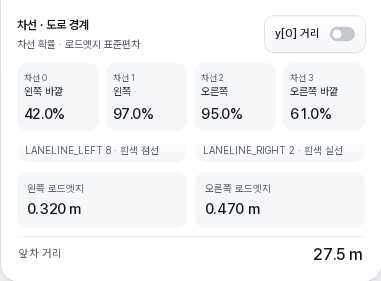

![Lateral y[0] distances](../docs/images/roadviewer-boundaries-distance.png)

In the video overlay, mint lane bands grow up to 75% confidence, reaching a maximum physical width of **0.225m**. Above 75%, width stays fixed while fill opacity grows from **7.5% to 20%**. The 1px outline's opacity follows confidence. Projection makes distant bands narrower.

Coral red road-edge bands use confidence `1/(1+standard deviation)`; maximum fill opacity remains 10%. Glow is video-only.

The road panel uses lane lines of 1–4px with confidence-based brightness and dashed lines below 50%. Road edges are 2px coral red lines, dashed above standard deviation 1. The model path is a translucent mint ribbon (not scaled to the vehicle width).

The paired front/rear ranges **25/5m, 50/10m and 80/20m** affect **only the road panel**. **후방 표시 · LR / RR** defaults to on and remembers its state; turning it off restores the full forward view. LR/RR appear behind the ego vehicle and 0m line. Rear dashed lines are straight position guides, not measured lanes or extrapolated road curvature. Rear coordinates retain the cluster command distance without the front targets' 0.8 distance restoration or curvature correction. Existing logs need reconversion to populate rear values; existing playback remains available. LR/RR are not added to the camera overlay, which retains BSD. Camera lanes, paths, vehicle boxes, detection markers and TARGET are not clipped to this setting; they still require valid data and projection. BSD walls retain their separate 40m maximum length.

### Objects and labels

The road tab's **레이어** (Layers) popover enables the rear view, model paths, lanes, edges, model leads, radarState targets, liveTracks, SCC exclusion and labels independently. **범례** (Legend) expands the colour key. The ellipse on the map marks the lead currently being followed. **SCC 감지점 제외** hides SCC-source points from the road view, overlay and liveTracks table. A low-probability model lead remains visible but is dimmed below 50%.

**정보 표시** selects one of Off, TrackID, Distance, yRel, Speed or Relative speed. TrackID is the default; Off leaves shapes only. **liveTracks 정보 표시** applies the selected label to raw points. The camera readouts can switch from lane probabilities/edge deviations to each line's initial `y[0]`.

Road-view liveTracks uses × for measured points and hollow circles otherwise; video uses ×. Raw points are not necessarily vehicles. Radar/liveTracks tables collapse and expand by their headings; expanded, they retain roughly ten rows of height with internal scrolling and sticky headers, including when empty. Tables can include objects beyond the road view's range.

Raw `yRel` is positive left; the road coordinate is `-yRel`, with x forward and y right. Model and selected lead distances may use different reference points.

### LF, FF and RF boxes

These are processed Hyundai CCNC display commands, not unfiltered radar objects. Distance is restored by dividing by 0.8. FF lateral position adds the model Position at that distance; if unavailable, it uses the same lane-center curvature correction as LF/RF. Missing geometry leaves the lateral correction unapplied. Filtering/clipping information cannot be recovered.

LF/RF are blue; FF is light cyan. Boxes assume width 1.8m, length 4.5m and default height 1.30m. The anchor is the rear face's bottom center. Orientation follows the midpoint of both lanes at the object and 5m ahead; missing lane geometry falls back to straight orientation. Boxes remain on the ground and ignore marker-height adjustment.

Height is adjustable from 0–3m (zero draws a ground rectangle); fill opacity is 0–100%, default 30%. Transparent boxes show far faces/edges. A new detection rises from the ground over 450ms. A frame without the detection dims the box to 40% at once before a 600ms fade, so even one-frame dropouts show as blinks; a quick return restores full brightness without replaying the entry. When the same car moves to another slot (e.g. FF→LF, matched by position, even with up to 600ms between the slots, 300ms of both being sent, or the old slot picking up another car right away) it slides there over 300ms and changes color instead of disappearing and reappearing. During playback, positions are interpolated between 20 Hz samples. Turning off **Smooth motion** disables all of this and shows each recorded sample as-is (on by default, remembered). Animation follows log time and reduced-motion preferences.

LF/FF/RF display is enabled by default, with saved selections respected. Their messages lack TrackID and speed; those labels show an unavailable value. A missing/stale command is not treated as a valid detection.

### Road signals, BSD and overlay settings

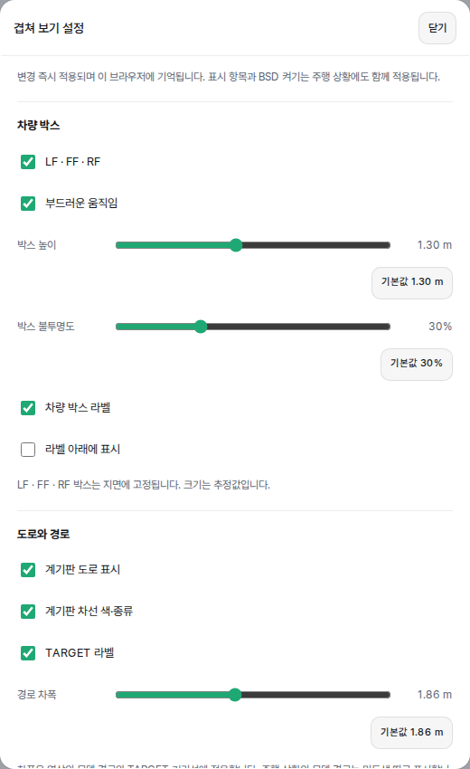

TARGET uses the configured path width (default 1.86m), with softly fading ends. Its video trail length follows smoothed actual deceleration `carState.aEgo`, reaching 8m at 3m/s² over the available lane geometry. It is not measured brake force. No acceleration data means no braking trail.

`LANE_HIGHLIGHT`, `LANE_LEFT` and `LANE_RIGHT` control lane highlighting to the valid end of the lanes. `LANE_HIGHLIGHT_DISTANCE` is not used. Mint turn arrows float at a fixed place ahead of the car (see below); they do not reproduce the physical bulb's exact flash phase.

BSD uses `carState.leftBlindspot/rightBlindspot`. Video walls rise/fade in and lower/fade out, extend at most 40m (only up to the car ahead when there is one: the cluster TARGET, or without it the cluster FF car, as for the model path), and default to 0.80m high. Ten vertical yellow lines move irregularly along each wall, five with stronger glow. The road panel uses a yellow glow on the detected side's border rather than a wall stripe. Walls are independent of marker height and the cluster-road toggle.

Over the video, the ⚙ button beside **겹쳐 보기** opens **겹쳐 보기 설정** (overlay settings); **카메라 설치 정보** is in the app bar's ⋯ menu. Settings include:

| Setting | Default / range |
|---|---|
| Vehicle box height | 1.30m / 0–3m |
| Vehicle box fill | 30% / 0–100% |
| Model path width | 1.86m / 1–3m |
| BSD wall height | 0.80m / 0–3m; zero hides the video wall |
| Marker height | 60cm / 0–200cm; connects markers to ground |
| Box, BSD and TARGET labels | Independently enabled; with the TARGET label on, the lead shows it and its FF box label is hidden (off: the FF label shows) |
| Ground labels (TARGET; LF/FF/RF under their boxes) | Near, they lie on the road like a decal (60% height, each letter leaning to the vanishing point) out to 18m; further away they stand up, upright from 23m; their size shrinks with distance (about 23px at 6m, 17px at 15m, 12px from 30m on a 900px picture) |
| 감지점 라벨 (point labels) | Off; radar and model points show their value (the 정보 표시 mode) small beside them. A point on a drawn LF/FF/RF car is only a short tick on the ground |
| Labels below boxes | Optional text below the box without background/border |

Every slider has an individual reset button. Settings are remembered. The path width affects video model paths and TARGET, not the road panel's mint ribbon. Rendering preferences do not require log reconversion.

**Road projection.** Video graphics are drawn as light on the road, brighter near the car. Cluster and radar-plan distances (the lead, the target following distance, the LF/FF/RF cars, radar tracks and the radar lead; not the model's leads) are measured from the front radar; they are drawn 1.52m further on (openpilot `RADAR_TO_CAMERA`), since the road coordinates start at the camera. The model path ends at the lead (cluster TARGET, or without one the cluster FF car) when there is one and otherwise runs to the end of the model path. Chevrons on it flow towards the car at 40% of its speed, from 5.5m ahead up to 30m (fading from 20m), or to 1m short of a nearer lead. They turn amber with deceleration (`carState.aEgo`), and are not drawn when longitudinal control (`carControl.longActive`, read from the vehicle data) is off. When it switches on they appear one by one from the nearest (about 0.8s); when it switches off they go one by one from the farthest (about 0.8s). Paused before play, the first frame is drawn with the values that arrive in the log's first 0.25s. While stopped they brighten and dim over 2.4s.

| Setting | Default / range |
|---|---|
| 앞차거리 (lead distance) | 호 (arc) / 끄기, 선 (line), 호; the path still ends at the lead when off |
| 목표 차간 거리 (target following distance) | On; `longitudinalPlan.desiredDistance` as amber marks on the path edges whenever longitudinal control is on (lead or not; none while off, fading over 0.3s); the lead mark turns red below 85% |
| 차량 박스 (vehicle boxes) | Off; a 3D box of light on the ground ring; the box height and fill sliders apply only when on |
| 차간 거리 단계 (following-distance setting) | On; `carControl.hudControl.leadDistanceBars` (1–4) as four cells at the bottom left |

The deceleration glow follows the chosen lead mark's shape. Past the lead, the model path continues to its end as dashed edges (3 m dashes every 6 m) that fade with distance; where they cross the lead car, the road is hidden behind it and they are drawn faint. Logs converted with 1.3.0 or later carry the following-distance setting and target distance. For logs converted earlier, the app fills them in the background after the update, one log at a time, reading only the original log (`rlog.zst`); no reconversion is needed. A log stored only on Google Drive is downloaded to a temporary copy that is deleted after reading; a log whose storage is unreachable or that cannot be read is tried again at the next app start. The fill waits while conversions, uploads, playback or archive moves are running.

Turning a blinker on lifts the path chevrons one by one into three arrows at a fixed place ahead of the car over 0.9s (the nearest chevron to the outermost arrow); turning it off returns them over 1.2s, innermost first, to the nearest places on the road. Without chevrons they curve out of and back into the car. Hazard lights split them to both sides. Off for under 0.25s counts as on.

### Wide-camera overlays

Wide video uses its sensor and `liveCalibration.wideFromDeviceEuler` with the front/device calibration. The same 3D coordinates are reused; only small shared camera metadata is added, not a second set of coordinates.

Missing calibration or an unsupported sensor produces an explanation instead of using front-camera projection. Older converted data needs log reanalysis to obtain wide calibration; this feature alone does not automatically reanalyze all ready recordings.

## Vehicle information graphs

Switch to **차량 정보** in the analysis tabs (**주행 상황 · 차선·도로 · 차량 정보 · 북마크**). The summary shows speed, acceleration, steering angle and steering intervention. Initial/last values can be held only within the supported data-boundary tolerances; initial preview identifies its first valid sample time.

**그래프 선택** chooses and reorders graphs by dragging the handle. Reset order keeps checkbox selections. Selection/order are remembered; additional graphs scroll inside the panel.

There are **24 graphs**:

| Group | Graphs |
|---|---|
| Speed and acceleration | Speed, acceleration, automatic target acceleration, longitudinal jerk, RPM |
| Pedals and braking | Driver pedal input, driver pedal state, automatic gas/brake output, acceleration/deceleration requests, longitudinal control stage, standstill/brake hold |
| Steering | Angle, steering rate, steering torque, automatic torque command, driver intervention, curvature, lateral acceleration |
| Control state | Automatic control, cruise state |
| Cluster vehicles | LF/FF/RF display state, forward distance, lateral LATERAL and yRel graphs |

Initially selected: speed, acceleration, driver pedal input, angle, intervention and automatic control. Zoom with +/− or return to the whole segment. Click/drag to seek; zoomed playback follows the current time near the center except at the ends. Dragging temporarily holds the viewport; release resumes following.

Driver pedal values differ from automatic requests and final commands. Some vehicles report brake pressed but no brake amount. Torque is a sensor/command value, not proof of driver intervention; `steeringPressed` provides that state. Target steering angle and RPM availability depend on the vehicle. Zero-only valid fields cannot distinguish true zeros from unpopulated defaults; missing fields are not fabricated. The LATERAL graph shows LF_LATERAL/FF_LATERAL/RF_LATERAL cluster commands before path/lane restoration; FF uses the signed −6.4–6.3m range. The separate yRel graph shows the restored box positions, positive left and negative right. Both can differ from raw radar coordinates. Existing replay data supplies the pre-restoration values without reanalysis; missing values remain unavailable.

## Drive route maps

Converting a log also keeps its route at one point per second: the device GPS (`gpsLocationExternal`, `gpsLocation`) when it has a fix, else the car's own GPS that the vehicle sends over CAN (`carState.vehicleGps`), else carrot's estimated position (`carrotMan.xPosLat/xPosLon`). Points that are zero or invalid, device fixes worse than 100 m, and jumps faster than 90 m/s are dropped. That is about 1 KB per minute of driving. Logs converted by earlier versions are filled in the background, newest first, from three minutes after start: only when the original rlog is on Home Assistant or the NAS (logs only on Google Drive are not downloaded by default and show no map), waiting while uploads, conversions, playback or archiving run.

**Fill maps from Google Drive logs**: with Google Drive archiving, the storage tab's "Run and advanced settings" has this switch (off by default, saved with Save settings). When on, logs whose original is only on Drive are read newest first, one at a time: the original is downloaded once to read its route only. The download sits in a temporary folder in the app's data and is deleted as soon as it has been read, whether that worked or not; only the route is kept (about 1 KB per minute). Expect about 13 MB of download per 1-minute segment. It pauses during uploads, conversions, playback and archive runs and carries on afterwards. Drive files are only read: never moved, deleted or renamed. **Run once** next to it makes one pass over the remaining logs even with the switch off, then stops; while it runs it becomes **Stop**, which stops after the log being read. Progress shows as "Drive 로그 지도 채우기: 120 / 406". A lost Drive connection or an expired sign-in stops it until the next run; network errors and rate limits are retried a few minutes later. A log that cannot be read three times is skipped, and a log gone from Drive keeps no map. Turning the switch off stops after the current log.

- **All drives**: the Logs screen's List | Map switch draws every drive the current search, tags and filters show, one pastel line each. A glass card list on the right (below on phones) has one card per drive and scrolls when long. Hovering a card thickens its line; picking a card or a line fits the map to that drive and opens **Play · Drive map · Show in list** inside the card. On wide screens the button at the top right folds and unfolds the list (remembered in this browser) without moving the map. On phones the list sits in a bottom sheet like the drive map's (its handle shows "주행 목록 N개"): drag the handle to settle it on one of three heights or tap it to hide it and bring it back at the middle height; moving the sheet does not move the map. With the sheet pulled down, picking a line shows that drive's card at the bottom. The switch is hidden while no drive has GPS.

  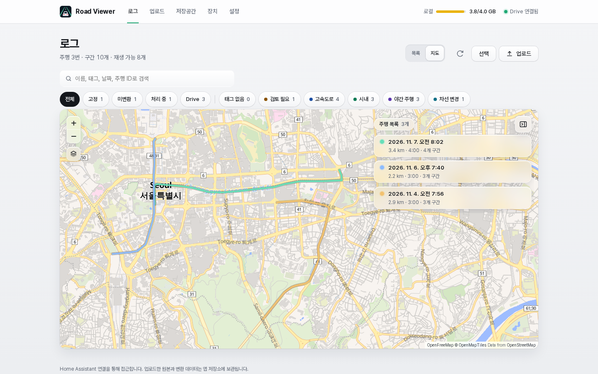
- **Drive map**: opened from the route shape in a drive card header (on a PC it unfolds into a square map on hover and opens on click; on phones use the **지도** button left of Play), the segment ⋯ menu's "Show on map", or the all-drives card. On wide screens the segment cards float at the map's top right and fold with a button. On phones they sit in a sheet below; drag the handle to settle it on one of three heights, or pull it all the way down to leave only the handle; a tap on the handle folds and unfolds it (hidden ↔ the middle height). Segments and their part of the route highlight each other. With the list folded or the sheet pulled down, picking a segment shows a "구간 N · time" pill at the bottom with **Play** and ✕ (clear the selection). Back or Escape closes it.

  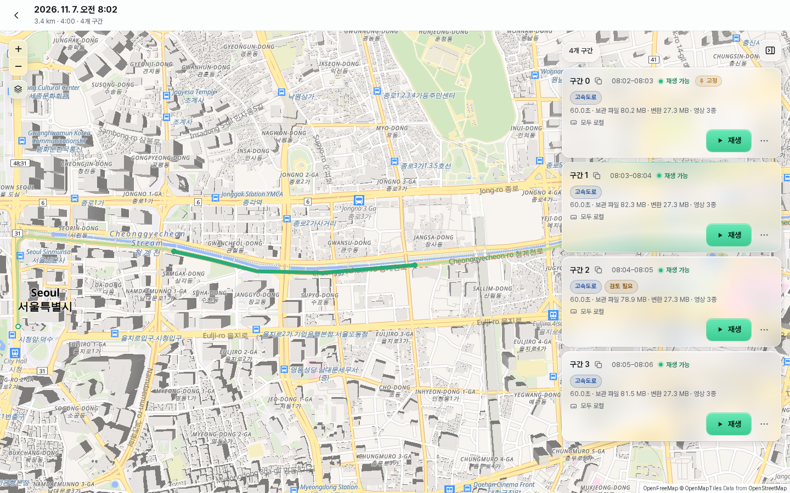

  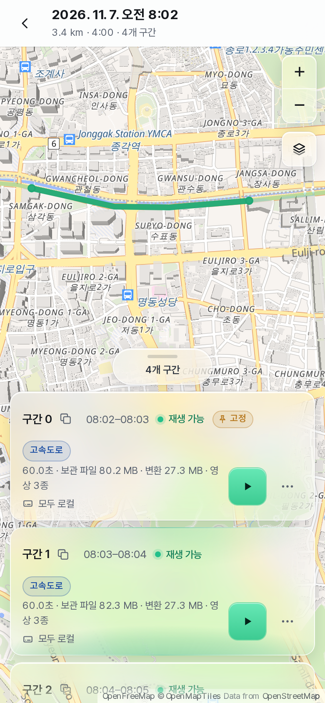
- **Replay Map tab**: segments with GPS get a Map tab among the analysis tabs. The segment being played is solid as a whole, the drive's other segments faded, and a car marker follows playback; Follow turns off when you move the map. Tapping the route seeks there, opening another segment if needed.

  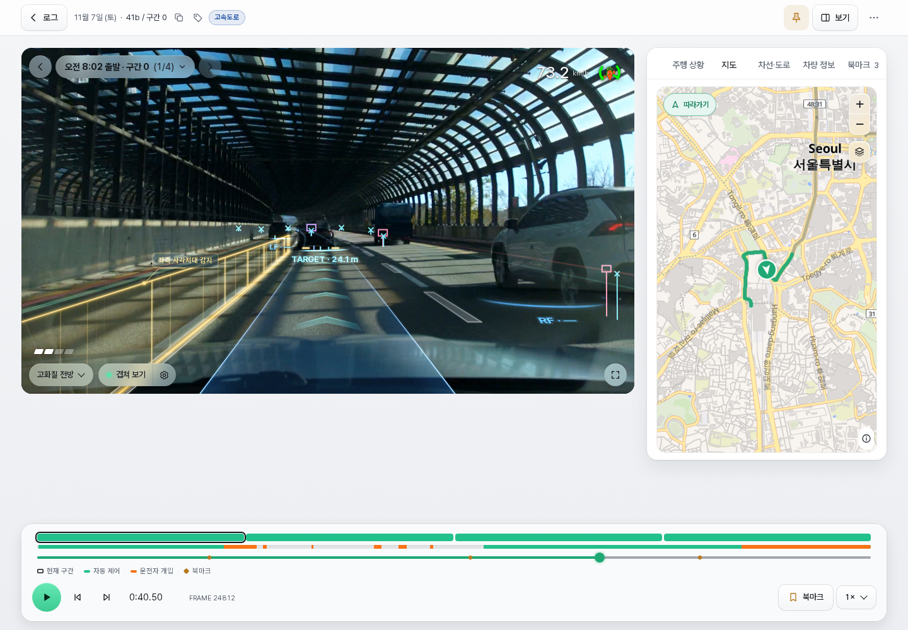
- **Small map over the video**: Overlay settings › Map (off by default). It shows a small map in the video's top-right corner, under the unchanged speed and wheel, at street zoom with the car centred across and a little below the middle (60% down), showing more road ahead. Its credit is folded into an ⓘ in the bottom-right corner; tapping the ⓘ shows it (without enlarging the map). Colours: automatic (follows the screen theme), light or dark; its own options 글자 숨기기 (hide labels) and 회색으로 (grey) apply the map display popover's two switches to the small map only (the popover does not change the small map). Drag its bottom-left corner (mouse or finger) to resize it, kept 4:3, never narrower than the speed and no lower than the bottom controls; the size is remembered in this browser and a double tap on the corner restores the default. Tapping it fills the picture and hides the quality and overlay controls meanwhile. It does not show for segments without video or GPS, nor while the Map tab is shown.

  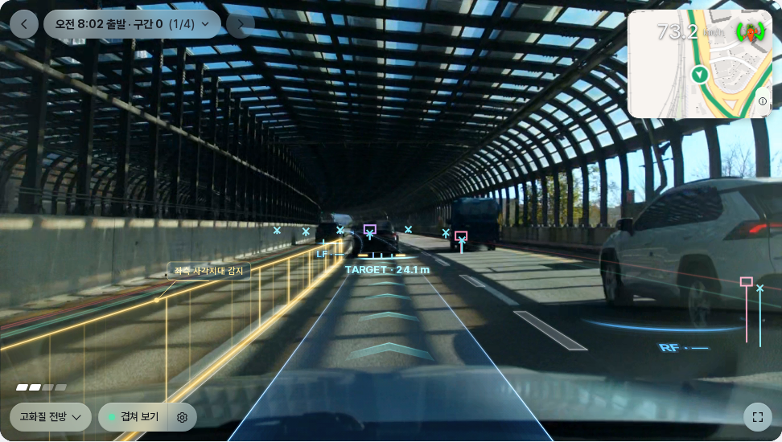

The basemap is OpenFreeMap's vector tiles made from OpenStreetMap data (Liberty light, Dark dark; the layers button under the zoom buttons opens a "지도 표시" (map display) popover, closed by Escape or a tap elsewhere, with two switches: "글자 숨기기" (hide labels) keeps the style and its colours, such as Liberty's yellow main roads, and hides every symbol layer: place and road names, place icons, road shields, one-way arrows and house numbers, at once without loading another style; "회색 지도" (grey map) switches to Positron light / Dark without 3D buildings, POI icons, road shields, one-way arrows and house numbers, keeping the names (in dark mode the change is small, the normal map being dark grey already); the two are independent, both on give a grey map without text; the popover's "지도 테마" (map theme: 자동 automatic, 라이트 light, 다크 dark) fixes the basemap apart from the screen theme, they apply to every map but the small map, are remembered in this browser and are off by default), fetched by the browser without an API key or account and drawn with MapLibre; an internet connection is needed and tile requests for the viewed area go to OpenFreeMap (tiles.openfreemap.org). The map library is fetched the first time a map opens and then served from the browser cache for the same app version. The map credit always sits in the map's bottom-right corner; on every map it starts folded into an ⓘ button (tap ⓘ to show it). Coordinates are served only by the map APIs behind Ingress, never in the log list, download archives, exports, the device API or archives (original rlogs always contained GPS).

## Camera information and steering icon

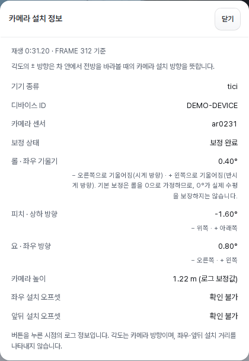

The camera dialog (**카메라 설치 정보** in the replay ⋯ menu) reports device type, dongle ID when available, sensor, calibration status, roll/pitch/yaw and height at the current sample. It distinguishes calibrated/default height. Installation translation offsets cannot be determined from the displayed information.

For camera installation directions viewed from inside the car facing forward:

| Angle | Negative | Positive |
|---|---|---|
| Roll | Right / clockwise | Left / counterclockwise |
| Pitch | Up | Down |
| Yaw | Right | Left |

Calibration normally assumes zero roll; a zero value does not prove a physically level installation.

Speed is based on `carState.vEgo`, not necessarily the dashboard speed. The wheel follows recorded steering angle, turns white with an **개입** ring for `steeringPressed`, and changes appearance with steering control state/torque. It is not a hands-on-wheel or pedal detector.

## Storage, cleanup and backups

The container data root is `/data/roadviewer`, not necessarily the same path on the host. UUID recording directories contain originals, metadata and prepared files. Replay data is gzip-compressed JSON. From 1.0.7 it uses replay format 2, which thins near-straight lane/path coordinates and repeated values, roughly halving the prepared data per segment; older data is rewritten in the background, one log at a time, after the app starts. Data converted by 0.3.14 or earlier is migrated to compressed storage in the background; older application versions may need reconversion to read it.

The cleanup timer checks incomplete uploads every minute; 15 minutes without progress expires them. **저장소 즉시 정리**, under **업로드가 중단되었나요?** on the Upload tab, force-cleans incomplete browser uploads before that timeout, potentially interrupting another browser's upload. It preserves registered recordings, active registration and valid device upload sessions.

Home Assistant app backups exclude originals (ZST, TS, HEVC), MP4s, analysis/graphs, per-recording metadata and upload staging. They retain configuration:

| State | Container path |
|---|---|
| Processing options | `/data/roadviewer/.processing-settings.json` |
| Storage policy and segment pins | `/data/roadviewer/.storage-settings.json` |
| Archive settings (excluding client credentials) | `/data/roadviewer/.archive-settings.json` |
| Device authentication | `/data/roadviewer/.devices.json` |
| NAS archive storage ID (files on the NAS are not backed up) | `/data/roadviewer/.archive.json` |

Supervisor manages external port mappings. Browser preferences are not included in app backups. Restoring a backup does not restore recordings: export them first (**Storage tab → 로컬 저장공간 → 내보내기**) and import the file after the restore (see below). Previously created backup archives are unchanged.

### Export and import

**내보내기** (Export) at the foot of the **로컬 저장공간** (Local storage) card on the Storage tab downloads every recording as one `roadviewer-export-<date>-<time>.tar` file; **내보내기** in selection mode exports only the selected segments. The server streams the file as it builds it, without a copy on disk.

- **Included:** locally stored originals (`rlog.zst` and camera originals, or the MP4 kept instead of an original) and each recording's record: name, upload time, tags, bookmarks, pin, upload filenames, video codec facts and storage locations.
- **Not included:** prepared data, thumbnails and upload staging. Imported recordings are converted again like uploads, following the automatic conversion setting (unconverted when it is off).
- **Drive/NAS files:** never downloaded; only their location (file ID, size, hash) is exported. Imported into an app connected to the same Drive folder or NAS, they play and download as before; otherwise the recording is imported and those files show as an unreachable archive. Upload sessions, tokens and other credentials are never exported.

**불러오기** (Import) takes an exported `.tar`. The browser reads it and uploads one recording at a time, so the server never stores the whole `.tar`: free space for the imported originals is enough. The card shows progress (bytes sent) and a summary: new recordings, recordings skipped because they already exist, and failures with their reason.

- Recording IDs are kept (NAS file paths derive from them). A recording whose ID or original log already exists is skipped.
- Every file is checked against the SHA-256 recorded at export and goes through the upload limits (`max_upload_mb`, per recording) and disk checks. A failed recording never appears in the list.
- **중단** (Stop) or closing the page keeps the recordings already registered; leftover staging is cleaned like an incomplete upload.
- Export files of another format version are refused.

Restart cleans incomplete processing outputs and requeues eligible work; manual conversion can resume with automatic conversion disabled. Decoder-format changes can invalidate prepared data before oldest-first reprocessing. Rendering-only updates do not inherently require reconversion.

## Storage budget and pins

**Google Drive MOVE is extension storage for local data.** With Drive MOVE and permission to delete local originals configured, the local maximum is a **soft limit**; see [Local quota with Google Drive MOVE](#local-quota-with-google-drive-move) for details.

The rejection/eviction rules below describe the existing policies outside effective Drive MOVE. Recordings referencing Drive are always excluded from automatic eviction.

On the **저장공간** (Storage) tab, select unlimited or a byte budget and the full-storage policy. Defaults are unlimited and reject new uploads. Usage, budget, actual free disk and reservations are shown separately.

- **Reject new:** retain existing recordings.
- **Delete oldest unpinned:** group by full route ID and order by earliest upload time, not driving time; delete only unpinned eligible segments.
- **Pin:** set from a segment's ⋯ menu (**구간 고정**) or the replay app bar's pin; a route card's pin covers that route's current segments. A pin affects only its segment, including after restart. New segments do not inherit another segment's pin. Selection mode excludes pins from bulk removal/deletion unless **고정 포함** is on. A pin protects from deletion only: Drive/NAS archiving moves pinned segments like the others, and they stay pinned and playable afterwards. Drive/NAS copies are never deleted automatically.

Incoming/active-upload routes, groups with queued/processing work, and pinned segments are protected. Legacy route pins migrate to existing segments. Short display names are not storage grouping keys.

Reservation requests never delete existing recordings. Chunk uploads reserve declared bytes plus metadata headroom; legacy multipart uploads also allow for a staging copy. A real 100MiB free-disk margin is required. Reclaimable logical quota may be reserved, but uploads still need actual disk space before eviction.

Deletion can occur only after all files have arrived, passed validation/checksums and need registration. Duplicate-only uploads do not trigger eviction. Capacity is preflighted before deleting; locks keep concurrent admission consistent. Completion, cancellation, terminal failure and expiry release reservations. Status polling and device token renewal do not extend idle expiry.

This is an upload-admission budget, not a filesystem quota: conversion output or other disk users can exceed estimates. Lowering the budget does not immediately delete files.

## NAS archiving (experimental)

Archiving moves original videos and log files of converted recordings to network storage (NAS) attached to Home Assistant, freeing local space. It is off by default; while off, nothing changes. There is no feature that moves archived files back to local storage.

### Setup

1. In Home Assistant **Settings → System → Storage**, add network storage with usage **Share**. The app sees it as `/share/<name>`.
2. Create a folder for Road Viewer on the NAS first, for example `/share/<name>/roadviewer`. The app does not create it.
3. In Road Viewer **Storage tab → 아카이빙 기본 설정** (Archive basics), select **NAS · 네트워크 저장소**, enter the path under **실행 및 고급 설정 → 고급 설정**, enable **자동 아카이빙** and press **설정 저장**. Changes apply without restarting.
4. Open the **저장공간** (Storage) tab and check that **NAS 상태** (NAS status) reads **연결됨** (connected).

`archive_path` must be below `/share/`, and a sub-folder is required, e.g. `/share/<name>/roadviewer`; the share itself (`/share/<name>`) is rejected. The first folder name may use letters, digits and underscores; later names may also use dots and hyphens; `..` is rejected. Saving an invalid path is refused. An invalid migrated path disables archiving and reports `settings_error`.

On first connection, and only while `/share/<name>` is actually mounted, the app writes `.roadviewer-storage.json` into the NAS folder and `.archive.json`, holding the same storage ID, into `/data/roadviewer`. The share counts as connected only when both IDs match, so an empty unmounted folder or another installation's folder is never used by mistake. Pointing `archive_path` at a different folder after the first connection shows **연결 불가** (unavailable). Do not delete either file.

### Reading the storage screen

1. **Storage and connection status:** compare local usage, soft limit, actual disk headroom, and outstanding reservations. The selected Drive/NAS has its own connection and capacity display. Expand secondary details for the last run and copy statistics. A full usage bar does not necessarily mean the physical disk is full. **내보내기** / **불러오기** at the foot of the local storage card move recordings to and from a file ([Export and import](#export-and-import)).
2. **Archiving basics:** choose the backend and COPY/MOVE. COPY keeps both verified remote copies and local files. Drive MOVE additionally requires permission to delete local originals, and removes them only after verification. NAS always uses verified moves. Minimum local age offers 7, 14, or 30 days and custom input.
3. **Execution and advanced settings:** choose 1, 6, 12, or 24 hours, or a custom interval. Batch size, NAS path/capacity, and the Drive folder belong under advanced settings. Existing custom values are preserved; stored units remain MB, hours, and minutes.
4. **Current settings summary:** preview the behavior in plain language, then choose **설정 저장** (Save settings). Unsaved, saving, saved, failed, and partially saved states are distinct. A retry saves only remaining changes; manual archiving is disabled while changes are unsaved. Editing the summary alone never starts a MOVE.

**The maximum and start threshold serve different purposes.** In Drive MOVE the maximum is a local soft limit that may be exceeded temporarily, while the archive threshold requests a move. Maximum 0 means unlimited; threshold 0 adds no separate start threshold. If both are positive, admission requests a move at the lower value. Minimum age and protection rules can leave no eligible files.

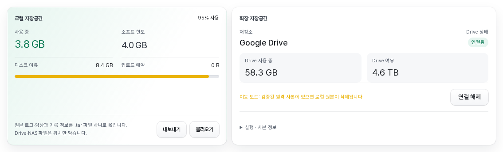

<details>
<summary>Full settings, mobile layout, and advanced settings</summary>

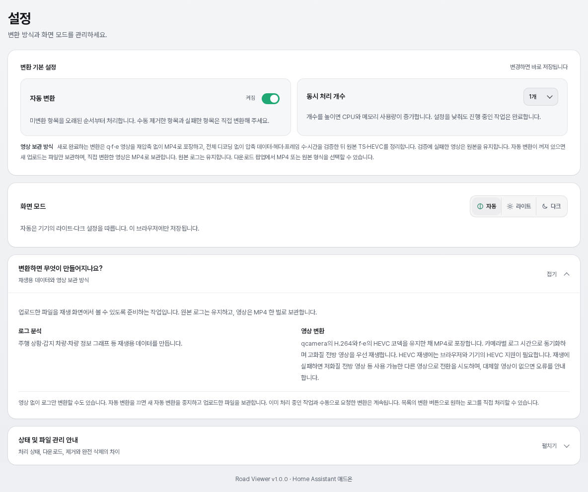

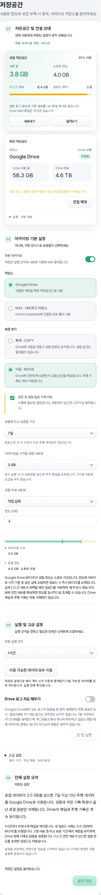

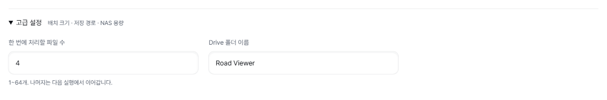

</details>

### Web UI settings

Use **Storage tab → 아카이빙 기본 설정** (Archive basics) for enabled, backend, mode, local deletion permission, minimum age and local usage criteria. **실행 및 고급 설정** contains the interval and an expandable advanced section for batch size, NAS path/capacity and the Drive folder. Presets and custom inputs preserve the existing hour/minute/MB values. **현재 설정 요약** previews draft behavior; only **설정 저장** applies it. Partial saves identify remaining changes and retries save only those changes. The start threshold is entered in GB with decimals (e.g. 2.5) and stored as MB (1 GB = 1024 MB); the custom local storage limit also accepts decimal GB. MB means 1024² bytes. NAS always moves after verification regardless of the mode selector. The keys below identify saved preferences, rather than add-on options.

Preferences are written atomically to `/data/roadviewer/.archive-settings.json` with mode 0600. Only `archive_gdrive_client_id` and `archive_gdrive_client_secret` remain add-on options; neither value is returned by the API or shown in the web UI. On the first update, if the file is absent, the old archive options in `/data/options.json` are migrated once. Enabled and disabled values are preserved, with defaults for missing fields. Afterwards the file is authoritative and old keys are ignored. Since 1.0.30 the old archive keys are no longer in the add-on configuration.

An unreadable/corrupt file or invalid migrated values disable archiving and show `settings_error`. The bad file is left untouched until the user saves from the UI. Saving is refused while a cycle runs. Saving starts no archive, deletion or eviction: startup and each save wait a full configured interval. **이동 가능한 데이터 모두 이동 / 복사 가능한 데이터 모두 복사** (Archive now) can run it manually. Migration never changes the token, storage identity or recordings.

| Option | Default | Range | Meaning |
|---|---|---|---|
| `archive_enabled` | `false` | — | Enable archiving |
| `archive_path` | empty | below `/share/` | NAS folder |
| `archive_local_threshold_mb` | `0` | 0 or more | Move files only while Road Viewer's local usage exceeds this. `0` moves whenever there is something eligible. |
| `archive_min_age_hours` | `24` | 0–8760 | Only recordings uploaded at least this long ago |
| `archive_interval_minutes` | `1440` (24 h) | 1–1440 | Interval between automatic runs |
| `archive_batch` | `4` | 1–64 | Maximum files moved per run |
| `archive_nas_max_mb` | `0` | 0 or more | Usage limit of the NAS folder; `0` means unlimited |
| `archive_nas_margin_mb` | `1024` | 0 or more | Clean up when NAS free space falls below this. Free space is measured on the whole NAS volume. |

### Manually move or copy all eligible data

Choose **이동 가능한 데이터 모두 이동** (Move all eligible data) or **복사 가능한 데이터 모두 복사** (Copy all eligible data) to open a confirmation based on saved settings. Review file/segment counts, size, expected freed space for MOVE, and exclusions. No transfer or deletion occurs before confirmation.

Only the scheduled **batch size and start threshold** are bypassed while the existing engine repeats. Minimum age and in-use protection remain; pinned recordings are moved like the others. Drive MOVE without local-delete permission is presented as COPY. Only verified, committed local files are removed; remote files are never deleted, and verified copies are not uploaded again.

Progress and success/failure counts are shown; settings changes and duplicate runs are blocked. The buttons are disabled while automatic archiving runs or settings are unsaved. Reload restores server-side job state. A restart-interrupted run is shown as interrupted, not successful. Failed or unprocessed files retain their originals. A Drive outage or authentication error stops the run.

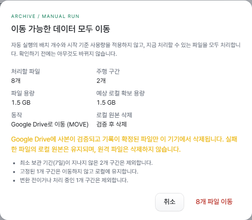

### What moves, in which order

Converted (playable) recordings older than `archive_min_age_hours` move oldest upload first. Within a recording, videos (MP4, HEVC, TS) move first and `rlog.zst` last. **Pinned segments are archived too:** a pin protects from deletion, not from moving.

`meta.json` and the converted replay/graph data never leave local storage. The library and road/vehicle replay therefore keep working while the NAS is unreachable.

Each file is copied to the NAS, flushed to disk, read back and compared by hash, renamed into place and recorded in the index; only then is the local file deleted. If any step fails or the app stops, the local original stays, and leftover partial copies are cleaned up on the next start.

### When it runs

Startup and settings saves wait `archive_interval_minutes` before running. Recovery of interrupted work happens in the first run. Each run checks the NAS connection and then:

1. Completes deletions postponed because the NAS was unreachable.
2. Cleans up the NAS if it is over its limit or low on free space (see below).
3. Requeues conversions postponed because the NAS was unreachable.
4. Moves files. Nothing is moved this time while an upload is being received, a conversion is running, or local usage is at or below `archive_local_threshold_mb`.

A run stops when the NAS is unreachable, NAS free space is below the file size plus 100MiB, a hash does not match, or copying fails; the next interval retries. An upload starting during a run lets the current file finish and then ends the run.

The **저장공간** tab shows **NAS 상태 / NAS 사용 중 / NAS 여유 / 마지막 아카이브** (status, used, free, last run) and the latest error. Secondary statistics and recent results are under **실행 · 사본 정보** (Run and copy details). To run it by hand, see [Manually move or copy all eligible data](#manually-move-or-copy-all-eligible-data).

### Video states

With archiving on, the library's video label has these states.

| Label | Meaning | Playback, download, conversion |
|---|---|---|
| 영상 있음 (video available) | Stored locally, or on the connected NAS according to the index. The list does not check each NAS file, so a NAS copy that went missing shows as no video when played. | As usual |
| 저장소 연결 불가 (storage unavailable) | The video is on the NAS, which cannot be reached now | Playback switches to another camera or, if none, shows “영상 저장소에 연결할 수 없습니다. NAS 연결을 확인하세요.” and continues without video. Downloads fail; ZIPs are never built partially. Conversion is refused with “저장소 연결 후 다시 시도하세요.” |
| 영상 없음 (no video) | No video registered, removed by NAS cleanup, or not found on the connected NAS. A file not found is never recorded as removed: its index entry stays, so it shows as available again once the NAS shows it. Only NAS cleanup records a removal. | Replay without video |
| 영상 확인 중 (checking) | The NAS connection is being checked | The replay page retries automatically shortly |
| 영상 읽기 오류 (read error) | The stored copy failed verification during recovery: neither the copy present on the NAS nor the leftover local file matches the record. A missing NAS copy alone never leads here, and the state clears at the next start once the NAS copy matches the record again. | Cannot be played or downloaded. Conversion of the recording is refused so its converted video is kept. |

### When the NAS is unreachable

An unreachable NAS never causes file deletion, removal of converted data or reconversion. Restarting the app keeps converted data of recordings with files on the NAS. Such recordings are checked once when the NAS first connects after the restart, and are reconverted (after a log analysis format change or with converted data missing) only if all their files on the NAS can be read. Queued conversions are postponed with “저장소에 연결할 수 없어 변환을 미뤘습니다.” and requeued once the NAS answers. Adding a new camera video to a recording with files on the NAS is refused while the NAS is unreachable (“저장소 연결 후 다시 시도하세요.”) and is not queued; upload it again once connected. Adding a camera video to a recording whose original log on the NAS is damaged or missing is refused (“원본 로그가 없어 영상을 추가할 수 없습니다. 로그와 영상을 함께 다시 업로드하세요.”) and its converted data is kept; delete the recording completely, then upload the log and videos together again.

With the **delete oldest unpinned** storage policy, recordings with files on the NAS are excluded from automatic deletion while it is unreachable; when it is connected, automatic deletion removes their NAS files too. **Reject new** is recommended together with archiving.

### Deletion

**완전 삭제** (Delete permanently) removes local data immediately and the NAS files as well. If the NAS is unreachable, the files to delete are recorded in `/data/roadviewer` and removed by the next run after it reconnects.

### NAS cleanup

When the NAS folder exceeds `archive_nas_max_mb` or NAS free space falls below `archive_nas_margin_mb`, NAS files are removed in this order. Free space is measured on the whole NAS volume, so other data growing on the same volume can trigger cleanup of archived videos.

1. Videos of unpinned recordings, oldest upload first.
2. If still short, `rlog.zst` of unpinned recordings, oldest first.

Files of pinned segments and of recordings waiting for or undergoing conversion are never removed. `meta.json` and converted data stay, so a recording without its videos replays without video, and one without `rlog.zst` still replays but cannot be reconverted or have its original log downloaded. Restarting the app keeps the converted data of such recordings. **Videos removed by cleanup can only be restored by uploading the same log and videos again** (**Add video later** under [Uploading files](#uploading-files)). Cleanup records its intent in the index before removing a file and records the removal after it. If the app stops in between, the next start clears the intent when the file is still there and records the removal when it is gone. A file that is merely not visible on a connected NAS (for example right after a reconnect) shows as no video but is never recorded as removed. Files an earlier version recorded as removed because it could not find them are restored at the next start when the NAS holds their recorded content. SMB-specific behaviours (stale file handles, cache delays, power loss) were only simulated, not tested on a real SMB share. While space stays short, runs continue on every interval and retry cleanup; only moving files pauses until space is freed, and the Storage tab shows the error.

### Backups

Files on the NAS are not part of Home Assistant backups. `.archive-settings.json`, the add-on options containing client credentials, and `/data/roadviewer/.archive.json`, holding the storage ID, are backed up with the app configuration. Back up the NAS itself separately.

## Google Drive archiving (experimental)

Google Drive can be used as the archive instead of a NAS. It is experimental and off by default (`archive_enabled: false`, `archive_backend: smb`). Nothing changes while archiving is off or uses the NAS.

- **Copy mode is the default.** Each file gets a verified copy on Drive and **the local file is never deleted**, so copy mode frees no local space.
- **Move mode** (the local original is deleted once a verified copy exists) needs **both** settings saved in the web UI under **저장공간 tab → 아카이빙 기본 설정**: **보관 방식** (storage mode) set to **이동 · MOVE** and **검증 후 로컬 원본 삭제 허용** (allow deleting local originals after verification) turned on (saved keys `archive_mode: move`, `archive_allow_local_delete: true`; these are not add-on options). With either one missing, Drive runs in copy mode. Drive move mode was verified on a real Drive account with one segment in a test environment. In move mode the local maximum acts as a soft limit, and recordings with Drive files or copies are excluded from automatic deletion (see [Local quota with Google Drive MOVE](#local-quota-with-google-drive-move)).
- **This version has no automatic Drive cleanup.** Files on Drive are deleted only for recordings the user deletes with **완전 삭제** (Delete permanently).
- There is no feature that moves files on Drive back to local storage.

### Preparing an OAuth client

Road Viewer signs in with Google's device flow (entering a code), so it needs an OAuth client of your own.

1. In the [Google Cloud console](https://console.cloud.google.com/), create or pick a project and enable the **Google Drive API**.
2. Configure the **OAuth consent screen**. For personal use without publishing the app, add the Google account you will use as a test user.
3. Choose **Credentials → Create credentials → OAuth client ID** with application type **TV and Limited Input devices**.
4. Enter the client ID and client secret in the app options `archive_gdrive_client_id` and `archive_gdrive_client_secret`.

Road Viewer asks for a single scope, `drive.file`. With it the app sees **only the folder and files it created**; it cannot read or change any other file in the account's Drive.

### Drive settings

The [common web UI settings](#web-ui-settings) (`archive_enabled`, `archive_local_threshold_mb`, `archive_min_age_hours`, `archive_interval_minutes`, `archive_batch`) mean the same for Drive. `archive_path` and `archive_nas_*` apply to the NAS only. Only client ID/secret are add-on options; other settings apply immediately when saved in the web UI. Folder names must contain 1–255 characters after trimming and name the folder created on first setup. Changing the name or switching backends preserves an already bound folder and its token.

| Key | Default | Meaning |
|---|---|---|
| `archive_backend` | `smb` | `smb` (NAS) or `gdrive`; **저장소** (storage) in the web UI |
| `archive_mode` | `move` | `move` or `copy` (**보관 방식** in the web UI). On Drive, `move` applies only together with `archive_allow_local_delete: true`; otherwise it is always copy, so with the defaults Drive runs in copy mode. Drive move mode was verified on a real Drive account with one segment in a test environment. The NAS moves as before. |
| `archive_allow_local_delete` | `false` | **검증 후 로컬 원본 삭제 허용** in the web UI. Allow deleting the local original once Drive holds a verified copy. Drive only. The Drive move mode it enables was verified on a real Drive account with one segment in a test environment. |
| `archive_gdrive_client_id` | empty | OAuth client ID (TV and Limited Input devices type) |
| `archive_gdrive_client_secret` | empty | OAuth client secret (password field) |
| `archive_gdrive_folder_name` | `Road Viewer` | Name of the dedicated folder created on Drive at the first connection |

`archive_local_threshold_mb` still applies in copy mode: copies are made only while local usage exceeds it, and since copying deletes nothing, usage does not go down. `0` copies whenever there is something eligible.

### Connecting Drive

1. Set client ID and secret in the add-on options, save and restart the app. Then select **Google Drive** under **저장공간 tab → 아카이빙 기본 설정** (Archive basics) and save. Turn on **자동 아카이빙** (automatic archiving) there to copy files. With archiving off the account can still connect; the **이동 가능한 데이터 모두 이동 / 복사 가능한 데이터 모두 복사** (Archive now) button and Drive usage and copy rows are hidden.
2. Open the **저장공간** (Storage) tab and press **Google Drive 연결** (Connect Google Drive) in the extension-storage (Google Drive) card; with archiving off it appears in a separate Google Drive card. The panel shows a code, the address (`https://www.google.com/device`) and the time left.
3. On any device (phone, PC), open that address in a browser, enter the code and approve with the Google account to use.
4. While the panel is open it checks for approval. Once approved the code disappears and **Drive 상태** (Drive status; **Drive 계정** with archiving off) reads **연결됨** (connected). The first connection creates the folder named in the settings. When connected with archiving off, the folder is created in the first run after archiving is enabled.

Without a client ID the panel shows “애드온 옵션에서 Google Drive 클라이언트 ID를 설정하세요” (set the Google Drive client ID in the add-on options) and the connect button is disabled. An expired or refused code shows why, and you can connect again. When the sign-in expires, a **다시 연결** (Reconnect) button appears; reconnecting keeps using the same folder. The device flow needs no redirect address, external port, or router/firewall change.

**연결 해제** (Disconnect) asks for confirmation, deletes the token file on this device at once and asks Google to revoke the token in the background; the device is disconnected even if the revoke fails. **The index, the local files and the files on Drive are left as they are.** An upload in progress stops before its next chunk and shows “연결이 해제되어 업로드를 중단했습니다. 다시 연결하세요” (disconnected, upload stopped; reconnect). Drive archiving and playback of files moved to Drive stop while disconnected. The **연결 해제** button and the move-mode notice are in the same Drive card. After reconnecting, the same folder is found and the stopped upload continues where it left off.

### Copy mode and move mode

**Copy mode** (default): each file is uploaded, verified by comparing the sha256 Drive reports (or its md5 when there is none, or else the sha256 of a downloaded copy) with the local file, and its copy recorded in the index. The local file stays; while it exists, playback, downloads and conversion always use it. The panel shows “복제 모드: 로컬 파일은 보존됩니다” (copy mode: local files are kept). Copy mode has been verified on a real Google account (2026-11-04).

**Move mode** (**이동 · MOVE** + **검증 후 로컬 원본 삭제 허용** in the web UI, verified on a real Drive account in a test environment): upload → verify → the index committed to disk, and only then the local original is deleted. The panel warns “이동 모드: 검증된 원격 사본이 있으면 로컬 원본이 삭제됩니다” (move mode: local originals are deleted once a verified remote copy exists). Pinned segments are moved too (a pin only blocks automatic and bulk deletion). Switching from copy to move mode reuses the copies already verified instead of uploading them again, then deletes the local files.

Moved files are streamed from Drive through the same addresses as before for playback and downloads (range requests supported). So that seeks are quick, the Drive video being watched is also fetched whole into the app's memory in the background, and ranges already received are served without Google. Browsers read only a little ahead while paused, so the replay page also reads the current segment's whole video (from that copy) in the background and switches to it while paused (up to 256 MB); every seek within the segment is then immediate and the seek bar shows it loaded to the end. Local videos work the same way. Only that one video is held: opening another video or camera drops it, and it is freed after 10 minutes unwatched. Files larger than 256 MB are not held and stream straight from Drive; a finished copy whose SHA-256 differs from the index is discarded. Nothing is written to disk, and downloads never use it. Playback responses may stay in the browser's private cache for an hour (`private, max-age=3600`), so seeks into ranges already received are immediate; download responses are not cached. Work that needs a local file, such as original-format export or reconversion, downloads a temporary copy from Drive, checks its sha256, uses it and deletes it. With less local free space than the file size plus 100MiB, the download fails with “보관된 파일을 내려받을 디스크 공간이 부족합니다.” (not enough disk space to fetch the archived file) and a conversion is postponed with “디스크 공간이 부족해 변환을 미뤘습니다.” (conversion postponed for lack of disk space).

When a conversion replaces an original video with its MP4 and the original's Drive copy has the same content, that copy becomes the stored original and is served from Drive. The new MP4 is uploaded by the next run.

### Drive runs and recovery

Runs follow the same schedule and conditions as the NAS. Startup and settings saves wait a full `archive_interval_minutes`; the first run finishes interrupted work. A run checks Drive and then measures Drive usage → processes postponed Drive deletions → requeues postponed conversions → uploads. Usage is measured before deletions, so space they free shows from the next run's figure. There is no step like NAS cleanup. A run stops when Drive is unreachable, sign-in expired, a rate limit is hit, Drive is full or verification fails; the next interval retries. None of these failures causes a local deletion or index change.

Uploads are resumable, in 16MiB chunks, over a reused connection to Google rather than a new one per chunk. The upload session is recorded in the index before the first chunk, so after an interrupted run the next start continues from where Drive stopped. If the answer to the last chunk was lost, or the app stopped before verification or the index commit, the completed file on Drive is found, verified and recorded without uploading it again. If move mode stopped after the commit and before deleting the local file, the next start verifies the Drive copy again and then deletes it. If a conversion stopped after replacing a file and before saving the index, the next start drops only the record of the copy that describes the previous content (the Drive file stays) and the new content is copied again. If a moved file's Drive copy no longer verifies but the local file left behind still matches the index, that local file is used again and a fresh copy is uploaded by the next run; the bad Drive file is left in place. Empty (0-byte) files are skipped by Drive archiving with a warning.

### Drive status and errors

The **저장공간** tab shows **저장소 / Drive 상태 / Drive 사용 중 / Drive 여유 / 복제 사본 / 복제 사본 용량 / 검증 실패 / 마지막 아카이브** (storage, Drive status, used, free, copies, copy size, failed verifications, last run). **Drive 상태** is one of **연결 안 됨** (not connected: before signing in or after disconnecting), **연결됨** (connected), **연결 불가** (unavailable), **확인 중** (checking) or **인증 만료** (sign-in expired). The panel does not ask Drive on each request; it shows the last check, and checks run in the background, so the panel opens at once even when Drive does not answer.

Last archive errors:

| Code | Shown |
|---|---|
| `storage_unavailable` | Google Drive에 연결할 수 없습니다. (Drive unreachable) |
| `auth_expired` | Google Drive 인증이 만료되었습니다. 다시 연결하세요. (sign-in expired) |
| `rate_limited` | Google Drive 요청 한도를 넘었습니다. 다음 주기에 다시 시도합니다. (rate limited, retried next interval) |
| `remote_full` | Google Drive 공간이 부족합니다. (Drive full) |
| `hash_mismatch` | Google Drive 사본 검증에 실패했습니다. (copy failed verification) |
| `os_error` | Google Drive에 파일을 올리지 못했습니다. (upload failed) |

Sign-in errors:

| Code | Shown |
|---|---|
| `access_denied` | 사용자가 승인을 거부했습니다 (the user refused) |
| `code_expired` | 코드가 만료되었습니다. 다시 연결하세요 (code expired) |
| `auth_expired`, `invalid_grant` | 인증이 만료되었습니다. 다시 연결하세요 (sign-in expired) |
| `invalid_client` | 클라이언트 ID/비밀키가 올바르지 않습니다 (wrong client ID or secret) |
| `signed_out` | 연결이 해제되어 업로드를 중단했습니다. 다시 연결하세요 (disconnected during an upload) |
| any other code | 인증 오류 (code) |

Error codes of the connect and retry requests: `409 gdrive_not_selected` (the archive is not Google Drive), `409 gdrive_not_configured` (no client ID), `409 gdrive_connected` (already connected), `503 gdrive_unavailable` (Google unreachable), `502 gdrive_auth_failed` (Google refused the client; `reason` holds the code), and for retry `409 no_archive_error` (nothing to retry), `400 invalid_archive_retry` (invalid request body) and `404` (unknown recording).

Videos on Drive use the same labels as the [NAS video states](#video-states). When Drive is unreachable the message is “영상 저장소(Google Drive)에 연결할 수 없습니다. 인터넷과 Google Drive 연결을 확인하세요.” (cannot reach Google Drive; check the internet and the Drive connection). A file deleted on Drive answers not found when played, but its index entry is never changed or recorded as removed; recovery at startup counts such files. The list does not check each Drive file. In copy mode a local file plays whatever the Drive state.

**Failed verification**: when an uploaded copy does not match the local file, the file is marked and both the local file and the Drive copy are kept. The local file still plays and is not uploaded again on every run. The recording's row shows “원격 사본 검증에 실패했습니다. 로컬 파일은 유지됩니다.” (the remote copy failed verification; the local file is kept) and a **재시도** (Retry) button, which clears the mark so the next run uploads it again. The mismatching Drive copy is not deleted automatically.

### Quota and Drive space

Drive is **extension storage, not a backup**. Archive runs measure usage; the panel displays the most recent measurement. Unknown quota is shown as **할당량 확인 불가** (`usage_reliable: false`). A full Drive stops the cycle with `remote_full` and preserves originals.

### Local quota with Google Drive MOVE

**Google Drive MOVE is extension storage for local data.** With Drive MOVE and permission to delete local originals configured, the local maximum is a **soft limit**. When archiving is enabled, reaching that limit or the archive start threshold requests a background move through the existing archiver; when both are positive, the lower value is used. Uploads can temporarily exceed the limit while physical disk space covers other uploads’ outstanding reservations, temporary files, and a **100 MiB safety margin**. Admission does not wait for a Drive transfer to finish.

MOVE deletes only the corresponding local file after remote transfer, integrity verification, and index commit. Minimum age, in-use protection, batch limits, and the shared cycle lock remain enforced. Pinned segments are moved too, but only after every unpinned candidate, when space is still short. Drive outages and verification failures preserve originals and records. Uploads continue while physical headroom is sufficient; otherwise new uploads are rejected without deleting existing records. Disabling archiving prevents moves; configured Drive MOVE still uses the soft limit, with physical disk headroom controlling upload admission.

Moved recordings **remain listed, playable, and downloadable**. Automatic local reclamation never deletes Drive files or recordings referencing them, including COPY references. Only explicit **Delete permanently** can enqueue remote deletion. Unattributed deletion intents from older versions are retained without automatic execution.

An explicit **Delete permanently** queues the recording’s moved files and verified copies for remote deletion. The request itself does not call Drive synchronously; the existing engine processes it when connected. Files from another installation are never deleted. Failed verification copies and superseded copies after reconversion are not automatically cleaned up. Removing an indexed file directly in Drive makes playback/download report not found.

### Drive backups and security

- The Drive sign-in (refresh token) is stored in `/data/roadviewer/.gdrive-auth.json` (mode 0600) and the Drive storage ID in `/data/roadviewer/.archive.json`. Both files and the app options (including the client secret) **are part of Home Assistant backups.** Anyone holding a backup can reach Road Viewer's Drive folder, so **keep backups as safe as a password.** Do not delete either file.
- Files on Drive are not part of Home Assistant backups.
- No new port is opened. All traffic with Google (sign-in and Drive) is outgoing HTTPS from the app to Google; Google never connects to the app.
- Changes such as connect, disconnect and retry are accepted only through the Home Assistant Supervisor (Ingress), like every other settings change.
- Tokens, the client secret, upload session addresses and Drive file IDs are never shown in the UI, API responses or logs.

### Validation scope and limits

The 0.13.1 work verified connection, COPY/MOVE, integrity checks, local deletion, Range playback, and original-format download against real Google Drive in a test environment. Automated regression tests use `tests/fake_drive.py`. These real-account checks were not repeated for this documentation/screenshots update, and no operational data was changed.

This does not establish recovery from unwritten data lost on power failure, long-term real quota/rate-limit behavior, every mid-stream remote failure under gunicorn, or every Google Cloud/OAuth account configuration.

## Connecting a comma device

1. Prepare a trusted certificate and key under Home Assistant `/ssl`.
2. Set `device_certfile` and `device_keyfile` to filenames directly under that directory, such as `fullchain.pem` and `privkey.pem`.
3. On the **장치** (Devices) tab, enable **외부 연결** (external access), choose a free HTTPS host port, save, then press **지금 재시작**. Only Road Viewer restarts.
4. Forward the selected external TCP port to that Home Assistant host port. Never expose Ingress 8099 or private upstream 8098.
5. Press **새 장치 연결** on the same tab and enter the HTTPS base URL and one-time code in the compatible comma/Carrot Web uploader.

Codes last five minutes, work once, and support copy, cancel and reissue. A new code invalidates the old one; successful pairing changes Cancel to Close. Issuing another code does not disconnect previously paired devices.

Nginx exposes only `/api/device/` on external HTTPS. Long-term credentials are returned once and later used for HMAC, not sent again. Certificate renewal is external; the app reloads valid updated certificate files.

**연결 해제** blocks new and subsequent authenticated requests. **목록 제거** removes a disconnected registration without deleting recordings; reconnect by pairing again. Device sessions have a two-hour absolute lifetime and 15-minute idle timeout. Valid partial device transfers can survive app restarts.

The old `device_api_enabled` option is unused. Remove a leftover option if Home Assistant reports it invalid. Saving a port differs from applying it; restart after ongoing uploads/playback finish. Missing/invalid TLS fails closed.

### Testing without openpilot

When external HTTPS is enabled, open `https://<domain>:<port>/api/device/test`. Pair and use virtual files or small real rlog/qcamera files, then create/resume a session, upload and finish. The page limits files to 64MiB because hashing uses browser memory. It supports interrupted transfer, invalid-signature and nonce-replay checks.

This uses the real API and storage policy. Virtual files are not real driving logs and will fail conversion. Keys/tokens stay in page memory; refreshing requires pairing again. Direct local HTML and Ingress access to this page are unsupported.

See the [English API specification](../docs/device-api.en.md) or [한국어 API 문서](../docs/device-api.md) for exact authentication, limits, recovery and test commands.

## Troubleshooting and validation

For stalled uploads, inspect file access, connectivity, capacity and the library's error. Application `Upload failure` logs include phase, offset, elapsed time, browser byte counters and error code. Browser bytes do not prove server persistence. Retry failed conversion after reading its reported cause.

CI covers both platforms, dependency/image security, real container HTTPS isolation, upload/storage/conversion and browser behavior. Actual Home Assistant performance and native Android file selection depend on the environment.

The bundled openpilot schema may need updating for sufficiently different log formats. See [schema licensing](schema/OPENPILOT-LICENSE) and the historical [changelog](CHANGELOG.md).


## Documentation screenshots

Screenshots were captured on 2026-11-07 from version 1.0.0 (branch `feature/ui-redesign`) with example data, not real devices, accounts, or private driving logs; the three introduction photos composite the earlier footage into the new UI. Pairing codes cannot connect a device. See the [image inventory and capture scope](../docs/images/README.en.md).
