# 설치 및 사용

현재 설명은 **1.2.22**의 기능을 기준으로 합니다.

한국어 · [English](DOCS.en.md)

처음 사용하는 경우 **업로드 탭 → 파일 추가 → 업로드 → 변환 → 재생** 순서로 시작하세요. 아래에서 필요한 작업을 찾아볼 수 있습니다.

- [화면 구성](#화면-구성)
- [파일 업로드](#파일-업로드)
- [로그 목록과 변환](#로그-목록과-변환)
- [로그 일괄 관리](#로그-일괄-관리)
- [구간 태그](#구간-태그)
- [장면 북마크](#장면-북마크)
- [재생 화면과 배치](#재생-화면과-배치)
- [주행 경로 지도](#주행-경로-지도)
- [저장소 정리·백업·업데이트](#저장소-정리백업업데이트)
- [저장공간 제한과 고정](#저장공간-제한과-고정)
- [NAS 아카이빙 (실험 기능)](#nas-아카이빙-실험-기능)
- [Google Drive 아카이빙 (실험 기능)](#google-drive-아카이빙-실험-기능)
- [외부 comma 장치 연결](#외부-comma-장치-연결)

## 설치와 접속

Home Assistant 앱 스토어의 저장소에 `https://github.com/Qualified4/roadviewer-ha`를 추가하고 **Road Viewer**를 설치·시작합니다. **웹 UI 열기** 또는 사이드바로 접속합니다. Home Assistant 버전에 따라 ‘앱’이 ‘애드온’으로 표시됩니다. HACS용 통합 구성요소가 아닙니다.

설치·업데이트는 GHCR에 미리 빌드한 이미지를 내려받습니다. 지원 플랫폼은 **amd64(Intel/AMD 64비트)**와 **aarch64(ARM 64비트)**이며, 기기에 맞는 이미지 하나만 받습니다. 여러 플랫폼을 배포해도 다른 플랫폼의 이미지까지 다운로드하지 않습니다. 32비트 ARM과 i386은 지원하지 않습니다.

Home Assistant가 제공하는 다운로드·압축 해제 진행률을 사용할 수 있습니다. 표시 방식은 Home Assistant/Supervisor 버전에 따라 다르며, 앱 시작까지의 남은 시간을 뜻하지 않습니다. 캐시된 이미지 계층은 재사용하므로 진행률이 건너뛸 수도 있습니다.

소스를 수정해 로컬 설치하려면 `roadviewer` 폴더를 Home Assistant의 `/addons/roadviewer`에 복사하고, 복사본 `config.yaml`의 `image:` 항목을 제거한 뒤 빌드합니다. `image:`를 유지하면 로컬 소스 대신 배포된 이미지를 사용합니다. 개발용 직접 빌드는 기존 Dockerfile로도 가능합니다.

원격 접속은 기존 Home Assistant 원격 주소로 로그인한 뒤 앱을 여세요. Ingress를 사용하므로 별도 Road Viewer 포트 개방은 필요하지 않습니다. Home Assistant Container에는 Supervisor 앱 스토어가 없으므로 이 방식으로 설치할 수 없습니다.

## 화면 구성

로그 목록 화면은 페이지 안의 탭 다섯 개로 나뉩니다. 넓은 화면에서는 상단, 휴대폰에서는 하단 탭 바에 표시합니다.

| 탭 | 내용 |
|---|---|
| 로그 | 검색, 필터 칩, 날짜별 주행 카드, 구간별 ⋯ 메뉴, 선택 모드(일괄 관리), 저장공간 요약 |
| 업로드 | 파일 추가·드래그 앤 드롭, 업로드 진행, 저장소 즉시 정리 |
| 저장공간 | 사용량·한도·삭제 정책, NAS·Google Drive 아카이빙 |
| 장치 | 외부 comma 장치 HTTPS 연결과 페어링 |
| 설정 | 자동 변환, 동시 처리 개수, 화면 모드, 변환·파일 관리 안내, 버전 |

**화면 모드**는 **자동 / 라이트 / 다크** 중에서 고릅니다. 자동은 기기의 라이트·다크 설정을 따르며 선택은 이 브라우저에만 저장됩니다. 재생 화면의 영상 영역은 화면 모드와 관계없이 어두운 배경을 유지합니다. 재생 화면의 ⋯ 메뉴에서도 같은 설정을 바꿀 수 있습니다.

## 파일 업로드

**업로드** 탭의 **파일 추가**에서 파일을 선택하거나 업로드 영역에 파일을 끌어다 놓은 뒤 **업로드**를 누릅니다. 업로드 중 다른 탭으로 옮겨도 전송은 계속되며, 헤더의 진행 표시(`업로드 N%`)로 진행률을 확인할 수 있습니다. 장치나 다른 브라우저에서 올리는 업로드도 같은 표시에 나타납니다(3초마다 갱신). 여러 파일을 한 번에 선택하거나 한 개씩 반복해서 추가할 수 있습니다. 업로드 전 **선택 비우기**로 선택을 지울 수 있습니다.

드래그 앤 드롭은 기존 선택 목록에 파일을 추가하며, 같은 이름의 선택 파일은 교체합니다. 실제 전송은 **업로드**를 눌러야 시작합니다. 폴더 자체는 추가할 수 없습니다. 지원 형식은 `rlog.zst`, 저용량 전방 `qcamera.ts`, 고화질 전방 `fcamera.hevc`, 와이드 `ecamera.hevc`입니다. 앱에서 내려받은 `qcamera.mp4`(또는 `camera.mp4`), `fcamera.mp4`, `ecamera.mp4`도 같은 구간의 `rlog.zst`와 함께 다시 업로드할 수 있습니다. 저용량 전방 MP4는 H.264, 고화질·와이드 MP4는 HEVC를 사용합니다. 같은 카메라의 원본과 MP4를 동시에 선택할 수 없으며, 이미 저장된 영상은 덮어쓰지 않습니다. 운전자 카메라는 지원하지 않습니다.

단일 구간은 다음 파일명을 사용합니다.

```text
rlog.zst
qcamera.ts
fcamera.hevc
ecamera.hevc
```

영상 세 종류는 선택 사항입니다. 없는 영상은 제외하고 로그만 올릴 수 있습니다.

여러 구간은 아래처럼 루트 ID와 구간 번호가 포함된 파일명을 사용합니다. 여러 루트와 연속되지 않은 구간 번호도 함께 올릴 수 있습니다.

```text
0000035f--b513269850--0--rlog.zst
0000035f--b513269850--0--qcamera.ts
0000035f--b513269850--0--fcamera.hevc
0000035f--b513269850--0--ecamera.hevc
0000035f--b513269850--5--rlog.zst
0000035f--b513269850--5--qcamera.ts
```

- **로그만 업로드:** 변환 후 영상 없이 주행 상황·차량 정보를 재생할 수 있습니다.
- **영상 나중에 추가:** 기존과 동일한 로그 파일을 새 영상과 함께 선택해 업로드합니다. 기존 항목에 영상이 추가되고 변환 설정에 따라 다시 처리합니다.
- **영상만 업로드:** 등록할 수 없습니다. 짝이 되는 로그를 함께 선택하세요.
- 같은 원본 영상을 다시 올려도 저장된 해시로 중복을 판별해 보관 MP4와 분석 결과를 유지합니다. 원본 형식 파일은 다운로드 팝업에서 만들 수 있습니다.
- **다른 영상으로 교체:** 이미 보관 중인 영상을 다른 영상으로 덮어쓰지는 않습니다. 교체하려면 기존 항목을 완전 삭제하고 로그·영상을 다시 업로드합니다.

### 중복 판정

원본 `rlog.zst`의 SHA-256으로 비교합니다. 이름을 바꾼 동일 파일은 건너뛰고, 이름이 같아도 내용이 다르면 별도 로그로 등록합니다. 압축을 다시 만든 파일은 별개로 판정될 수 있습니다.

중복 판정은 전송 후 등록 단계에서 수행하므로 파일 전송은 발생하지만 중복 저장·변환은 하지 않습니다. 기존 로그에 없던 영상을 추가하거나, 원본 영상이 누락된 보관 자료에 영상을 추가하는 경우는 예외입니다. 이미 저장된 중복 항목을 자동으로 삭제하지는 않습니다.

### 용량 제한과 모바일

| 항목 | 제한 또는 동작 |
|---|---|
| 한 번에 선택한 파일 수 | 최대 100개 |
| 한 번에 업로드할 파일의 합계 | 기본 512 MB, 앱 설정 `max_upload_mb`에서 16~2048 MB |
| 압축 해제된 단일 로그 | 최대 512 MB |
| 변환 작업 제한 시간 | 작업당 10분 |
| 업로드 전송 단위 | 256 KiB 조각, 일시적 전송 실패 시 최대 5회 재시도 |
| 외부 장치 한 번의 업로드 | 최대 50구간, 200개 파일, 합계 8 GiB |
| 외부 장치 영상 파일 | 파일당 최대 2 GiB, 로그(`rlog.zst`)는 `max_upload_mb` 이하 |

`max_upload_mb`는 **업로드 한 번의 합계 제한**이며 전체 저장 용량 제한이 아닙니다. 화면의 MB 설정값은 내부에서 1024 단위로 계산합니다. 업로드 가능한 용량은 업로드 버튼 아래에 표시합니다.

Android Home Assistant 앱의 파일 선택창에서 다중 선택이 정상 반환되지 않으면 **파일 추가**를 반복해 한 개씩 선택할 수 있습니다. 폴더 선택과 파일 선택 진단 UI는 제공하지 않습니다. 업로드 중 앱을 닫거나 파일 접근 권한이 끊기면 실패할 수 있으며, 재접속 후에는 파일을 다시 선택해 업로드하세요. 실패한 업로드는 정리 대상이 됩니다.

## 로그 목록과 변환

**로그** 탭 상단에는 로그 검색과 필터 칩이 있습니다. 검색은 로그 이름·태그·날짜(출발·업로드)에서 찾고, 필터 칩은 **전체**, **고정**, **미변환**(변환 실패 포함), **처리 중**(대기 포함), **Drive**, **NAS**와 태그마다 하나씩(그리고 **태그 없음**) 표시하며 칩 옆에 해당 구간 수를 보여 줍니다. Drive·NAS 칩은 해당 위치에 파일이 있는 구간이 있을 때만 나타납니다. 검색·기본 칩·태그 칩은 함께 적용됩니다(AND). 필터는 각 구간에 적용되며 해당 구간이 없는 주행은 숨깁니다. 태블릿·데스크탑에서 칩이 2줄을 넘으면 나머지는 2줄째 끝의 **+N개 더보기**로 접히고, 누르면 모두 펼쳐집니다(**접기**로 다시 접음). 선택한 태그는 접혀도 앞으로 당겨져 보입니다. 폰에서는 칩이 한 줄로 가로 스크롤됩니다.

같은 주행 ID의 구간은 하나의 **주행 카드**로 묶고, 카드는 날짜별(오늘·어제·날짜) 그룹으로 나눕니다. 카드에는 썸네일과 전체 길이, 출발 시각, 구간 상태 막대(구간마다 한 칸, 상태별 색. 20구간이 넘으면 앞 20칸 뒤에 **+**를 붙이고, + 색은 나머지 구간 중 가장 주의가 필요한 상태를 따릅니다), **자동 제어 N% · 개입 N회**, 고정·태그 배지가 표시됩니다. 출발 시각은 로그의 실제 시계 기준이며 **`HH:MM 출발`**로 표시합니다. 로그에서 시각을 알 수 없으면 **`업로드 HH:MM`**으로 업로드 시각을 대신 표시하며, 이 값은 실제 주행 시각이 아닙니다. 자동 제어 비율과 개입 횟수는 변환 데이터의 텔레메트리(자동 제어 상태·운전자 개입)로 계산합니다.

카드는 기본으로 접혀 있으며 펼침 버튼으로 구간 목록을 펼치거나 접습니다. 펼침 상태는 기억하지 않으므로 로그 목록에 들어올 때마다 모든 카드가 접힌 상태로 시작합니다. 카드의 **재생**은 가장 앞의 재생 가능한 구간을 엽니다(없으면 첫 구간의 변환 버튼). 카드의 핀은 전체 고정일 때 노란 배경과 노란 아이콘, 일부 고정일 때 배경 강조 없이 노란 아이콘, 고정이 없을 때 회색 아이콘으로 구분합니다. 이 핀은 현재 저장된 같은 주행의 전체 구간에 적용되며(나중에 추가한 구간에는 자동 상속하지 않습니다), 일부만 고정됐을 때 누르면 전체 고정하고 모두 고정됐을 때 누르면 전체 해제합니다. 카드의 ⋯ 메뉴에는 **전체 구간 다운로드**와 **전체 구간 태그 편집**이 있습니다.

펼친 구간 행에는 썸네일, 이름, 상태, 저장 위치 칩과 **재생** 또는 **변환** 버튼, 구간별 ⋯ 메뉴가 있습니다. ⋯ 메뉴에는 **제거**(재생 가능·대기 중일 때), **다운로드**, **태그 편집**, **로그 이름 복사**, **구간 고정 / 해제**, **완전 삭제**가 있으며 각 구간에만 적용됩니다.

목록과 재생 화면의 이름은 `00000395--0d0eda17c5--7`을 `395 / 구간 7`처럼 줄여 표시합니다. 이름 옆 복사 아이콘이나 ⋯ 메뉴의 **로그 이름 복사**는 선행 0과 해시를 포함한 원래 식별자 `00000395--0d0eda17c5--7`을 복사합니다. 저장 파일이나 구간 구분 기준은 바꾸지 않습니다.

**새로고침** 버튼은 로그 목록·상태·용량·변환 설정을 다시 조회합니다. 페이지 전체를 새로 열거나 변환을 재시작하는 기능은 아닙니다. 목록은 약 3초마다, 처리 중인 항목의 진행 정보는 약 1초마다 자동 갱신합니다.

로그 탭의 저장공간 요약은 Road Viewer가 사용하는 파일 용량의 합계입니다. 원본·변환 결과·업로드 임시 파일 등이 포함되며, 장치 전체 디스크의 사용량이나 남은 공간을 나타내지는 않습니다. 공간이 부족해지면 경고와 **정리** 버튼(저장공간 탭으로 이동)을 표시합니다. 각 로그에는 보관 파일 용량(원본 로그·영상 또는 원본 영상 대신 보관하는 MP4)과 제거 가능한 변환 데이터 용량을 따로 표시합니다. **다운로드** 팝업에서 로그·카메라별 파일과 MP4·원본 형식을 선택합니다. 각 파일의 받기는 개별 다운로드이고, 선택 다운로드는 ZIP 스트리밍입니다. MP4에서 원본 형식(TS·HEVC)을 무손실로 다시 포장할 수 있으나 업로드 파일과 바이트·해시까지 같지는 않습니다. 여러 구간은 [선택 모드](#로그-일괄-관리)에서 고르고, 다운로드 팝업에서는 파일 종류와 형식만 고릅니다.

### 썸네일과 출발 시각

썸네일(가장 작은 전방 영상의 프레임)과 출발 시각은 변환할 때 함께 만듭니다. 이 기능 이전에 변환했거나 NAS·Google Drive로 아카이빙한 로그는 백그라운드에서 한 번에 하나씩 채웁니다. 로컬·NAS 파일은 제자리에서 앞부분만 읽고, Drive 파일은 범위 요청으로 앞쪽 약 2 MB만 받으며 파일 전체를 내려받지 않습니다. 업로드 수신·변환 중이거나 영상(로컬·Drive)을 재생하는 동안에는 잠시 멈췄다가 이어서 처리합니다. 아카이빙과는 동시에 진행합니다. 저장소에 연결할 수 없거나 Drive 오류가 나면 나중에 다시 시도합니다. 시각을 읽을 수 없는 로그는 업로드 시각을, 썸네일을 만들 수 없는 로그는 기본 그림을 표시합니다. 재변환은 필요하지 않습니다.

**영상 있음 / 영상 없음**은 보관 중인 원본 영상 또는 MP4의 존재 여부입니다. MP4 변환 완료 여부와는 다릅니다. **재생** 버튼은 로그의 변환이 완료되면 표시되며 로그만 있는 항목에도 나타납니다.


### 변환 및 저장 설정

새로 완료하는 변환은 qcamera의 H.264와 f·e의 HEVC를 재압축 없이 MP4로 포장하고, 압축 프레임·디코더 헤더·프레임 수·로그 시간 검증 후 원본 TS·HEVC를 정리합니다. 실패한 영상은 원본을 유지합니다. rlog.zst는 그대로 보관합니다. 자동 변환을 끄면 업로드 파일을 보관하고 수동 변환 후 MP4로 저장합니다. HEVC 재생에는 브라우저·기기의 지원이 필요하며 재생 실패 시 저화질 영상으로 전환합니다. 검증은 압축 데이터와 헤더의 SHA-256 및 패킷 시간·수를 비교하며, 전체 영상을 디코딩하지 않습니다. 원본 자체의 모든 디코딩 오류를 검사하는 방식은 아닙니다.

**설정** 탭의 자동 변환·동시 처리 개수·화면 모드는 변경 즉시 저장합니다. 저장 한도와 삭제 정책은 **저장공간** 탭에서 별도로 저장하며, 사용량·한도·디스크 여유·업로드 예약을 나누어 표시합니다. 자세한 상태 설명과 다운로드·삭제 동작은 설정 탭의 **처리 상태, 다운로드, 제거와 완전 삭제의 차이**를 펼쳐 확인하세요. 설정 탭 아래에는 앱 버전이 표시됩니다.

설정 탭에서 **자동 변환**을 켜거나 끌 수 있습니다. 켜면 대상 미변환 로그를 오래된 업로드 순서로 처리합니다. 끄면 대기 중인 자동 작업을 정리하지만, 이미 실행 중인 작업과 수동으로 요청한 변환은 계속 진행합니다.

각 구간 아래에는 로그와 카메라 영상(고화질·저용량·와이드)이 어디에 있는지 **로컬**, **Drive**, **NAS**로 표시합니다. 아카이빙으로 옮긴 파일만 Drive나 NAS로 표시되고, 나머지는 로컬입니다. NAS 정리로 지워진 파일은 **삭제됨**으로 표시합니다. 업로드 중인 항목에는 표시하지 않습니다.

구간의 ⋯ 메뉴에서 **다운로드**를 누르면 팝업에서 파일과 MP4·원본 형식을 고릅니다. **전체 선택**과 **선택 해제**로 ZIP에 포함할 파일을 조절합니다. 각 파일 옆의 **받기**는 ZIP 없이 해당 파일만 받습니다. 여러 구간을 선택한 경우에는 **개별 받기**를 펼쳐 구간별 파일을 받습니다. f·e는 HEVC, q는 TS로 재압축 없이 다시 만들며 화질은 같지만 업로드 파일과 바이트·해시까지 동일하지는 않습니다. 선택한 여러 파일은 ZIP으로 스트리밍하고, 서버에 다운로드용 복사본을 보관하지 않습니다. 선택 모드의 다운로드도 같은 팝업을 사용하며 선택한 최대 150구간을 묶습니다. 없는 카메라는 제외합니다. MP4는 보관 영상이므로 유일한 MP4는 변환 데이터 제거로 삭제하지 않습니다.

재생 화면 앱 바의 ⋯ 메뉴에도 로그 목록과 같은 **제거**, **다운로드**, **완전 삭제**가 있습니다. 제거를 확인하면 로그 목록으로 돌아갑니다. 완전 삭제를 확인하면 같은 주행의 이전 구간으로, 없으면 다음 구간으로 이동하고, 둘 다 없으면 로그 목록으로 돌아갑니다.

**동시 처리**는 1~4개 중 선택하며 기본은 1개입니다. 설정은 앱 재시작 후에도 유지됩니다. 개수를 낮춰도 실행 중인 작업은 중단하지 않고, 이후 새 작업을 시작할 때 변경한 한도를 적용합니다. 동시에 여러 개를 처리하면 완료 순서는 달라질 수 있습니다.

| 상태 | 의미와 사용 가능한 작업 |
|---|---|
| 미변환 | 로그와 보관 영상을 유지한 상태입니다. **변환**으로 재생 데이터를 만듭니다. |
| 대기 중 | 변환 순서를 기다립니다. 중복 변환 요청은 받지 않습니다. |
| 처리 중 | 로그 분석 또는 영상 변환 중입니다. 처리 단계와 가능한 진행 정보를 표시합니다. |
| 재생 가능 | **재생**하거나 **제거**로 변환 데이터만 지울 수 있습니다. |
| 변환 실패 | 오류를 확인하고 **변환**으로 다시 시도합니다. |

진행 막대는 준비부터 큰 압축·저장이 끝날 때까지 표시됩니다. 영상이 있는 로그는 준비·압축 해제 0~4%, 로그 읽기 4~45%, 프레임 분석 45~60%, 카메라 읽기·포장·검증 60~80%, 그래프 생성·JSON 변환·압축 저장·재생 데이터 정리 80~100%로 나눕니다. 영상이 없으면 그 비중을 읽기·분석·저장에 재분배합니다. 읽은 바이트, 처리한 프레임·샘플, 저장한 바이트에 따라 약 1초마다 갱신하며 막대는 부드럽게 이어집니다. 각 작업의 실제 이름과 전체 진행률을 표시합니다. 큰 파일의 압축·원자적 저장이 끝나면 100%가 되고, 마지막 요약 저장·결과 등록에서는 막대를 숨기고 빛 효과만 유지합니다. 이 마지막 구간에는 무거운 변환 작업을 남기지 않습니다. 이 비율은 작업량 기준 단계 가중치이며 남은 시간의 백분율은 아닙니다.

### 로그 일괄 관리

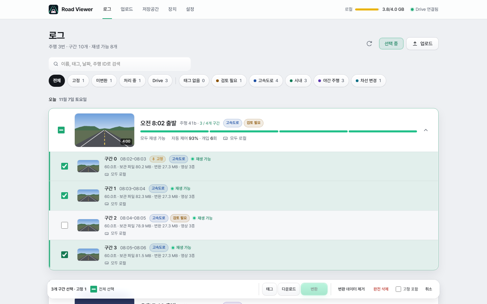

여러 구간은 로그 목록 안의 **선택 모드**에서 한 번에 처리합니다. 별도 팝업은 없습니다.

1. 로그 탭의 **선택** 버튼을 누르거나, 터치 화면에서는 구간을 길게 누릅니다(약 0.5초). 길게 누른 구간은 바로 선택됩니다.
2. 구간 체크박스나 주행 카드의 전체 선택 체크박스로 고릅니다. 일부만 선택한 주행은 −로 표시하고 `선택 수 / 구간 수`를 보여 줍니다. 필터로 숨긴 선택 항목도 선택 수에 포함해 따로 알려 줍니다.
3. 화면 하단의 작업 바에서 **태그**, **다운로드**, **변환**을 누르거나, 좁은 화면에서는 **더보기**를 펼쳐 **내보내기**, **변환 데이터 제거**, **완전 삭제**, **고정 포함**을 사용합니다. **전체 선택**으로 보이는 구간을 모두 고르고, **취소**로 선택 모드를 끝냅니다.

| 작업 | 처리 대상과 결과 |
|---|---|
| 변환 | 미변환·실패 로그를 수동 대기열에 넣습니다. 자동 변환이 꺼져 있어도 실행하며 동시 처리 설정을 따릅니다. 이미 재생 가능·대기·처리 중인 항목은 건너뜁니다. |
| 변환 데이터 제거 | 분석·그래프와 다시 만들 수 있는 MP4를 삭제합니다. 원본 로그·영상와 유일한 MP4는 유지합니다. 대기 중인 변환은 취소하고 변환 데이터를 제거합니다. 처리 중인 항목만 제거하지 않습니다. |
| 완전 삭제 | 해당 항목의 원본·영상·변환 데이터를 모두 삭제합니다. 되돌릴 수 없습니다. |
| 다운로드 | 공통 팝업에서 로그·카메라와 MP4·원본 형식을 선택하고 전체 선택·선택 해제를 사용합니다. 각 파일 옆의 받기는 ZIP 없이 개별 다운로드합니다. 모두 받기는 선택 구간의 모든 파일을 ZIP으로 스트리밍하며, 없는 카메라는 제외합니다. 서버에 다운로드 복사본을 보관하지 않으며 최대 150구간을 묶습니다. |
| 내보내기 | 선택 구간의 원본과 기록 정보를 `.tar` 파일 하나로 받습니다([내보내기와 불러오기](#내보내기와-불러오기)). 최대 150구간이며, 모든 구간을 선택하면 전체 기록을 내보냅니다. |

**고정 포함**은 선택 모드를 시작할 때마다 꺼져 있습니다. 기본 상태에서는 고정된 항목을 제거·완전 삭제에서 제외하고, 서버에서도 실행 직전 고정 여부를 확인합니다. 켜면 고정 항목도 포함되며 확인창에서 다시 안내합니다. 변환에는 이 설정이 영향을 주지 않습니다.

실행 중에는 선택·고정 포함·취소를 잠급니다. 완료·건너뜀·미완료 개수를 표시하고 실패한 항목만 선택을 유지합니다. 제거한 항목은 자동 재변환하지 않으므로 다시 처리하려면 **변환**을 누르세요.

### 변환·제거·완전 삭제

구간 행에는 **재생** 또는 **변환** 버튼과 옆의 ⋯ 메뉴를 표시합니다. ⋯ 메뉴에 **제거**, **다운로드**, **태그 편집**, **로그 이름 복사**, **구간 고정**, **완전 삭제**가 있습니다. 미변환 상태에서는 **제거**를 숨기며 **완전 삭제**는 유지합니다. 대기·처리 중에는 바깥 버튼이 상태를 표시합니다. 대기 중에는 ⋯ 메뉴의 **제거**로 변환 예약을 취소할 수 있습니다.

- **변환:** 원본 영상에서 MP4를 만들고 로그를 분석합니다. MP4만 보관 중이면 영상을 재사용하며 분석·그래프 데이터를 만듭니다. 영상이 없으면 로그만 처리합니다.
- **제거:** 분석·그래프 및 원본 영상에서 다시 만들 수 있는 MP4를 삭제합니다. 원본 로그·영상와 원본 영상 대신 보관하는 유일한 MP4는 유지합니다. 수동 제거한 항목은 자동 변환이 켜져 있어도 다시 처리하지 않으며, **변환**을 직접 눌러야 합니다.
- **완전 삭제:** 원본과 변환 데이터를 모두 삭제합니다. 해당 항목의 진행 중인 작업도 취소합니다.

## 구간 태그

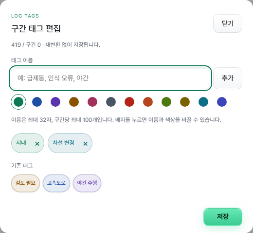

구간의 ⋯ 메뉴에서 **태그 편집**을 눌러 구간을 분류할 수 있습니다. 주행 카드의 ⋯ 메뉴의 **전체 구간 태그 편집**은 그 주행의 모든 구간에 적용합니다. 재생 화면에서는 태그 버튼을 사용합니다. 태그는 구간당 최대 100개, 이름은 32자까지이며, 12가지 색상과 기존 태그 자동완성을 제공합니다. 선택한 태그 배지를 누르면 이름과 색상을 편집할 수 있습니다. 이름의 앞뒤·연속 공백을 정리하고 대소문자만 다른 이름은 중복으로 저장하지 않습니다.

로그 탭의 태그 필터 칩에서 특정 태그 또는 **태그 없음**을 선택하세요. 여러 구간에 적용하려면 **선택 → 구간 선택 → 작업 바의 태그**에서 **태그 추가** 또는 **태그 제거**를 선택합니다. 선택한 태그만 변경하며 다른 태그와 고정 상태는 유지합니다. 일부 저장이 실패하면 성공한 구간은 유지하고 실패한 구간만 다시 시도합니다.

태그는 서버의 구간 메타데이터에 저장됩니다. 변환·재변환·변환 데이터 제거 후에도 유지되며, 구간을 완전 삭제하면 함께 삭제됩니다. 카메라별 태그나 특정 시점의 북마크는 아닙니다.

웹 UI는 앱에 포함된 Pretendard Variable 1.3.9를 사용합니다. 외부 CDN 연결 없이 한글을 표시하며, 최초 폰트 전송량은 약 1.96 MiB이고 이후에는 브라우저 캐시를 사용합니다. [공식 배포](https://github.com/orioncactus/pretendard/releases/tag/v1.3.9)의 SIL Open Font License를 함께 포함합니다.

## 장면 북마크

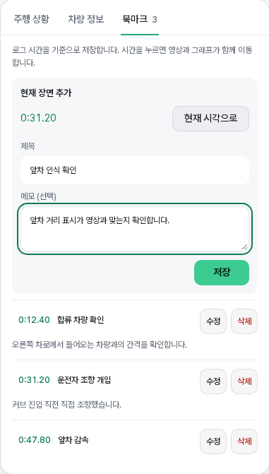

북마크 탭의 **현재 장면 기록** 또는 하단 재생바의 **북마크**를 누르면 현재 화면을 유지한 채 기록 팝업이 열리고 누른 시각이 선택됩니다. 제목(최대 80자)과 메모(최대 1000자)는 선택 사항입니다. 제목 없이 저장하면 장면 시각으로 이름을 붙입니다. 재생 중에도 선택한 시각은 유지되며, **현재 시각으로** 버튼을 누르면 갱신됩니다. 팝업을 닫아도 작성 중인 초안은 같은 구간에서 유지됩니다. 모바일에서는 키보드 위에 입력칸과 저장 버튼을 유지하고, 입력 중에는 재생 컨트롤러를 숨깁니다. 구간당 최대 100개를 저장할 수 있으며 북마크 탭에서 목록 확인·수정·삭제를 할 수 있습니다.

탐색 바의 금색 마커 또는 북마크 탭의 시간순 목록을 누르면 영상·주행 상황·그래프가 함께 이동합니다. 재생 중이면 계속 재생하고, 일시정지 중이면 정지 상태를 유지합니다. 목록의 **수정**·**삭제**로 제목·메모를 고치거나 북마크를 지울 수 있습니다.

북마크는 영상이 아닌 로그 시간을 기준으로 구간 메타데이터에 저장하므로 카메라 전환과 재변환 후에도 유지됩니다. 변환 데이터 제거로 지워지지 않으며, 구간을 완전 삭제하면 함께 삭제됩니다. 재분석은 필요하지 않습니다.

## 영상 선택

영상을 열 때는 영상 위 카메라·화질 선택 버튼으로 여는 목록의 **기본 화질**(닫기 버튼 옆, **기본 재생 화질** 창)에서 정한 화질(저용량 전방 qcamera 또는 고화질 전방)을 먼저 재생하고, 그 영상이 없으면 다른 전방 영상, 그마저 없으면 와이드를 사용합니다. 화질은 모바일 데이터(기본 저용량)와 와이파이 · 유선(기본 고화질)에 따로 정하며 브라우저마다 저장되고, 다음에 여는 영상부터 적용됩니다. 연결 종류는 브라우저가 알려 줄 때만 구분하고(안드로이드의 Chromium 계열 브라우저), 그렇지 않으면 휴대폰·태블릿은 모바일 데이터, 그 밖의 기기는 와이파이 · 유선 설정을 따릅니다. 재생 가능한 영상이 여러 개면 같은 선택 버튼에서 전환합니다. 재생 시각과 재생/일시정지 상태를 유지하며 카메라별 시작 시각을 사용합니다. 영상 로딩에 실패하면 남아 있는 영상으로 대체를 시도합니다.

카메라가 다르면 센서와 시야각도 다릅니다. 와이드 겹쳐보기에는 별도의 보정값이 필요합니다. 로그 재생 준비 전에는 제어 버튼 대신 안내를 표시하고, 하단 탐색 바에는 영상 버퍼 구간을 표시합니다.

## 재생 화면과 배치

재생 화면은 위쪽의 간결한 앱 바, 영상 위 컨트롤, 하단에 떠 있는 재생 바, 분석 탭으로 구성됩니다.

**앱 바**

| 항목 | 동작 |
|---|---|
| 뒤로 | 로그 목록으로 돌아갑니다. |
| 날짜 · 로그 이름 | 날짜, 로그 이름(복사 버튼), **태그** 버튼, 태그와 **고정** 배지를 한 줄로 표시합니다. 제목(구간 선택)은 영상 왼쪽 위에 있습니다. |
| 이전 / 다음 | 같은 주행이면 **이전 구간 / 다음 구간**, 아니면 **이전 로그 / 다음 로그**로 이동합니다. 영상 왼쪽 위 제목 양옆의 ‹ › 버튼입니다. |
| 핀 | 현재 구간을 고정·해제하며 로그 목록의 고정 상태와 공유합니다. 고정 시 노란색으로 표시합니다. |
| 보기 | **좌우 분할**, **상하 분리**, **화면 폭…**을 고릅니다. 그 아래 **재생** 묶음에서 **끝나면 다음 구간 재생**(기본 꺼짐: 구간을 끝까지 재생하면 같은 주행의 다음 재생 가능한 구간을 이어서 재생)과 **구간을 옮기면 일시정지**(기본 켜짐: 끄면 재생 중에 구간을 옮겨도 이어서 재생)를 켜고 끕니다. 이 브라우저에 기억됩니다. 휴대폰에서는 ⋯ 메뉴 안에 있습니다. |
| ⋯ | **제거**, **다운로드**, **카메라 설치 정보**, **화면 모드**, 로그 정보·버전, **완전 삭제** |

**영상 위 컨트롤**

- **왼쪽 위 제목:** 주행 출발 시각 · 구간 k와 같은 주행 안의 위치 `(i/N)`을 표시합니다. 출발 시각을 알 수 없으면 `업로드 …` 시각을 표시합니다. 누르면 같은 주행의 **구간 선택** 목록이 열립니다.
- **왼쪽 아래:** 카메라·화질 선택, **겹쳐 보기** 켜기·끄기와 옆의 ⚙ 설정
- **오른쪽 위:** 차량 속도(`carState.vEgo`)와 조향 핸들 상태. 운전자가 조향에 개입하면 핸들 주위에 **개입** 링을 표시합니다.
- **오른쪽 아래:** 전체 화면 버튼. 휴대폰·태블릿에서는 가로 화면으로 엽니다. 브라우저가 화면 방향 고정을 지원하면(안드로이드 크롬·삼성 인터넷 등) 기기를 세로로 들고 있어도 가로로 바뀌고, 지원하지 않으면(안드로이드 Home Assistant 앱, iPad) 화면을 90° 돌려 보여 주므로 기기를 왼쪽으로 눕혀서 봅니다. 기기를 가로로 돌리면 돌림 없이 그대로 표시합니다.

재생 중에는 제목, 왼쪽 아래 버튼, 전체 화면 버튼이 사라지고 영상을 터치하거나 마우스를 움직이면 몇 초 동안 다시 보이고, 보이는 동안 영상을 다시 터치하면 바로 숨습니다. 터치 화면이나 높이가 낮은 화면에서는 재생 중 앱 바도 위로 접히며, 일시정지하면 다시 나타납니다. 영상은 하단 재생 바에 가리지 않도록 화면 높이에 맞춰 크기를 정합니다.

**하단 재생 바**는 스크롤해도 화면 아래에 떠 있습니다.

- **구간 띠:** 같은 주행의 구간을 한 칸씩 표시하고 로그 목록과 같은 색(재생 가능 초록·처리 중 노랑·오류 빨강·미변환 회색)으로 구분하며, 지금 재생 중인 구간은 테두리로 표시합니다. 재생 가능한 다른 구간을 누르면 그 구간으로 이동합니다. 구간이 많은 긴 주행에서는 띠를 가로로 스크롤하며 현재 구간을 가운데에 맞춥니다. 마우스를 올리면(터치는 길게 누르면) 그 구간의 썸네일과 시작 시각을 띠 위에 보여 주고, 떼면 사라집니다. 길게 누른 채 손가락을 옮기면 마우스처럼 다른 구간의 썸네일을 이어서 볼 수 있으며, 긴 주행에서는 띠 끝에 손가락을 두면 띠가 그쪽으로 넘어갑니다. 휴대폰·태블릿 전체 화면에서는 구간 띠를 숨기며, 구간 이동은 왼쪽 위 제목 메뉴로 합니다.
- **이벤트 트랙:** 자동 제어 구간과 운전자 개입 시점을 색으로 표시합니다(범례: 현재 구간·자동 제어·운전자 개입·북마크).
- **탐색 바:** 영상 버퍼 구간과 북마크 마커를 함께 표시합니다. 재생 중 탐색하면 옮긴 위치부터 계속 재생하고, 일시정지 중 탐색하면 일시정지를 유지합니다.
- **재생 / 일시정지**(Space), **이전·다음 프레임**(← / →), **시간**(누르면 현재 시각과 전체 길이 표시를 전환), **북마크**, **속도**(0.25~4배)

**배치**

- **자동 배치:** 좌우 분할과 상하 분리를 모두 끄면 화면 크기에 따라 배치합니다.
- **좌우 분할:** 영상과 분석 패널을 나란히 표시합니다. 폭을 늘리면 영상과 주행 상황 높이도 함께 커집니다.
- **상하 분리:** 영상과 분석 패널을 위아래로 배치합니다.

좌우 배치에서는 영상이 앱 바 아래에 고정되고 오른쪽 분석 내용만 스크롤됩니다. 상하 배치에서는 영상이 위에 고정되고, 아래로 스크롤한 만큼 영상이 줄어들어 최소 60% 크기가 되고, 스크롤을 멈추면 그 크기를 유지하며 위로 올리면 올린 만큼 다시 커집니다. 높이가 낮은 휴대폰 화면(예: 폴드 커버 화면)에서는 아래로 스크롤할 때 재생 바도 재생·탐색·시간만 있는 한 줄로 접히며, 위로 스크롤하거나 빈 곳을 누르면 다시 펼쳐집니다.
- **화면 폭:** **보기 → 화면 폭…**을 눌러 팝업에서 조절합니다. 슬라이더 위치는 고정되고 결과는 즉시 반영됩니다. 실제 표시 폭은 화면 너비를 넘지 않습니다.

| 화면 너비 | 조절 범위 | 기본값 |
|---|---|---|
| 600px 이하 | 50~100% | 100% |
| 601~1280px | 320~1280px | 1280px |
| 1280px 초과 | 720~1920px | 1420px |

화면 폭은 위 세 범주별로 따로 기억합니다.

배치·화면 폭과 주요 표시 선택은 브라우저에 저장됩니다. 다른 기기나 브라우저에는 별도로 적용해야 합니다.

영상·주행 상황·차량 정보의 짧은 시작·종료 시차는 경계 허용 범위에서 보완합니다. 실제로 영상이 짧거나 로그가 끝난 구간을 임의로 늘려 재생하지는 않습니다. 차량 정보의 시작값을 미리 보여줄 때는 사용한 첫 유효 샘플 시각을 안내합니다.

## 주행 상황과 영상 겹쳐보기

**영상 겹쳐보기:** 차선은 민트색 띠와 1px 테두리로 표시합니다. 확률 0~75%에서 폭과 내부 불투명도가 증가하고, 75%부터 폭은 최대 0.225m로 유지합니다. 확률 75~100%에서는 내부 불투명도만 7.5~20%로 증가합니다. 테두리 불투명도는 확률에 비례합니다. 도로 좌표에서 만든 띠를 투영하므로 멀수록 가늘어집니다. 로드엣지는 코랄 레드 띠와 테두리이며 가중치 1/(1+표준편차)에 따라 폭과 선명도가 변합니다. 로드엣지 내부 최대 불투명도는 10%입니다.

**오른쪽 주행 상황:** 차선은 확률에 따라 1~4px 두께와 밝기가 변하며, 50% 미만은 점선입니다. 로드엣지는 2px 코랄 레드 선이고 표준편차 1 초과는 점선입니다. 모델 경로는 반투명 민트색 띠입니다. 영상의 발광 효과는 적용하지 않습니다.

**전방 / 후방 범위:** 25/5m·50/10m·80/20m를 선택하며 오른쪽 주행 상황에만 적용합니다. **후방 표시 · LR / RR**은 기본 켜짐이며 선택을 기억합니다. 끄면 전방이 화면 전체를 사용합니다. 0m 선과 내 차량을 기준으로 후방에 LR·RR을 표시하고, 거리 모드에서는 `후방 8.0m`처럼 표시합니다. 후방 점선은 전방 차선 곡률을 연장하지 않는 직선 참고선이며 실제 차선이 아닙니다. LR·RR은 송신 거리 그대로 표시하며 전방 차량의 0.8배 역보정과 곡률 보정을 적용하지 않습니다. 기존 로그에서 후방 데이터가 없으면 해당 로그를 다시 변환해야 하며, 기존 재생 데이터는 유지합니다. 영상의 차선·경로·차량 박스·감지점·TARGET에는 이 범위 제한을 적용하지 않습니다. 유효한 로그 좌표와 카메라 투영이 있어야 표시되며, BSD 벽의 별도 최대 길이 40m는 유지합니다.

주행 상황 탭의 **레이어** 팝오버에서 후방 표시, 모델 주행 경로(`position`), 차선, 로드엣지, 모델 앞차, radarState 중앙·좌우 차량, liveTracks 감지점, SCC 감지점 제외와 정보 표시를 선택합니다. 좌우 폭과 전방 거리도 조절할 수 있습니다. 색 설명은 **범례**를 펼쳐 확인합니다. 지도의 타원은 현재 추종 중인 앞차를 표시합니다. **SCC 감지점 제외**를 켜면 주행 상황·영상 겹쳐 보기·liveTracks 표에서 SCC 출처 점을 숨깁니다. 모델 주행 경로의 초기값은 켜짐이며 이후 선택을 기억합니다.

TARGET 거리선과 빛의 폭은 **경로 차폭** 설정(기본 1.86m)을 따릅니다. 차선 중앙에 배치하며 양 끝이 서서히 투명해집니다. 영상에서는 실제 감속도(`carState.aEgo`)가 클수록 내 차 쪽으로 빛이 길어지며, 3 m/s² 감속에서 최대 8m로 표시합니다. 최근 0.25초 값을 완화해 반영하며 차선 형상이 있는 범위에만 그립니다. 실제 제동력 측정값은 아니며 가속도 데이터가 없으면 빛 꼬리는 표시하지 않습니다.

**LF · FF · RF**는 현대 CCNC 계기판으로 보낸 왼쪽·전방·오른쪽 표시 위치를 재생합니다. 초기값은 켜짐이며 선택을 기억합니다. 주행 상황과 영상 겹쳐보기에 함께 적용되고, LF·RF는 블루, FF는 밝은 청록색으로 구분합니다. 영상에는 폭 1.8m·길이 4.5m·기본 높이 1.30m로 가정한 반투명 3D 박스를 그립니다. 뒤쪽 면 하단 중앙이 보정한 추정 좌표이며, 박스는 해당 거리와 5m 앞에서 구한 좌우 차선 중간점을 잇는 방향으로 회전하며 지면에 붙습니다. 양쪽 차선 형상이 부족하면 직진 방향을 유지합니다. 별도 ×나 연결선은 추가하지 않고 차량 높이 조정에서도 제외합니다. 박스 불투명도는 0~100%(기본 30%)로 조절하며 선택을 기억합니다. 테두리는 계속 표시되며 투명할 때는 반대편 면과 모서리도 비칩니다. 박스 높이는 0~3m(기본 1.30m)로 조절하고 기억합니다. 새로 감지된 박스는 450ms 동안 바닥에서 높이가 올라옵니다. 감지가 빠진 프레임에서는 박스가 즉시 40% 밝기로 흐려진 뒤 600ms 동안 사라지므로, 한 프레임 끊김도 깜빡임으로 보입니다. 짧은 끊김 뒤 다시 감지되면 바로 원래 밝기로 돌아오고 등장 효과를 반복하지 않습니다. 같은 차량이 다른 칸으로 옮겨 가면(예: FF→LF. 위치로 같은 차량을 판단하며, 두 칸 사이에 최대 600ms 공백이 있거나 300ms 동안 두 칸이 함께 송신되어도, 원래 칸에 곧바로 다른 차량이 잡혀도 적용) 사라졌다 다시 솟아오르지 않고 300ms 동안 새 위치로 이동하며 색이 바뀝니다. 재생 중에는 20Hz 기록 사이의 위치를 보간합니다. **부드러운 움직임**을 끄면 이 효과를 모두 끄고 기록된 값을 프레임마다 그대로 표시합니다(기본 켜짐, 선택 기억). 로그 시작부터 존재하는 박스는 완성된 높이로 표시하며, 일시정지·탐색·동작 줄이기 설정을 따릅니다. 높이 0은 바닥 사각형으로 표시합니다. **차량 박스 라벨**, **BSD 라벨**, **TARGET 라벨**을 각각 설정할 수 있습니다. 끄면 해당 도형·거리선은 유지하고 라벨만 숨깁니다. 기본값은 모두 켜짐이며 선택을 개별적으로 기억합니다. 기존 박스·BSD 통합 설정은 두 항목에 이어받습니다. 전방 거리는 송신값을 0.8로 나누고, FF 횡위치는 해당 거리의 모델 Position에 기록된 좌우 오프셋을 더합니다. Position이 없으면 LF·RF와 같이 그 거리의 좌우 차선 중앙값에서 시작점 중앙값을 뺀 만큼 더합니다. 0.8배 거리 축소를 사용하는 CCNC 확장 로직의 근사 역보정이며 다른 송신 방식에는 맞지 않을 수 있습니다. FF의 Position과 대체 차선 형상이 모두 없거나, LF·RF의 양쪽 차선 형상이 없으면 곡률 보정을 생략합니다. 시간 필터·좌표 제한으로 잃은 정보는 복원되지 않습니다. 거리·yRel은 표시할 수 있지만 TrackID·속도·상대 속도는 이 메시지에 없어 `—`로 표시합니다. 최근 150ms 이내 유효한 송신 메시지가 없으면 표식을 숨깁니다. 기존 데이터에 이 항목이 없으면 로그를 재분석해야 합니다. 자동 재생성 여부는 디코더 형식 변경과 변환 설정에 따릅니다.

**계기판 도로 표시**는 송신된 `TARGET`과 `TARGET_DISTANCE`의 거리선, 좌우 방향지시등, 중앙·좌우 차로 강조를 표시합니다. 강조 색상은 `LANE_HIGHLIGHT`, 좌우 활성화는 `LANE_LEFT`와 `LANE_RIGHT`를 따릅니다. `LANE_HIGHLIGHT_DISTANCE`는 사용하지 않고 유효한 차선 끝까지 강조합니다. 방향지시등은 로그 재생 시각에 맞춰 점멸하며, 실제 전구 점멸 위상을 복원하는 것은 아닙니다.

영상의 모델 주행 경로는 반투명 보라색 띠로 표시합니다. 로그 스키마에 차폭이 없어 기본값 1.86m를 사용하며, **경로 차폭**에서 1~3m로 조절하고 기억합니다. 영상에서는 카메라 원근감을 적용합니다.

**정보 표시**는 끄기·TrackID·거리·yRel·속도·상대 속도 중 하나를 고릅니다. 기본값은 TrackID이며, 끄면 도형만 남습니다. **liveTracks 정보 표시**를 켜면 선택한 정보를 원시 감지점에도 표시합니다. 모델 앞차의 확률이 50% 미만이면 흐리게 표시합니다.

전방 카메라 아래에서는 차선 4개의 확률과 좌우 로드엣지 표준편차를 확인합니다. **좌우 거리 y[0]**를 켜면 각 선 배열의 첫 번째 y값으로 전환합니다.

**주행 상황 겹쳐 보기**는 로그의 카메라 보정·센서 정보를 이용해 차선·모델 경로·감지 위치를 영상 위에 투영합니다. 필요한 정보가 없거나 유효하지 않으면 안내를 표시합니다. **차량 높이 조정**을 켜면 위치 표식을 설정한 높이로 표시하고 바닥까지 선을 연결합니다. 겹쳐보기 **설정** 팝업에서 0~200cm를 1cm 단위로 조절합니다. 기본값은 60cm이며 0cm는 지면 위치입니다. 켜진 상태에서는 변경을 즉시 반영하고, 높이와 켜짐 상태는 각각 브라우저에 기억합니다. 높이 변경 자체로 로그를 다시 변환할 필요는 없습니다. 차량 모양이나 크기를 정확히 복원하는 기능은 아닙니다.

깜빡이는 기록된 좌우 신호에 따라 민트색 화살표 세 개가 바깥쪽으로 순차 점등됩니다. 사각지대 감지는 `carState.leftBlindspot/rightBlindspot`을 사용하며, 해당 차선에 전방 최대 40m·기본 높이 0.80m의 반투명 노란 벽이 올라오면서 나타나고 내려가면서 사라집니다. 유지 중에는 두께감 있는 금빛 테두리와 앰버색 패널을 유지하며, 주변으로 퍼지는 그라데이션 없이 세로 노란 선 10개가 벽을 따라 앞뒤로 부드럽고 불규칙하게 왕복합니다. 그중 5개는 번갈아 위아래 테두리와 같은 발광 효과를 적용하고 나머지 5개는 가는 선으로 유지합니다. 움직임은 로그 시각으로 계산해 같은 시점에는 항상 같은 위치를 표시합니다. 차량 높이 조정과 독립적으로 지면에 붙습니다. 깜빡이는 계기판 도로 표시, 사각지대 벽은 별도의 사각지대 벽 표시 설정으로 끌 수 있습니다. 애니메이션은 로그 시간에 따라 재생·탐색·일시정지와 동기화되고, 동작 줄이기 설정에서는 즉시 표시됩니다. 차선이나 카메라 보정 정보가 없는 구간에서는 영상의 벽을 그리지 않습니다.

### 겹쳐 보기 설정

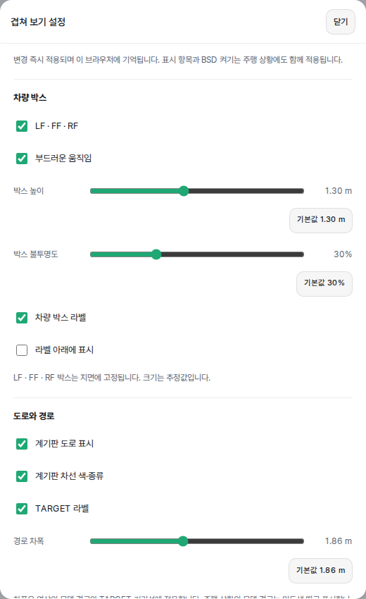

영상 위 **겹쳐 보기** 버튼 옆의 ⚙ 버튼에서 **겹쳐 보기 설정**을 엽니다. 카메라 설치 정보는 앱 바의 ⋯ 메뉴에 있습니다. 차량 박스의 표시·높이·불투명도, 박스·BSD·TARGET 라벨, 계기판 도로 표시, 경로 차폭, 차량 위치 표식 높이를 한 팝업에서 조절합니다. **라벨 아래에 표시**를 켜면 차량 박스 아래에 배경·테두리 없이 라벨을 표시합니다. 각 설정은 다음에도 유지됩니다. 팝업의 모든 슬라이더에는 개별 기본값 버튼이 있습니다.

**사각지대 벽 표시**는 계기판 도로 표시와 별개로 켜고 끌 수 있습니다. 켜면 로그의 BSD 감지 신호에 따라 표시하고, 영상의 벽 높이는 0~3m(기본 0.80m)로 조절합니다. 높이 0에서는 영상의 벽을 숨깁니다. 평면도에서는 감지된 쪽의 좌우 테두리에 노란 빛으로 표시합니다. 최대 길이는 40m입니다.

**경로 차폭**은 영상의 모델 경로와 TARGET 거리선·빛의 폭에 적용합니다. 우측 주행 상황의 모델 경로는 차폭 설정과 무관한 민트색 띠입니다.

### 와이드 영상 겹쳐보기

와이드 영상을 선택하면 해당 카메라의 센서와 `liveCalibration.wideFromDeviceEuler` 보정값으로 차선·경로·차량·BSD를 투영합니다. 전방과 동일한 3D 좌표를 공유하고, 와이드 보정 정보만 공유 카메라 메타데이터에 저장하므로 좌표를 중복 저장하지 않습니다. 카메라를 바꿔도 재생 시각은 유지합니다. 보정값이 없거나 지원하지 않는 센서이면 안내를 표시하며 전방 좌표를 대신 그리지 않습니다. 이전 변환 데이터에는 와이드 보정값이 없어 원본 로그의 재분석이 필요합니다. 이 기능 추가만으로 정상 변환된 기존 로그를 자동 재분석하지는 않습니다.

### 레이더 목록과 좌표

차선·도로 경계 수치는 분석 탭의 **차선·도로** 탭에 있습니다. 차선 확률과 y[0] 거리 모드는 같은 레이아웃으로 표시하며 로드엣지·앞차 정보의 높이와 글꼴을 맞춥니다.

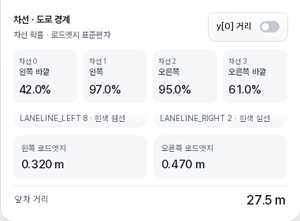

![y[0] 거리 표시](../docs/images/roadviewer-boundaries-distance.png)

`radarState 차량 값`은 중앙·좌우 목록을 modelProb 필터 없이 표시합니다. `liveTracks 감지점`은 측정 여부와 관계없이 유효한 점을 표시합니다. 주행 상황의 **×는 measured=true**, 빈 원은 false입니다. 전방 카메라의 liveTracks 표식은 ×입니다. 원시 감지점이 모두 차량인 것은 아닙니다.

두 표는 제목을 눌러 접고 펼칠 수 있습니다. 펼친 표는 약 10행 높이를 유지하며 나머지 항목은 내부 스크롤로 확인합니다. 열 제목은 고정되고, 감지 수가 줄거나 없어도 표 높이는 유지됩니다.

표의 `yRel`은 로그 원본 값이고 주행 상황에서는 `−yRel`로 변환합니다. 모델 좌표는 전방 x, 오른쪽 y를 사용합니다. 지도에는 선택한 범위 안의 점만 그리지만 표에는 범위 밖의 점도 포함합니다. 모델 앞차와 선택된 앞차의 거리는 기준점 차이가 있을 수 있습니다.

## 차량 정보 그래프

분석 탭(**주행 상황 · 차선·도로 · 차량 정보 · 북마크**)의 **차량 정보**를 누르면 영상과 동기화된 그래프를 표시합니다. 상단에는 현재 속도·가속도·조향각·조향 개입을 요약합니다.

**그래프 선택** 팝업의 체크박스로 표시 항목을 고르고, 오른쪽 손잡이를 드래그해 순서를 바꿉니다. **순서 초기화**는 체크 상태를 유지한 채 기본 순서로 되돌립니다. 선택과 순서는 브라우저에 저장되며, 그래프가 많으면 그래프 영역 안에서 스크롤합니다.

기본 순서의 24개 그래프는 다음과 같습니다.

| 그룹 | 그래프 |
|---|---|
| 속도·가감속 | 속도, 가속도, 자동 목표 가속도, 자동 가감속 저크, 회전수(RPM) |
| 페달·제동 | 운전자 페달 입력량, 운전자 페달 조작 상태, 자동 가스·브레이크 출력, 자동 가속·감속 요청, 자동 가감속 제어 단계, 정차·브레이크 홀드 |
| 조향 | 조향각, 핸들 회전 속도, 조향 토크, 자동 조향 토크 명령, 운전자 조향 개입, 주행 곡률, 횡가속도 제어 |
| 제어 상태 | 자동 제어 상태, 크루즈 상태 |
| 계기판 차량 | LF·FF·RF 표시 상태, 전방 거리, 좌우 위치(LATERAL), 좌우 위치(yRel) |

처음에는 속도·가속도·운전자 페달 입력량·조향각·운전자 조향 개입·자동 제어 상태를 표시합니다.

`+ / −`로 시간축을 확대·축소하고 **전체 구간**으로 되돌립니다. 그래프 클릭·가로 드래그로 재생 위치를 옮길 수 있습니다. 확대 상태에서는 가능한 범위 안에서 현재 시각이 중앙에 오도록 따라가며, 드래그 중에는 시간축을 유지하고 놓으면 다시 중앙으로 맞춥니다.

### 값 해석

- **좌우 위치(LATERAL)**는 계기판 송신값 `LF_LATERAL`·`FF_LATERAL`·`RF_LATERAL`입니다. 경로·차선 곡률 복원 전 값이며 FF는 −6.4~6.3m로 해석합니다. **좌우 위치(yRel)**는 박스에 적용한 보정 후 값으로, 왼쪽이 양수·오른쪽이 음수입니다. 두 그래프는 별도로 선택할 수 있고 레이더 원시 좌표와 다를 수 있습니다. 기존 보정 전 값이 없는 구간은 LATERAL을 확인 불가로 표시합니다.

- 운전자 페달 입력량·밟음 여부와 자동 가감속 명령·최종 출력은 별개입니다. 브레이크 밟음 여부만 기록하고 입력량은 채우지 않는 차량도 있습니다.
- 자동 감속 요청은 요청 가속도의 부호를 표시하며 실제 브레이크 페달 조작을 뜻하지 않습니다.
- 조향 토크 그래프의 ‘운전자’는 `carState.steeringTorque`의 센서값입니다. 자동 조향 명령과 다르며, 값의 변화만으로 운전자 개입을 확정하지 않습니다. 조향 개입 상태는 `steeringPressed`를 사용합니다.
- 조향각 목표는 제어기에 기록된 값입니다. 토크 제어 차량의 목표각도 포함하지만 모든 차량에서 기록되는 것은 아닙니다. RPM 역시 차량 구현에 따라 제공 여부와 의미가 다릅니다.
- 로그 전체에서 해당 항목의 유효한 값이 모두 0이면 실제 0과 미기록 기본값을 구분할 수 없다는 안내가 표시됩니다. 유효한 기록이 없으면 별도로 안내합니다. 없는 값을 임의로 추정해 채우지 않습니다.

## 주행 경로 지도

로그를 변환할 때 주행 위치를 1초에 한 점씩 함께 저장합니다. 기기 GPS(`gpsLocationExternal`, `gpsLocation`)가 위치를 잡았으면 그것을, 아니면 차량 내비가 CAN으로 보내는 차량 GPS(`carState.vehicleGps`)를, 둘 다 없으면 carrot의 추정 위치(`carrotMan.xPosLat/xPosLon`)를 씁니다. 위치가 0이거나 유효하지 않은 점, 기기 GPS의 정확도가 100m보다 나쁜 점, 앞 점에서 초속 90m 넘게 튄 점은 버립니다. 1분 구간에 1KB 안팎이라 저장공간은 거의 늘지 않습니다. 이전 버전에서 변환한 로그는 앱이 켜지고 3분 뒤부터 최신 로그 순으로 하나씩 채웁니다. 원본 rlog가 HA나 NAS에 있는 로그만 읽고, Google Drive에만 있는 로그는 기본으로 받아 오지 않으므로 지도가 비어 있습니다. 업로드·변환·재생·아카이브 중에는 기다립니다.

**Drive 로그 지도 채우기**: Google Drive 아카이빙을 쓸 때 저장공간 탭의 "실행 및 고급 설정"에 나오는 설정입니다(기본 꺼짐, "설정 저장"으로 저장). 켜면 Drive에만 원본이 있는 로그를 최신 순으로 하나씩, 원본을 한 번 내려받아 경로만 읽습니다. 받은 원본은 앱 데이터 폴더의 임시 폴더에 두었다가 읽기가 끝나면 성공·실패와 관계없이 바로 지우고, 남는 것은 경로(1분에 약 1KB)뿐입니다. 1분 구간마다 약 13MB를 내려받으며, 업로드·변환·재생·아카이빙 중에는 쉬고 끝나면 이어갑니다. Drive의 파일은 읽기만 하고 옮기거나 지우거나 이름을 바꾸지 않습니다. 옆의 **한 번 실행**은 설정이 꺼져 있어도 남은 로그를 한 번 훑어 채우고 멈추며, 실행 중에는 **중지**로 바뀌어 지금 읽는 로그를 마치고 멈춥니다. 진행은 "Drive 로그 지도 채우기: 120 / 406"처럼 표시됩니다. Drive 연결이 끊기거나 인증이 만료되면 멈추고 다음 실행에서 다시 시도하며, 네트워크 오류나 요청 한도 초과는 몇 분 뒤 다시 시도합니다. 세 번 읽지 못한 로그는 건너뛰고, Drive에서 지워진 로그는 지도 없이 둡니다. 설정을 끄면 지금 읽는 로그까지만 처리합니다.

- **전체 지도**: 로그 화면의 "목록 | 지도"에서 지도를 고르면 지금 검색·태그·필터 조건에 걸린 주행을 파스텔 색 선으로 보여 줍니다. 오른쪽(휴대폰은 아래)의 유리 카드 목록이 주행마다 한 장씩이며, 많으면 스크롤됩니다. 카드에 마우스를 올리면 그 선이 굵어지고, 카드나 선을 고르면 지도가 그 주행에 맞춰지고 카드 안에 **재생 · 주행 지도 · 목록에서 보기**가 펼쳐집니다. 넓은 화면에서는 오른쪽 위 버튼으로 목록을 접고 펼치며(이 브라우저에 기억), 접고 펼쳐도 지도는 그 자리에 있습니다. 휴대폰에서는 목록이 주행 지도처럼 아래 시트에 있고(손잡이에 "주행 목록 N개"), 손잡이를 끌면 세 높이 중 가까운 곳에 멈추고 누르면 숨김 ↔ 중간 높이로 바뀌며, 시트를 움직여도 지도는 그대로입니다. 시트를 내린 상태에서 선을 고르면 아래에 그 주행 카드가 나옵니다. GPS가 있는 주행이 없으면 전환이 나오지 않습니다.

  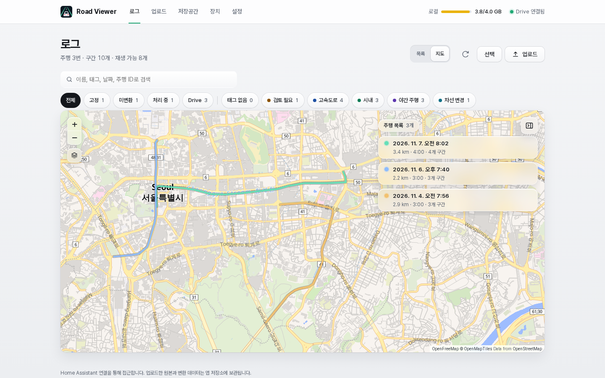
- **주행 지도**: 주행 카드 머리글의 경로 그림(PC는 마우스를 올리면 오른쪽으로 정사각형 지도가 펼쳐지고 누르면 열림, 휴대폰은 재생 왼쪽의 **지도** 버튼), 구간 ⋯ 메뉴의 "지도에서 보기", 전체 지도 카드의 "주행 지도"로 엽니다. 넓은 화면에서는 구간 카드가 지도 오른쪽 위에 떠 있고 버튼으로 접고 펼칩니다. 휴대폰에서는 아래 시트에 구간 카드가 있고, 손잡이를 끌면 세 높이 중 가까운 곳에 멈추고 끝까지 내리면 손잡이만 남습니다. 손잡이를 누르면 펼치기·접기처럼 숨김 ↔ 중간 높이로 바뀝니다. 구간을 누르면 지도에서 그 구간이, 지도 구간을 누르면 해당 카드가 강조됩니다. 목록을 접었거나 시트를 내린 상태에서 구간을 고르면 아래에 "구간 N · 시각" 알약 카드가 나와 **재생**하거나 ✕로 선택을 풉니다. 뒤로가기나 Esc로 닫습니다.

  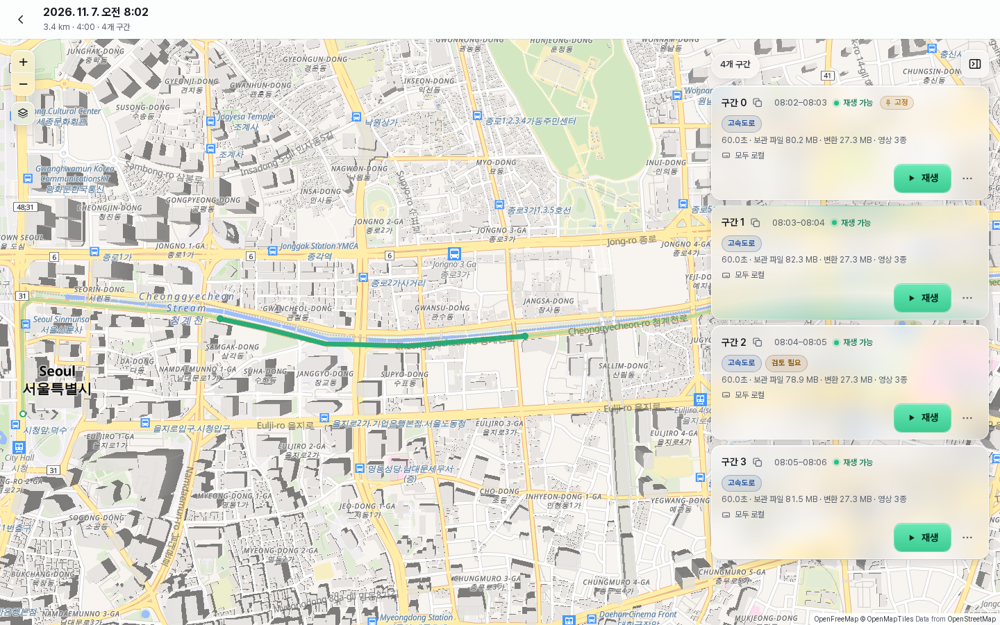

  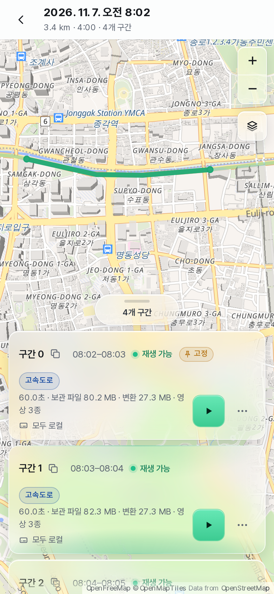
- **재생 화면 지도 탭**: GPS가 있는 구간에서 분석 탭에 "지도"가 나옵니다. 지나온 길은 진하게, 남은 길은 흐리게 그리고 차 표시가 재생 위치를 따라갑니다. "따라가기"는 지도를 직접 움직이면 꺼집니다. 경로를 누르면 그 위치로 이동하고, 다른 구간이면 그 구간을 엽니다.

  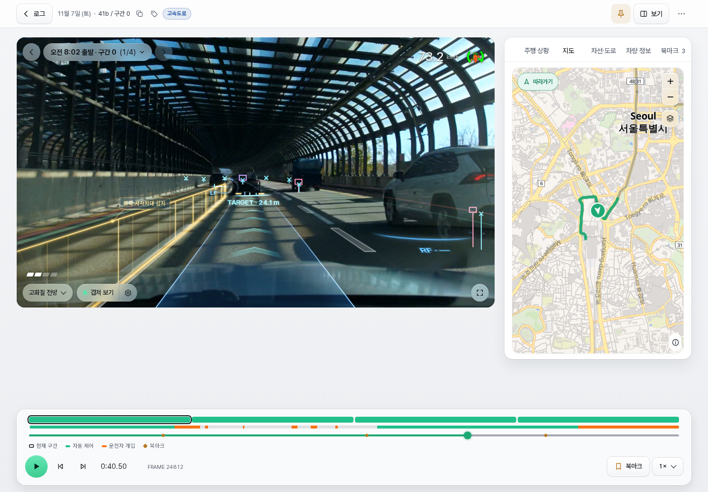
- **영상 위 작은 지도**: 겹쳐 보기 설정 › 지도에서 켭니다(기본 꺼짐). 영상 오른쪽 위에 작은 지도를 보여 주고 속도와 핸들 표시는 그 위에 그대로 그립니다. 지도는 거리 단위로 확대한 채 차를 좌우 가운데, 위아래로는 가운데보다 조금 아래(위에서 60%)에 두고 따라가 앞쪽 길이 더 보입니다. 지도 출처는 오른쪽 아래 ⓘ로 접혀 있고 ⓘ를 누르면 펼쳐집니다(누르는 것만으로는 지도가 커지지 않음). 색상은 자동(화면 테마를 따름) · 라이트 · 다크이고, "작은 지도 글자 숨기기"와 "작은 지도 회색으로"는 지도 표시 팝업의 두 선택지와 같은 동작을 작은 지도에만 적용합니다(지도 표시 팝업은 작은 지도에 영향을 주지 않습니다). 왼쪽 아래 모서리를 마우스나 손가락으로 끌면 4:3 비율 그대로 크기를 바꿀 수 있고(속도 표시보다 좁아지지 않고 아래 버튼 줄까지 커짐), 이 브라우저에 기억됩니다. 모서리를 두 번 누르면 기본 크기로 돌아갑니다. 지도를 누르면 영상 자리를 채우도록 커지고 화질 선택과 겹쳐 보기 버튼은 그동안 숨겨집니다. 영상이나 GPS가 없는 구간, 지도 탭을 보고 있을 때는 나오지 않습니다.

  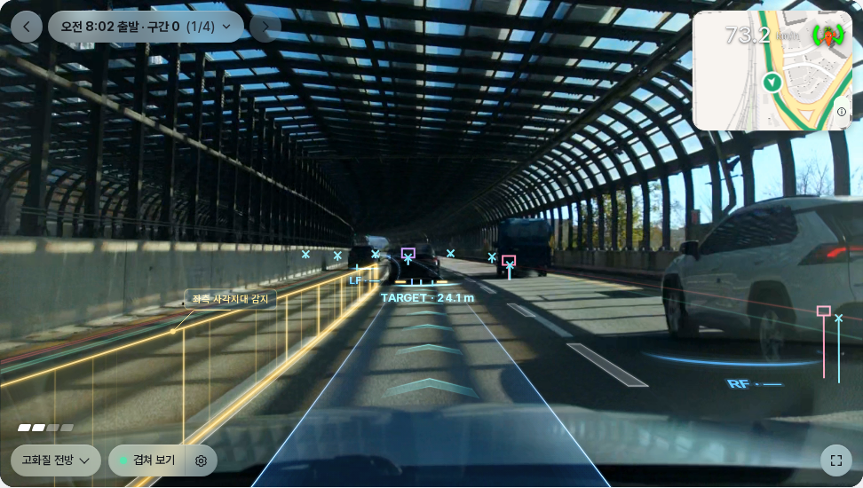

지도 바탕은 OpenStreetMap 데이터로 만든 OpenFreeMap 벡터 지도(라이트 Liberty, 다크 Dark)입니다. 확대·축소 버튼 아래 레이어 버튼을 누르면 "지도 표시" 팝업이 지도 안쪽으로 열립니다(Esc나 바깥을 누르면 닫힘). 팝업에는 두 선택지가 있습니다. "글자 숨기기"는 지도 스타일과 색(라이트 Liberty의 노란 큰길 등)을 그대로 두고 지명·도로 이름·장소 아이콘·도로 번호·일방통행 화살표·번지 같은 글자·기호 레이어를 모두 숨깁니다(지도를 다시 받지 않아 바로 바뀝니다). "회색 지도"는 차분한 스타일(라이트 Positron, 다크 Dark)로 바꾸고 3D 건물·장소 아이콘·도로 번호·일방통행 화살표·번지를 빼며 글자는 남깁니다. 다크 모드는 원래 지도도 어두운 회색이라 차이가 작습니다. 팝업 맨 위의 "지도 테마"(자동 · 라이트 · 다크)는 지도 바탕을 화면 테마와 따로 고정합니다(자동은 화면 테마를 따름). 두 선택지는 따로 켜고 끄며(하나라도 켜지면 레이어 버튼이 강조됨) 둘 다 켜면 글자 없는 회색 지도가 됩니다. 페이지의 모든 지도(작은 지도 제외)에 적용되고 이 브라우저에 기억되며 기본은 꺼짐입니다. API 키나 계정 없이 휴대폰 브라우저가 직접 받아 와 MapLibre로 그립니다. 인터넷 연결이 필요하고, 보는 지역의 지도 조각 요청이 OpenFreeMap(tiles.openfreemap.org)으로 갑니다. 지도 라이브러리는 지도를 처음 열 때 한 번 받고, 같은 앱 버전 동안 브라우저 캐시를 씁니다. 지도 출처 표기는 항상 지도 오른쪽 아래 구석에 있고, 모든 지도에서 처음부터 ⓘ 버튼으로 접혀 있습니다(ⓘ를 누르면 펼침). 위치 좌표는 Ingress 화면의 지도 API로만 제공하고, 로그 목록·다운로드 압축·내보내기·장치 API·아카이브에는 넣지 않습니다(원본 rlog에는 원래부터 GPS가 들어 있습니다).

## 카메라 설치 정보와 핸들 표시

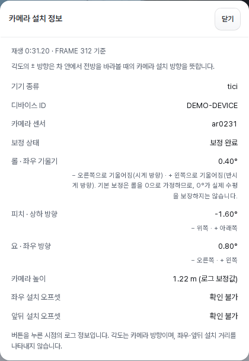

재생 화면 ⋯ 메뉴의 **카메라 설치 정보**는 버튼을 누른 시점의 기기 종류, 디바이스 ID(`dongleId`), 센서, 보정 상태, 롤·피치·요와 카메라 높이를 표시합니다. ID가 없으면 확인 불가로 표시합니다. 높이는 로그 보정값 또는 기본값 사용 여부를 구분하고, 좌우·앞뒤 설치 오프셋은 확인 불가로 표시합니다.

각도는 차 안에서 전방을 바라볼 때의 카메라 설치 방향으로 해석합니다.

| 각도 | − 방향 | + 방향 |
|---|---|---|
| 롤 | 오른쪽 기울기·시계 방향 | 왼쪽 기울기·반시계 방향 |
| 피치 | 위쪽 | 아래쪽 |
| 요 | 오른쪽 | 왼쪽 |

기본 보정은 롤을 0으로 가정하므로 `0°`가 실제 수평을 보장하지는 않습니다. 이 설명은 팝업에도 표시됩니다.

영상 위 속도는 `carState.vEgo` 기반이며 계기판 속도와 다를 수 있습니다. 핸들 아이콘은 기록된 조향각으로 회전하고, `steeringPressed`가 참이면 흰색 핸들과 **개입** 링으로 운전자 조향 개입을 표시합니다. 자동 조향 상태·토크에 따라 색상과 크기가 바뀌며 유효한 상태가 없으면 확인 불가로 표시합니다. 손을 단순히 얹었는지 또는 페달을 조작했는지 판정하는 표시가 아닙니다.

## 저장소 정리·백업·업데이트

앱 내부 저장 경로는 `/data/roadviewer`입니다. 로그별 폴더에 원본과 변환 결과를 보관합니다. 재생·그래프 데이터는 gzip으로 압축해 저장합니다. 1.0.7부터는 재생 데이터에서 직선에 가까운 차선·경로 좌표와 반복 값을 줄인 형식(재생 형식 2)으로 저장해 구간당 변환 데이터가 약 절반이 되며, 이전 형식의 데이터는 앱 시작 후 백그라운드에서 하나씩 새 형식으로 바뀝니다. 또한 0.3.14 이하 버전에서 변환한 데이터는 앱 시작 후 백그라운드에서 하나씩 압축 형식으로 바뀝니다. 바뀐 데이터는 이전 버전에서 읽을 수 없으므로, 이전 버전으로 되돌리면 해당 로그를 다시 변환해야 합니다. 이는 앱 컨테이너 내부 경로이며 Home Assistant 호스트에서 보이는 경로와 같다고 가정하면 안 됩니다.

미완료 업로드는 1분마다 검사하며, 15분 이상 전송이 없으면 정리합니다. **저장소 즉시 정리**는 업로드 탭의 **업로드가 중단되었나요?** 안내에서 누를 수 있으며, 15분이 지나지 않았어도 미완료 임시 업로드를 삭제합니다. 등록을 마무리 중인 파일과 등록된 로그는 보존하지만, 현재 브라우저 업로드는 중단하며 다른 브라우저의 업로드도 중단될 수 있습니다. 유효한 장치 API 업로드 세션은 보호합니다.

Home Assistant 앱 백업에서는 다음을 제외합니다.

- 보관 MP4 영상, 처리 전 TS·HEVC와 rlog.zst 로그
- 변환 MP4, 분석·그래프 JSON, 로그별 목록 메타데이터
- 업로드 임시 파일과 이전 파일 선택 진단 데이터

백업에 포함되는 설정은 다음과 같습니다.

| 설정 | 저장 위치 |
|---|---|
| 업로드 용량·인증서 파일명 등 앱 옵션 | `/data/options.json` |
| 자동 변환·동시 처리 | `/data/roadviewer/.processing-settings.json` |
| 저장 한도·삭제 정책·구간 고정 | `/data/roadviewer/.storage-settings.json` |
| 아카이빙 설정(클라이언트 자격 증명 제외) | `/data/roadviewer/.archive-settings.json` |
| 장치 등록·인증 상태 | `/data/roadviewer/.devices.json` |
| NAS 아카이빙 저장소 ID(NAS의 파일은 백업 대상 아님) | `/data/roadviewer/.archive.json` |

외부 API 포트 매핑은 Supervisor가 관리합니다. 화면 모드·화면 배치·표시 항목·그래프 선택 및 순서·접힘 상태는 브라우저에 저장하며 다른 기기와 자동으로 동기화하지 않습니다.

**백업 복원 후 기록 목록은 비어 있습니다.** 백업과 별도로 **저장공간 탭 → 로컬 저장공간 → 내보내기**로 기록을 파일로 받아 두고, 복원 후 **불러오기**로 되돌리세요(아래 [내보내기와 불러오기](#내보내기와-불러오기)). 이미 만들어진 과거 백업 파일의 내용은 바뀌지 않습니다. 브라우저에 저장한 표시 설정은 앱 백업 대상이 아닙니다.

### 내보내기와 불러오기

**저장공간 탭 → 로컬 저장공간** 카드 아래의 **내보내기**는 모든 기록을 `roadviewer-export-날짜-시각.tar` 파일 하나로 브라우저에서 받습니다. 선택 모드의 **내보내기**는 선택한 구간만 받습니다. 서버는 파일을 만들면서 바로 보내므로 디스크에 사본을 만들지 않습니다.

- **포함:** 로컬에 있는 원본 로그(`rlog.zst`)와 카메라 원본(원본 대신 보관하는 MP4 포함), 기록 정보(이름, 업로드 시각, 태그, 북마크, 고정, 업로드 파일 이름, 영상 코덱 정보, 저장 위치).
- **제외:** 변환 데이터·썸네일·업로드 임시 파일. 불러온 기록은 업로드처럼 자동 변환 설정에 따라 다시 변환됩니다(꺼져 있으면 미변환으로 들어옵니다).
- **Drive·NAS 파일:** 내려받지 않고 위치(파일 ID·크기·해시)만 담습니다. 같은 Drive 폴더나 같은 NAS에 연결된 앱에 불러오면 전처럼 재생·다운로드됩니다. 연결되지 않은 앱에서는 기록은 들어오지만 해당 파일은 저장소 연결 불가로 표시됩니다. 진행 중인 업로드 세션이나 토큰 같은 인증 정보는 담지 않습니다.

**불러오기**로 내보낸 `.tar` 파일을 고르면 브라우저가 파일을 읽어 기록을 하나씩 올립니다. `.tar` 전체를 서버에 올려 두지 않으므로 불러올 원본만큼의 여유 공간이면 됩니다. 진행률(보낸 용량)과 결과(새 기록, 이미 있어 건너뛴 기록, 실패한 기록과 이유)를 카드에 표시합니다.

- 기록 ID를 그대로 유지합니다(NAS의 파일 위치가 ID로 정해집니다). 같은 ID나 같은 원본 로그를 가진 기록이 이미 있으면 건너뜁니다.
- 파일마다 내보낼 때의 SHA-256과 비교하고, 업로드와 같은 용량 제한(`max_upload_mb`, 기록 하나 기준)·디스크 확인을 거칩니다. 실패한 기록은 목록에 나타나지 않습니다.
- 불러오는 중에 **중단**하거나 화면을 닫으면 등록을 마친 기록은 유지되고, 남은 임시 파일은 미완료 업로드처럼 정리됩니다.
- 다른 형식 버전의 내보내기 파일은 거부합니다.

앱 재시작 시 중단된 작업의 불완전한 변환 결과를 정리하고 변환 설정에 따라 다시 대기열에 넣습니다. 수동으로 요청한 변환은 자동 변환이 꺼져 있어도 재개 대상입니다. 로그 분석 형식이 바뀌는 업데이트에서는 대상 기존 변환 결과를 먼저 정리한 뒤 오래된 업로드부터 다시 처리합니다. 자동 변환을 껐거나 수동 제거한 항목은 수동 변환이 필요합니다. 원본 로그·영상와 원본 영상 대신 보관하는 MP4는 유지합니다.

## 문제 확인과 검증 범위

업로드 실패 시 파일 접근 상태·네트워크·저장공간을 확인하세요. 전송 중 15초 동안 진척이 없으면 해당 조각을 중단하고 1초 후부터 최대 5회 재시도합니다. 재시도 사이 대기는 최대 4초이며, 느려도 전송이 계속되는 연결은 유지합니다. 화면에는 파일 읽기·전송 확인·서버 응답 대기를 구분해 표시합니다. 진행률은 서버가 확인한 용량 기준입니다. 앱 로그의 `Upload failure`에는 실패 단계, 전송 위치, 경과 시간(`elapsedMs`), 브라우저 전송량(`loaded`/`total`), 오류 코드(`errorCode`)가 남습니다. 브라우저 전송량은 서버 저장 완료를 뜻하지 않습니다. 변환 실패는 목록에 표시되는 오류와 앱 로그를 확인한 뒤 다시 변환할 수 있습니다.

GitHub Actions에는 amd64/aarch64 빌드, 이미지 메타데이터, API·업로드·변환·스키마 관련 검사와 브라우저 테스트가 구성되어 있습니다. 실제 Home Assistant 장비의 처리 성능과 모바일 네이티브 파일 선택창은 환경에 따라 다릅니다.

포함된 cereal/car 스키마는 사용 중인 openpilot 체크아웃을 기반으로 합니다. 다른 브랜치의 로그 형식과 차이가 크면 스키마 갱신이 필요할 수 있습니다. 스키마와 UI 리소스의 라이선스는 [OPENPILOT-LICENSE](schema/OPENPILOT-LICENSE)를 참고하세요.

## 외부 comma 장치 연결

1. Home Assistant `/ssl`에 도메인의 유효한 인증서와 개인키를 준비합니다.
2. 앱 옵션에서 `device_certfile: fullchain.pem`, `device_keyfile: privkey.pem`을 지정합니다. 인증서 파일명은 `/ssl` 바로 아래의 파일명입니다.
3. Road Viewer의 **장치** 탭에서 **외부 연결** 토글을 켜고 HTTPS 포트(예: 18443)를 입력합니다. **네트워크 설정 저장 → 지금 재시작** 순서로 누르면 Road Viewer만 재시작하고 화면이 다시 연결됩니다. 끄려면 토글을 끄고 저장한 뒤 재시작합니다. 포트는 켰을 때만 표시됩니다. 기존 Home Assistant 네트워크 포트 설정도 그대로 불러옵니다.
4. 공유기에서 `WAN TCP 18443 → Home Assistant IP TCP 18443`으로 연결합니다. 다른 호스트 포트를 설정했다면 그 포트로 전달합니다. Ingress의 8099 포트를 외부로 전달하지 마세요.
5. **장치** 탭의 **새 장치 연결**을 누르면 5분간 한 번 사용할 수 있는 코드가 표시됩니다. 장치 업로더에서 `https://도메인:18443`과 코드를 사용합니다. 코드 옆 아이콘으로 복사할 수 있으며 남은 유효 시간이 표시됩니다.

**새 코드 발급**은 만료 전후 모두 가능하며, 새 코드가 발급되면 이전 코드는 즉시 무효가 됩니다. 연결 대기 중에는 붉은색 **취소**로 코드를 취소할 수 있고, 연결 완료 후에는 **닫기**로 바뀝니다. 연결 완료 후 새 코드를 발급해 다른 장치를 추가해도 기존 장치의 연결은 유지됩니다.

TLS는 Road Viewer 컨테이너의 Nginx에서 종료합니다. 이 포트는 `/api/device/`만 제공하며 웹 UI와 관리 API를 공개하지 않습니다. 장기 키는 최초 한 번만 장치에 전달하고 이후 HMAC으로 인증합니다.

연결 해제하면 새 세션과 기존 세션의 이후 요청도 차단합니다. 해제된 장치는 **목록 제거**로 등록 정보를 지울 수 있습니다. 제거한 항목은 등록 한도 100개에서 빠지며 재시작 후에도 목록에 나타나지 않습니다. 업로드한 로그·영상은 유지되고, 다시 사용하려면 새로 페어링해야 합니다.

인증서 발급·갱신은 기존 인증서 관리 서비스를 사용하며 Road Viewer는 갱신된 파일을 확인해 재로딩합니다. TLS 설정 오류가 있으면 앱이 시작되지 않으므로 파일을 바로잡거나 네트워크 포트를 비우고 재시작하세요.

장치 세션은 전체 배치에 하나이며 최대 2시간, 조각 전송 없이 15분이면 만료됩니다. 만료 전에는 서버 재시작 후에도 이어올릴 수 있습니다. **저장소 즉시 정리**는 유효한 장치 세션을 삭제하지 않습니다. 기존 브라우저 업로드의 강제 정리 동작은 유지합니다.

### 포트 적용과 재시작

API 포트 상태는 시작 시 Supervisor에서 이 앱의 네트워크 매핑을 읽어 확인합니다. 조회에 실패하면 외부 API는 꺼진 상태로 두고 Ingress에 이유를 표시합니다.

포트 변경은 내부 화면에서 저장한 후 **지금 재시작**으로 적용하세요. 저장된 상태와 현재 적용 상태를 구분해 표시하므로 저장만으로 연결 상태가 바뀌지는 않습니다. 활성화 전과 재시작 전에 인증서·키를 검사합니다. 재시작하면 업로드·재생이 끊기고 변환 작업은 다시 처리될 수 있으므로 작업을 마친 뒤 적용하세요. Home Assistant 전체는 재시작하지 않습니다. 실제 포트 매핑은 Supervisor가 보관하므로 Home Assistant의 네트워크 항목에도 반영되지만 그 화면을 직접 조작할 필요는 없습니다.

이전 버전의 `device_api_enabled` 옵션은 더 이상 사용하지 않습니다. 업데이트 후 이 키가 남아 유효하지 않은 옵션 경고가 표시되면 구성 YAML에서 해당 줄을 삭제하세요.

### PC 브라우저로 장치 API 테스트

외부 연결을 켜고 재시작한 뒤 `https://사용중인도메인:외부포트/api/device/test`에 접속하면 openpilot 없이 테스트할 수 있습니다. Home Assistant에서 발급한 페어링 코드를 입력하고 **가상 파일 준비 → 세션 생성 / 복구 → 업로드 / 이어올리기 → 완료 처리** 순서로 진행하세요. 첫 조각 뒤 멈추는 옵션으로 중단과 재개도 확인할 수 있습니다. 서명 오류·nonce 재사용 차단 검사도 제공합니다.

실제 파일도 선택할 수 있으며 이 HTML 페이지는 파일당 64 MiB까지 지원합니다. 가상 파일은 목록에는 등록되지만 주행 데이터가 아니므로 변환은 실패합니다. 테스트도 실제 저장 정책을 적용합니다. 새로고침하면 메모리에 보관한 인증 정보가 사라져 다시 연결해야 합니다. TLS 인증서와 네트워크 포트 설정이 필요하며, 로컬 HTML 파일을 직접 여는 방식은 지원하지 않습니다.

## 저장공간 제한과 고정

**Google Drive MOVE는 로컬 확장 저장공간입니다.** Drive MOVE와 로컬 원본 삭제 허용을 함께 설정하면 로컬 최대 사용량은 **소프트 리밋**으로 동작하며, 자세한 동작은 [Google Drive MOVE의 로컬 한도](#google-drive-move의-로컬-한도)를 참고하세요.

아래 업로드 거부·오래된 구간 삭제 규칙은 Drive MOVE 외 기존 정책에 해당합니다. Drive 파일이 연결된 기록은 자동 삭제 후보에서 제외합니다.

**저장공간** 탭에서 최대 용량과 부족 시 정책을 선택합니다. 기본값은 제한 없음 / 새 업로드 거부입니다. GB는 1024³ bytes 기준입니다. 현재 사용량, 실제 디스크 여유, 업로드 예약량도 표시합니다.

- **새 업로드 거부**: 기존 데이터를 유지합니다.
- **오래된 미고정 구간 삭제**: 같은 전체 주행 ID의 구간 중 고정하지 않은 구간을 삭제하고 고정한 구간은 남깁니다. 가장 이른 업로드 시각을 기준으로 오래된 주행부터 선택합니다. 주행 시각 기준은 아닙니다.
- **구간 고정 / 해제**: 로그 목록 구간의 ⋯ 메뉴 **구간 고정** 또는 재생 화면 앱 바의 핀 아이콘으로 해당 구간만 고정하거나 해제합니다. 주행 카드의 핀은 그 주행의 현재 구간 전체에 적용합니다. 다른 구간이나 나중에 추가되는 구간에는 적용되지 않습니다. 기존 주행 고정은 현재 저장된 각 구간의 고정으로 이전됩니다. 고정 상태는 재시작 후에도 유지됩니다. 일괄 제거·완전 삭제에서는 기본적으로 제외됩니다. 고정은 삭제 보호일 뿐이며 Drive·NAS 아카이빙에서는 다른 구간과 같이 옮겨지고, 옮긴 뒤에도 고정과 재생이 그대로 유지됩니다. Drive·NAS의 사본은 자동으로 삭제되지 않습니다. 선택 모드의 **고정 포함**을 켜면 포함되며 구간의 ⋯ 메뉴에서는 직접 제거·완전 삭제할 수 있습니다.

고정된 구간, 업로드에 포함된 주행, 대기·변환 중인 주행은 자동 삭제 대상에서 제외합니다. 충분한 공간을 확보할 수 없는 경우 데이터를 지우기 시작하지 않고 오류를 반환합니다. 한도를 낮추는 순간에는 삭제하지 않습니다.

예약 요청만으로 기존 로그를 삭제하지 않습니다. 브라우저·장치의 조각 업로드는 파일 합계와 메타데이터 여유를, 한 번에 보내는 기존 업로드는 등록 중 복사본까지 고려해 파일 합계의 두 배를 예약하고 디스크에는 100MiB 여유를 요구합니다. 실제 디스크에는 임시 업로드를 받을 공간이 있어야 하므로 디스크가 가득 찬 상태에서 자동 삭제를 기대해 업로드할 수는 없습니다. 논리적 저장 한도 초과분은 삭제 가능한 항목을 고려해 예약하지만, 실제 삭제는 모든 파일 수신·검증·해시 확인 뒤 등록 직전에만 수행합니다. 중복만 있는 업로드는 자동 삭제를 일으키지 않습니다. 동시 업로드도 같은 공간을 중복 예약할 수 없습니다. 완료·취소·종료 실패·만료 시 예약과 임시 파일을 해제합니다. 이 한도는 업로드 입장 제한이며 강제 파일시스템 quota가 아닙니다. 이후 분석 JSON/MP4 생성량이나 다른 앱의 디스크 사용량은 달라질 수 있습니다.

저장 설정과 Pin은 `.storage-settings.json`, 인증 구성은 `.devices.json`에 보관하며 모두 앱 설정으로 백업됩니다. 인증 구성 파일에는 장기 키를 유도하는 비밀값이 있으므로 백업도 안전하게 보관하세요. 실제 주행 로그·영상·변환 데이터와 임시 세션은 기존처럼 백업에서 제외합니다.

장치 개발자는 [Device API v1](https://github.com/Qualified4/roadviewer-ha/blob/main/docs/device-api.md)을 참고하세요. 이 저장소는 서버와 웹 UI를 제공하며 장치 업로더 구현은 별도입니다.

## NAS 아카이빙 (실험 기능)

변환을 마친 로그의 원본 영상과 로그 파일을 Home Assistant에 연결한 네트워크 저장소(NAS)로 옮겨 로컬 저장공간을 확보합니다. 기본값은 꺼짐이며, 끈 상태에서는 기존 동작이 바뀌지 않습니다. 옮긴 파일을 로컬로 되돌리는 복원 기능은 없습니다.

### 설정 순서

1. Home Assistant **설정 → 시스템 → 저장소**에서 네트워크 저장소를 추가하고 용도를 **Share**로 선택합니다. 앱에서는 `/share/<이름>`으로 보입니다.
2. NAS 안에 Road Viewer 전용 폴더를 미리 만듭니다. 예: `/share/<이름>/roadviewer`. 앱은 폴더를 만들지 않습니다.
3. Road Viewer **저장공간 탭 → 아카이빙 기본 설정**에서 저장소를 **NAS · 네트워크 저장소**로 선택하고 **실행 및 고급 설정 → 고급 설정**에 경로를 입력합니다. **자동 아카이빙**을 켜고 **설정 저장**을 누릅니다. 재시작 없이 적용됩니다.
4. **저장공간** 탭을 열어 **NAS 상태**가 **연결됨**인지 확인합니다.

`archive_path`는 `/share/` 아래 경로만 허용하며 하위 폴더가 있어야 합니다. 예: `/share/<이름>/roadviewer`. 공유 자체(`/share/<이름>`)는 거부합니다. 첫 폴더 이름은 영문·숫자·밑줄만, 이후 폴더 이름은 영문·숫자·밑줄·점·하이픈만 쓸 수 있고 `..`은 거부합니다. 잘못된 경로는 저장을 거부하며 이전 설정의 경로가 잘못되면 아카이빙을 끄고 `settings_error`를 표시합니다.

처음 연결할 때(`/share/<이름>`이 실제로 마운트되어 있을 때만) NAS 폴더에 `.roadviewer-storage.json`, `/data/roadviewer`에 같은 저장소 ID를 담은 `.archive.json`을 만듭니다. 두 ID가 같아야 연결됨으로 판단하므로 NAS가 마운트되지 않은 빈 폴더나 다른 설치의 폴더를 잘못 사용하지 않습니다. 이미 연결한 뒤에 다른 폴더로 바꾸면 **연결 불가**로 표시됩니다. 두 파일을 지우지 마세요.

### 저장공간 화면 읽기

1. **저장공간 및 연결 상태:** 로컬 사용량·소프트 한도·실제 디스크 여유·업로드 예약을 함께 봅니다. 로컬 저장공간 카드 아래의 **내보내기**·**불러오기**로 기록을 파일로 옮깁니다([내보내기와 불러오기](#내보내기와-불러오기)). 오른쪽은 선택한 Drive/NAS의 연결·여유 공간이며, 실행 결과와 사본 통계는 보조 정보를 펼쳐 확인합니다. 사용량 막대의 100%는 물리적 디스크가 가득 찼다는 뜻이 아닙니다.
2. **아카이빙 기본 설정:** 저장소와 COPY/MOVE를 선택합니다. COPY는 검증된 사본과 로컬 파일을 모두 유지합니다. Drive MOVE는 로컬 삭제 허용을 함께 켜야 검증 후 로컬 파일을 지웁니다. NAS는 항상 검증 후 이동합니다. 최소 보관 기간은 7·14·30일 또는 직접 입력으로 지정합니다.
3. **실행 및 고급 설정:** 실행 간격은 1·6·12·24시간 또는 직접 입력으로 정합니다. 배치 크기, NAS 경로·공간 기준, Drive 폴더는 고급 설정에 있습니다. 기존 선택지에 없는 값도 그대로 표시·저장하며 내부 단위는 MB·시간·분을 유지합니다.
4. **현재 설정 요약:** 편집한 값의 예상 동작을 문장으로 확인하고 **설정 저장**을 누릅니다. 미저장·저장 중·성공·실패·일부 저장 상태가 구분됩니다. 일부 저장 후 재시도하면 남은 변경만 저장하며, 미저장 변경이 있으면 **이동 가능한 데이터 모두 이동 / 복사 가능한 데이터 모두 복사**는 실행할 수 없습니다. 요약을 바꾸는 것만으로 실제 MOVE를 시작하지 않습니다.

**최대 사용량과 시작 기준은 다릅니다.** Drive MOVE의 최대 사용량은 일시 초과 가능한 로컬 소프트 한도이고, 아카이빙 시작 기준은 이동 요청의 기준입니다. 0은 각 항목의 설명을 따릅니다(최대 사용량 0은 무제한, 아카이빙 기준 0은 별도 시작 임계값 없음). 두 값이 모두 양수이면 더 낮은 기준부터 업로드 경로가 이동을 요청합니다. 최소 보관 기간이나 보호 조건 때문에 이동할 대상이 없을 수 있습니다.

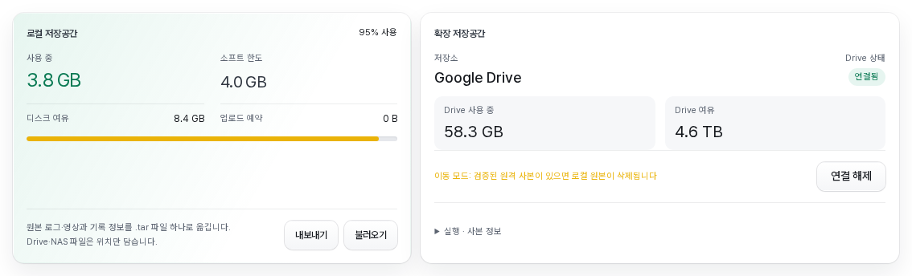

<details>
<summary>전체 설정과 모바일·고급 설정 예시</summary>

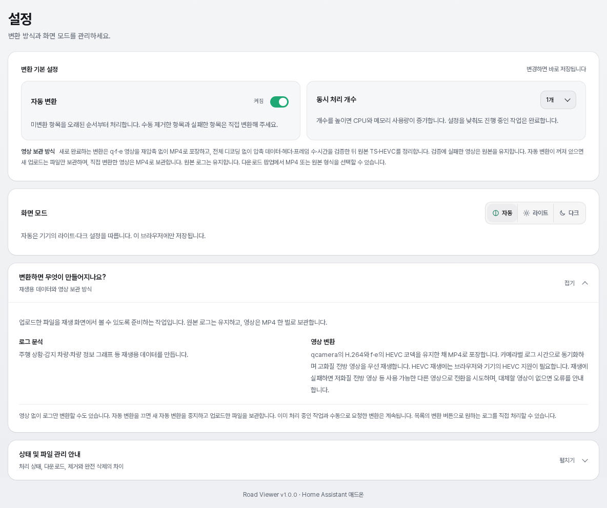

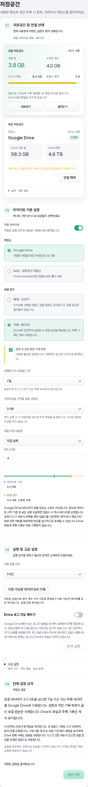

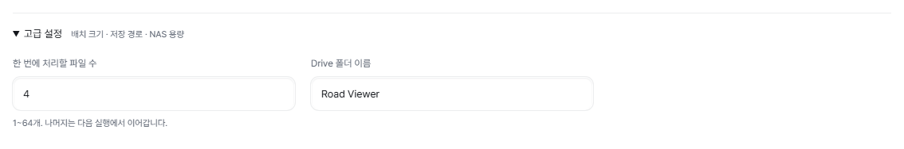

</details>

### 웹 UI 설정

**저장공간 탭 → 아카이빙 기본 설정**에서 사용 여부·저장소·보관 방식·로컬 원본 삭제 허용·보관 기간·사용량 기준을 바꿉니다. 실행 간격은 **실행 및 고급 설정**, 배치·NAS 경로·용량·Drive 폴더는 그 아래 **고급 설정**에 있습니다. 기간·간격·시작 기준은 프리셋과 직접 입력을 지원하며 기존 값은 보존됩니다. **현재 설정 요약**은 편집값을 미리 보여주며 **설정 저장** 전에는 적용하지 않습니다. 저장 일부만 성공하면 남은 변경을 표시하고 재시도 시 아직 저장하지 못한 부분만 저장합니다. 화면의 시작 기준은 GB 단위로 소수점(예: 2.5)까지 입력하며 저장할 때 MB(1 GB = 1024 MB)로 바꿉니다. 로컬 저장 한도의 직접 입력도 GB 소수점을 받습니다. MB는 1024² bytes 기준입니다. NAS는 모드 선택과 관계없이 항상 검증 후 이동합니다. 아래 키는 저장 파일의 이름이며 애드온 옵션에서 편집하지 않습니다.

설정은 `/data/roadviewer/.archive-settings.json`에 원자적으로 저장됩니다(권한 0600). OAuth 클라이언트 ID·보안 비밀만 애드온 옵션 `archive_gdrive_client_id`, `archive_gdrive_client_secret`에 남으며 API와 웹 UI에 반환하지 않습니다. 처음 업데이트할 때 파일이 없으면 기존 `/data/options.json`의 아카이빙 값을 한 번만 이전합니다. 꺼짐도 그대로 유지하며 빠진 값은 아래 기본값을 씁니다. 이후에는 파일이 우선이고 이전 옵션 키는 무시합니다. 1.0.30부터 이전 아카이빙 키는 앱 구성 화면에서 빠졌습니다.

파일이 손상되거나 읽을 수 없거나 이전 값이 잘못되면 아카이빙을 끄고 `settings_error`를 표시합니다. 잘못된 파일은 덮어쓰지 않으며 화면에서 저장해야 복구됩니다. 설정 저장은 실행 중이면 거부됩니다. 저장 자체는 아카이브·삭제·정리를 시작하지 않고, 시작 및 저장 후에는 설정한 주기를 온전히 기다립니다. **이동 가능한 데이터 모두 이동 / 복사 가능한 데이터 모두 복사**로 직접 실행할 수도 있습니다. 이전 과정은 토큰·저장소 ID·기록 파일을 변경하지 않습니다.

| 옵션 | 기본값 | 범위 | 설명 |
|---|---|---|---|
| `archive_enabled` | `false` | — | 아카이빙 사용 |
| `archive_path` | 빈 값 | `/share/` 아래 | NAS 폴더 경로 |
| `archive_local_threshold_mb` | `0` | 0 이상 | Road Viewer의 로컬 사용량이 이 값을 넘을 때만 옮깁니다. `0`이면 대상이 있을 때마다 옮깁니다. |
| `archive_min_age_hours` | `24` | 0–8760 | 업로드 후 이 시간이 지난 로그만 옮깁니다. |
| `archive_interval_minutes` | `1440` (24시간) | 1–1440 | 자동 실행 간격 |
| `archive_batch` | `4` | 1–64 | 한 번 실행할 때 옮기는 최대 파일 수 |
| `archive_nas_max_mb` | `0` | 0 이상 | NAS 폴더 사용량 상한. `0`이면 제한하지 않습니다. |
| `archive_nas_margin_mb` | `1024` | 0 이상 | NAS 여유 공간이 이 값보다 작으면 정리합니다. 여유 공간은 NAS 볼륨 전체 기준입니다. |

### 수동으로 적격 데이터 모두 이동·복사

저장된 설정으로 **이동 가능한 데이터 모두 이동** 또는 **복사 가능한 데이터 모두 복사**를 누르면 확인창을 먼저 엽니다. 파일·구간 수, 용량, MOVE의 예상 로컬 확보 용량과 제외 사유를 확인한 뒤 실행합니다. 확인 전에는 전송·삭제하지 않습니다.

자동 실행의 **배치 개수와 시작 임계값만** 적용하지 않고 기존 엔진을 반복합니다. 최소 보관 기간·사용 중 보호는 유지하며 고정 로그도 다른 로그와 같이 옮깁니다. Drive MOVE라도 로컬 삭제 허용이 꺼져 있으면 COPY로 안내합니다. 검증·기록 확정 후 해당 로컬 파일만 삭제하며 원격 파일은 삭제하지 않습니다. 이미 검증된 사본은 다시 올리지 않습니다.

실행 중에는 진행률·성공·실패 수를 보여주며 설정 변경과 중복 실행을 막습니다. 자동 아카이빙이 실행 중이거나 저장하지 않은 변경이 있으면 버튼이 비활성화됩니다. 새로고침해도 서버의 작업 상태를 다시 표시합니다. 재시작으로 끝나지 못한 작업은 성공이 아닌 **중단됨**으로 표시하고, 실패·연결 장애 시 미완료 파일의 원본을 유지합니다. Drive 장애나 인증 오류가 나면 중단합니다.

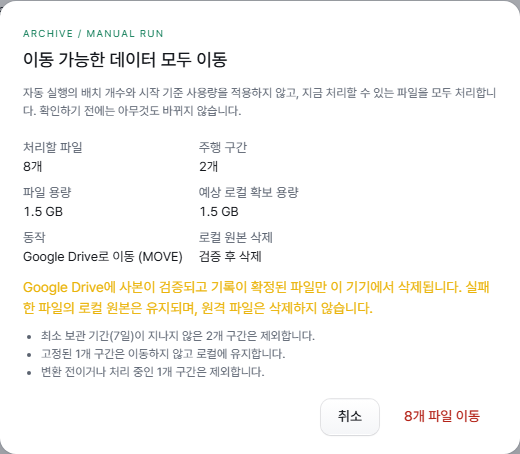

### 옮기는 대상과 순서

변환이 완료된(재생 가능한) 로그 중 `archive_min_age_hours`가 지난 로그를 업로드가 오래된 순으로 옮깁니다. 한 로그 안에서는 영상(MP4·HEVC·TS)을 먼저, `rlog.zst`를 마지막에 옮깁니다. **고정한 구간도 옮깁니다.** 고정은 삭제 보호이며 이동 금지가 아닙니다.

`meta.json`과 변환 데이터(재생·그래프 데이터)는 옮기지 않고 항상 로컬에 남습니다. 따라서 NAS에 연결할 수 없어도 목록과 주행 상황·차량 정보 재생은 그대로 동작합니다.

파일마다 NAS에 복사 → 디스크 기록 확인 → 복사본을 다시 읽어 해시 비교 → 이름 확정 → 저장 위치 기록 순서로 진행하고, 모두 끝난 뒤에만 로컬 파일을 지웁니다. 중간에 실패하거나 앱이 중단돼도 로컬 원본은 남으며, 다음 시작 때 남은 임시 복사본을 정리합니다.

### 실행 시점

앱 시작 및 설정 저장 후 `archive_interval_minutes`만큼 기다렸다가 실행합니다. 이전 중단의 복구도 첫 실행에서 처리합니다. 매 실행은 NAS 연결을 확인한 뒤 다음 순서로 진행합니다.

1. NAS 연결 불가로 미뤄 둔 삭제를 처리합니다.
2. NAS가 상한을 넘었거나 여유가 부족하면 정리합니다(아래 참고).
3. NAS 연결 불가로 미뤄 둔 변환을 다시 대기열에 넣습니다.
4. 파일을 옮깁니다. 업로드를 받는 중이거나 변환 작업이 있거나, 로컬 사용량이 `archive_local_threshold_mb` 이하이면 이번에는 옮기지 않습니다.

NAS에 연결할 수 없거나, NAS 여유가 파일 크기 + 100MiB보다 작거나, 해시가 맞지 않거나, 복사 중 오류가 나면 그 실행을 멈추고 다음 주기에 다시 시도합니다. 옮기는 중 업로드가 시작되면 현재 파일만 마치고 끝냅니다.

**저장공간** 탭에는 **NAS 상태 / NAS 사용 중 / NAS 여유 / 마지막 아카이브**와 마지막 오류가 표시됩니다. 보조 통계와 최근 실행 결과는 **실행 · 사본 정보**에 있습니다. 직접 실행하는 방법은 [수동으로 적격 데이터 모두 이동·복사](#수동으로-적격-데이터-모두-이동복사)를 참고하세요.

### 영상 상태

아카이빙을 켜면 목록의 영상 표시가 다음 상태로 나뉩니다.

| 표시 | 의미 | 재생·다운로드·변환 |
|---|---|---|
| 영상 있음 | 로컬에 있거나, 저장 기록상 연결된 NAS에 있습니다. 목록은 NAS 파일을 하나씩 확인하지 않으므로 NAS에서 사라진 복사본은 재생할 때 영상 없음으로 나타납니다. | 평소와 같습니다. |
| 저장소 연결 불가 | 영상이 NAS에 있지만 지금 연결할 수 없습니다. | 재생 화면은 다른 카메라로 바꾸거나, 없으면 “영상 저장소에 연결할 수 없습니다. NAS 연결을 확인하세요.”를 표시하고 영상 없이 재생합니다. 다운로드는 실패하며 ZIP은 일부만 만들지 않습니다. 변환은 “저장소 연결 후 다시 시도하세요.”로 거부합니다. |
| 영상 없음 | 등록된 영상이 없거나, NAS 정리로 지워졌거나, 연결된 NAS에서 파일을 찾지 못했습니다. 찾지 못한 파일은 삭제로 기록하지 않고 저장 기록을 그대로 두므로, NAS에 다시 보이면 영상 있음으로 돌아옵니다. 삭제로 기록하는 것은 NAS 정리뿐입니다. | 영상 없이 재생합니다. |
| 영상 확인 중 | NAS 연결을 확인하는 중입니다. | 재생 화면은 잠시 후 자동으로 다시 시도합니다. |
| 영상 읽기 오류 | 복구 중 검증에 실패했습니다. NAS에 있는 복사본과 남아 있던 로컬 파일 모두 저장 기록과 맞지 않습니다. NAS 복사본이 없는 것만으로는 이 상태가 되지 않으며, NAS 복사본이 다시 저장 기록과 맞으면 다음 시작 때 해제됩니다. | 재생·다운로드할 수 없습니다. 이미 만든 변환 영상을 지키기 위해 그 로그의 변환도 거부합니다. |

### NAS에 연결할 수 없을 때

연결 불가는 어떤 경우에도 파일 삭제·변환 데이터 정리·재변환의 이유가 되지 않습니다. 앱을 재시작해도 NAS에 파일이 있는 로그의 변환 데이터는 유지합니다. 이런 로그는 재시작 후 NAS에 처음 연결되었을 때 한 번 다시 확인해, 로그 분석 형식이 바뀌었거나 변환 데이터가 없으면 NAS의 원본을 모두 읽을 수 있을 때만 다시 변환합니다. 대기 중이던 변환은 “저장소에 연결할 수 없어 변환을 미뤘습니다.”로 미뤄 두었다가 연결되면 다시 대기열에 넣습니다. NAS에 파일이 있는 로그에 새 카메라 영상을 추가 업로드하면 연결 불가 동안에는 “저장소 연결 후 다시 시도하세요.”로 거부하며 대기열에 넣지 않습니다. 연결된 뒤 다시 업로드하세요. NAS의 원본 로그가 손상되었거나 없어진 로그에는 새 카메라 영상을 추가할 수 없으며 “원본 로그가 없어 영상을 추가할 수 없습니다. 로그와 영상을 함께 다시 업로드하세요.”로 거부하고 변환 데이터는 그대로 둡니다. 이때는 기존 항목을 완전 삭제한 뒤 로그와 영상을 함께 다시 업로드하세요.

저장공간 정책이 **오래된 미고정 구간 삭제**이면 NAS에 파일이 있는 로그는 연결 불가 동안 자동 삭제 대상에서 빠집니다. 연결된 상태에서 자동 삭제되면 NAS 파일도 함께 지웁니다. 아카이빙과 함께 쓸 때는 **새 업로드 거부**를 권장합니다.

### 삭제

**완전 삭제**하면 로컬 데이터를 바로 지우고 NAS 파일도 지웁니다. NAS에 연결할 수 없으면 삭제할 파일을 `/data/roadviewer`에 기록해 두고, 연결된 뒤 다음 실행에서 마저 지웁니다.

### NAS 정리

NAS 폴더 사용량이 `archive_nas_max_mb`를 넘거나 NAS 여유가 `archive_nas_margin_mb`보다 작으면 다음 순서로 NAS 파일을 지웁니다. 여유 공간은 NAS 볼륨 전체 기준이므로 같은 볼륨의 다른 데이터가 늘어나도 보관한 영상이 정리될 수 있습니다.

1. 고정하지 않은 로그의 영상을 업로드가 오래된 로그부터 지웁니다.
2. 그래도 부족하면 고정하지 않은 로그의 `rlog.zst`를 오래된 로그부터 지웁니다.

고정한 구간의 파일과 변환 대기·변환 중인 로그의 파일은 지우지 않습니다. `meta.json`과 변환 데이터는 남으므로 영상이 지워진 로그는 영상 없이 재생되고, `rlog.zst`까지 지워진 로그는 재생은 되지만 다시 변환하거나 원본 로그를 받을 수 없습니다. 앱을 다시 시작해도 이런 로그의 변환 데이터는 그대로 남습니다. **정리로 지운 영상은 같은 로그와 영상을 다시 업로드해야만 되살릴 수 있습니다**([영상 나중에 추가](#파일-업로드)). 정리는 파일을 지우기 전에 저장 기록에 삭제 예정을 남기고, 지운 뒤에 삭제로 기록합니다. 중간에 앱이 멈추면 다음 시작 때 파일이 남아 있으면 삭제 예정만 지우고, 없어졌으면 삭제로 기록합니다. 연결된 NAS에서 파일이 보이지 않을 뿐인 경우(재연결 직후 등)는 영상 없음으로 표시하지만 삭제로 기록하지 않습니다. 이전 버전이 찾지 못한 파일을 삭제로 기록했더라도 NAS에 기록된 내용 그대로 있으면 다음 시작 때 되살립니다. SMB 고유의 동작(오래된 파일 핸들, 캐시 지연, 전원 차단)은 실제 SMB 공유가 아닌 모의 환경에서만 시험했습니다. 공간이 계속 부족하면 실행은 주기마다 계속하며 정리를 다시 시도하고, 공간이 확보될 때까지 파일 이동만 멈춥니다. 저장공간 탭에 오류가 표시됩니다.

### 백업

NAS의 파일은 Home Assistant 백업 대상이 아닙니다. 아카이빙 설정 파일 `.archive-settings.json`, 클라이언트 자격 증명을 담은 앱 옵션과 저장소 ID를 담은 `/data/roadviewer/.archive.json`은 앱 설정과 함께 백업됩니다. NAS 자체의 백업은 NAS에서 따로 관리하세요.

## Google Drive 아카이빙 (실험 기능)

NAS 대신 Google Drive를 아카이브 저장소로 쓸 수 있습니다. 실험 기능이며 기본값은 꺼짐입니다(`archive_enabled: false`, `archive_backend: smb`). 끈 상태와 NAS를 쓰는 상태의 동작은 바뀌지 않습니다.

- **기본은 복제 모드입니다.** 파일마다 검증된 사본을 Drive에 두고 **로컬 파일은 지우지 않습니다.** 따라서 복제 모드로는 로컬 저장공간이 늘어나지 않습니다.
- **이동 모드**(검증된 사본이 있으면 로컬 원본 삭제)는 웹 UI의 **저장공간 탭 → 아카이빙 기본 설정**에서 **보관 방식**을 **이동 · MOVE**로 고르고 **검증 후 로컬 원본 삭제 허용**을 켜서 **둘 다** 저장해야만 켜집니다(저장 키 `archive_mode: move`, `archive_allow_local_delete: true`. 애드온 옵션이 아닙니다). 하나라도 빠지면 복제 모드로 동작합니다. Drive 이동 모드는 테스트 환경의 실제 Drive에서 1개 구간으로 검증했습니다. 이동 모드에서는 로컬 최대 사용량이 소프트 한도로 동작하고, Drive 파일이나 사본이 있는 기록은 자동 삭제 대상에서 제외됩니다([Google Drive MOVE의 로컬 한도](#google-drive-move의-로컬-한도)).
- **이 버전에는 Drive 자동 정리가 없습니다.** Drive의 파일은 사용자가 **완전 삭제**한 로그의 파일만 지웁니다.
- Drive로 옮긴 파일을 로컬로 되돌리는 복원 기능은 없습니다.

### 준비: OAuth 클라이언트 만들기

Road Viewer는 Google의 기기 인증(코드 입력) 방식으로 로그인하므로 직접 만든 OAuth 클라이언트가 필요합니다.

1. [Google Cloud 콘솔](https://console.cloud.google.com/)에서 프로젝트를 만들거나 고르고 **Google Drive API**를 사용 설정합니다.
2. **OAuth 동의 화면**을 구성합니다. 앱을 게시하지 않고 혼자 쓴다면 테스트 사용자에 사용할 Google 계정을 추가합니다.
3. **사용자 인증 정보 → 사용자 인증 정보 만들기 → OAuth 클라이언트 ID**를 고르고 애플리케이션 유형을 **TV 및 입력 제한 기기**(TV and Limited Input devices)로 선택합니다.
4. 만들어진 클라이언트 ID와 클라이언트 보안 비밀을 앱 옵션 `archive_gdrive_client_id`, `archive_gdrive_client_secret`에 입력합니다.

Road Viewer가 요청하는 권한 범위는 `drive.file` 하나입니다. 이 범위로는 **Road Viewer가 만든 폴더와 파일만** 볼 수 있으며, 같은 계정의 다른 Drive 파일은 읽거나 바꿀 수 없습니다.

### Drive 설정

[웹 UI의 공통 설정](#웹-ui-설정)(`archive_enabled`, `archive_local_threshold_mb`, `archive_min_age_hours`, `archive_interval_minutes`, `archive_batch`)은 Drive에도 같은 뜻으로 적용됩니다. `archive_path`와 `archive_nas_*`는 NAS 전용입니다. 클라이언트 ID·보안 비밀만 애드온 옵션이고, 나머지는 웹 UI에서 저장하면 재시작 없이 적용됩니다. 폴더 이름은 공백을 제외하고 1–255자이며 처음 만들 폴더의 이름입니다. 이미 연결된 폴더와 토큰은 이름이나 저장소를 바꿔도 유지합니다.

| 키 | 기본값 | 설명 |
|---|---|---|
| `archive_backend` | `smb` | `smb`(NAS) 또는 `gdrive`. 웹 UI의 **저장소** |
| `archive_mode` | `move` | `move` 또는 `copy`(웹 UI의 **보관 방식**). Drive에서는 `archive_allow_local_delete: true`가 함께 있어야만 `move`가 적용되고, 그 외에는 항상 복제입니다. 기본값 그대로이면 Drive는 복제 모드입니다. Drive 이동 모드는 테스트 환경의 실제 Drive에서 1개 구간으로 검증했습니다. NAS는 기존대로 이동합니다. |
| `archive_allow_local_delete` | `false` | 웹 UI의 **검증 후 로컬 원본 삭제 허용**. Drive에 검증된 사본이 있을 때 로컬 원본 삭제를 허용합니다. Drive 전용입니다. 이 옵션으로 켜지는 Drive 이동 모드는 테스트 환경의 실제 Drive에서 1개 구간으로 검증했습니다. |
| `archive_gdrive_client_id` | 빈 값 | OAuth 클라이언트 ID(TV 및 입력 제한 기기 유형) |
| `archive_gdrive_client_secret` | 빈 값 | OAuth 클라이언트 보안 비밀(비밀번호 입력란) |
| `archive_gdrive_folder_name` | `Road Viewer` | 처음 연결할 때 Drive에 만드는 전용 폴더 이름 |

복제 모드에서도 `archive_local_threshold_mb` 조건은 그대로 적용됩니다. 로컬 사용량이 이 값을 넘은 동안에만 사본을 만들며, 복제는 로컬 파일을 지우지 않으므로 사용량은 줄지 않습니다. `0`이면 대상이 있을 때마다 사본을 만듭니다.

### Drive 연결 절차

1. 애드온 옵션에 클라이언트 ID·보안 비밀을 입력하고 저장한 뒤 앱을 재시작합니다. 이후 **저장공간 탭 → 아카이빙 기본 설정**에서 **Google Drive**를 선택하고 저장합니다. 실제 파일 복사는 **자동 아카이빙**을 켜야 합니다. 꺼져 있어도 계정 연결은 가능하며 Drive 사용량·사본 항목과 **이동 가능한 데이터 모두 이동 / 복사 가능한 데이터 모두 복사** 버튼은 숨겨집니다.
2. **저장공간** 탭을 열고 확장 저장공간(Google Drive) 카드의 **Google Drive 연결**을 누릅니다. 아카이빙이 꺼져 있으면 별도의 Google Drive 카드에 표시됩니다. 화면에 코드와 주소(`https://www.google.com/device`), 남은 유효 시간이 표시됩니다.
3. 휴대폰이나 PC 등 아무 기기의 브라우저에서 그 주소를 열어 코드를 입력하고, 사용할 Google 계정으로 승인합니다.
4. 패널이 열려 있는 동안 승인 여부를 자동으로 확인합니다. 승인되면 코드가 사라지고 **Drive 상태**(아카이빙이 꺼져 있으면 **Drive 계정**)가 **연결됨**이 됩니다. 처음 연결할 때 설정한 이름의 전용 폴더를 만듭니다. 아카이빙이 꺼진 상태로 연결했다면 폴더는 아카이빙을 켠 뒤 첫 실행 때 만듭니다.

클라이언트 ID가 비어 있으면 “애드온 옵션에서 Google Drive 클라이언트 ID를 설정하세요”가 표시되고 연결 버튼이 비활성화됩니다. 코드가 만료되거나 승인을 거부하면 그 이유가 표시되며 다시 연결할 수 있습니다. 인증이 만료되면 **다시 연결** 버튼이 나타나고, 다시 연결해도 같은 폴더를 그대로 사용합니다. 기기 인증 방식이므로 리디렉션 주소, 외부 포트, 공유기·방화벽 설정을 바꿀 필요가 없습니다.

**연결 해제**를 누르면 확인 후 이 기기에 저장된 토큰 파일을 바로 지우고, Google에 토큰 폐기를 백그라운드로 요청합니다. 폐기 요청이 실패해도 이 기기의 연결은 해제됩니다. **저장 기록, 로컬 파일, Drive의 파일은 바꾸지 않습니다.** 올리던 파일은 다음 조각을 보내기 전에 멈추고 “연결이 해제되어 업로드를 중단했습니다. 다시 연결하세요”를 표시합니다. 해제된 동안에는 Drive 아카이빙과 Drive로 옮긴 파일의 재생이 멈춥니다. **연결 해제** 버튼과 이동 모드 안내도 같은 Drive 카드에 있습니다. 다시 연결하면 같은 폴더를 찾아 멈춘 업로드를 이어서 올립니다.

### 복제 모드와 이동 모드

**복제 모드**(기본): 파일마다 Drive에 올리고, Drive가 알려 주는 sha256(없으면 md5, 그것도 없으면 내려받아 계산한 sha256)을 로컬 파일과 비교해 검증한 뒤 저장 기록에 사본을 남깁니다. 로컬 파일은 그대로 두며, 로컬 파일이 있는 동안 재생·다운로드·변환은 항상 로컬 파일을 씁니다. 패널에는 “복제 모드: 로컬 파일은 보존됩니다”가 표시됩니다. 복제 모드는 실제 Google 계정에서 검증했습니다(2026-11-04).

**이동 모드**(웹 UI의 **이동 · MOVE** + **검증 후 로컬 원본 삭제 허용**, 테스트 환경의 실제 Drive에서 검증): 업로드 → 검증 → 저장 기록을 디스크에 확정한 다음에만 로컬 원본을 지웁니다. 패널에는 경고 “이동 모드: 검증된 원격 사본이 있으면 로컬 원본이 삭제됩니다”가 표시됩니다. 고정한 구간도 같이 이동합니다(고정은 자동·일괄 삭제만 막습니다). 복제 모드에서 이동 모드로 바꾸면 이미 검증된 사본을 다시 올리지 않고 그대로 사용한 뒤 로컬 파일을 지웁니다.

이동한 파일은 기존과 같은 주소로 Drive에서 바로 받아 재생·다운로드합니다(구간 요청 지원). 재생 중인 Drive 영상은 시크가 빠르도록 파일 전체를 앱의 메모리에 백그라운드로 받아 두고, 받아 둔 구간은 Google을 거치지 않고 보냅니다. 브라우저는 일시정지 중에는 앞부분만 미리 받으므로, 재생 화면이 지금 구간 영상 전체를 이 사본에서 백그라운드로 받아 일시정지 중에 바꿔 끼웁니다(256MB 이하). 그 뒤로는 구간 안 어디로 이동해도 바로 나오고 시크 바도 끝까지 회색으로 표시됩니다. 로컬 영상도 같습니다. 메모리에는 지금 보는 영상 하나만 두며, 다른 영상이나 카메라를 열면 이전 영상을 버리고 10분 동안 보지 않으면 비웁니다. 256MB를 넘는 파일은 담지 않고 Drive에서 바로 받으며, 다 받은 뒤 SHA-256이 저장 기록과 다르면 버립니다. 디스크에는 쓰지 않고 다운로드에는 쓰지 않습니다. 재생용 응답은 브라우저 개인 캐시에 1시간 동안 보관할 수 있어(`private, max-age=3600`) 받아 둔 구간으로 바로 이동합니다. 다운로드 응답은 캐시하지 않습니다. 원본 형식 내보내기와 다시 변환처럼 로컬 파일이 필요한 작업은 Drive에서 임시로 내려받아 sha256을 확인한 뒤 쓰고, 끝나면 지웁니다. 이때 로컬 여유 공간이 파일 크기 + 100MiB보다 작으면 다운로드는 “보관된 파일을 내려받을 디스크 공간이 부족합니다.”로 실패하고, 변환은 “디스크 공간이 부족해 변환을 미뤘습니다.”로 미룹니다.

변환이 원본 영상을 MP4로 바꾸면, 원본의 Drive 사본이 원본과 같은 내용일 때 그 사본이 원본의 저장본이 되어 Drive에서 제공합니다. 새 MP4는 다음 실행에서 다시 올립니다.

### Drive 실행 시점과 중단 복구

실행 주기와 조건은 NAS와 같습니다. 앱 시작 및 설정 저장 후 `archive_interval_minutes`만큼 기다리며 이전 중단의 복구도 첫 실행에서 처리합니다. 매 실행은 Drive 연결을 확인한 뒤 Drive 사용량 측정 → 미뤄 둔 Drive 삭제 처리 → 미뤄 둔 변환 재대기 → 업로드 순서로 진행합니다. 사용량은 삭제보다 먼저 재므로, 삭제한 만큼은 다음 실행의 측정값부터 패널에 반영됩니다. NAS 정리에 해당하는 단계는 없습니다. Drive에 연결할 수 없거나, 인증이 만료되었거나, 요청 한도를 넘었거나, Drive가 가득 찼거나, 검증에 실패하면 그 실행을 멈추고 다음 주기에 다시 시도합니다. 이런 실패는 로컬 파일 삭제나 저장 기록 변경의 이유가 되지 않습니다.

업로드는 16MiB 조각 단위로 이어 올릴 수 있는 방식이며, Google과의 연결을 재사용해 조각마다 새로 연결하지 않습니다. 업로드 세션은 첫 조각을 보내기 전에 저장 기록에 남기므로, 앱이 중간에 멈추면 다음 시작 때 Drive가 받은 지점부터 이어서 올립니다. 마지막 조각의 응답을 받지 못했거나 검증·기록 전에 멈췄다면 Drive에 완성된 파일을 찾아 검증한 뒤 기록하며, 같은 파일을 다시 올리지 않습니다. 이동 모드에서 기록 후 로컬 삭제 전에 멈췄다면 다음 시작 때 Drive 사본을 다시 검증한 뒤 지웁니다. 변환이 파일을 바꾼 뒤 저장 기록을 남기기 전에 멈췄다면, 다음 시작 때 이전 내용을 가리키는 사본 기록만 지우고(Drive 파일은 남습니다) 새 내용은 다시 복제합니다. 이동한 파일의 Drive 사본이 더 이상 검증되지 않지만 남아 있던 로컬 파일이 저장 기록과 같으면, 그 로컬 파일을 다시 사용하고 다음 실행에서 새 사본을 올립니다. 검증되지 않은 Drive 파일은 지우지 않고 그대로 둡니다. 크기가 0인 빈 파일은 Drive에 올리지 않고 경고만 남깁니다.

### Drive 상태와 오류

**저장공간** 탭에는 **저장소 / Drive 상태 / Drive 사용 중 / Drive 여유 / 복제 사본 / 복제 사본 용량 / 검증 실패 / 마지막 아카이브**가 표시됩니다. **Drive 상태**는 **연결 안 됨**(로그인 전 또는 연결 해제), **연결됨**, **연결 불가**, **확인 중**, **인증 만료** 중 하나입니다. 패널은 Drive에 그때그때 묻지 않고 마지막 확인 결과를 보여 주며, 확인은 백그라운드에서 합니다. 그래서 Drive가 응답하지 않아도 패널은 바로 열립니다.

마지막 아카이브 오류:

| 코드 | 표시 |
|---|---|
| `storage_unavailable` | Google Drive에 연결할 수 없습니다. |
| `auth_expired` | Google Drive 인증이 만료되었습니다. 다시 연결하세요. |
| `rate_limited` | Google Drive 요청 한도를 넘었습니다. 다음 주기에 다시 시도합니다. |
| `remote_full` | Google Drive 공간이 부족합니다. |
| `hash_mismatch` | Google Drive 사본 검증에 실패했습니다. |
| `os_error` | Google Drive에 파일을 올리지 못했습니다. |

인증 오류:

| 코드 | 표시 |
|---|---|
| `access_denied` | 사용자가 승인을 거부했습니다 |
| `code_expired` | 코드가 만료되었습니다. 다시 연결하세요 |
| `auth_expired`, `invalid_grant` | 인증이 만료되었습니다. 다시 연결하세요 |
| `invalid_client` | 클라이언트 ID/비밀키가 올바르지 않습니다 |
| `signed_out` | 연결이 해제되어 업로드를 중단했습니다. 다시 연결하세요 |
| 그 밖의 코드 | 인증 오류 (코드) |

연결·재시도 요청의 오류 코드: `409 gdrive_not_selected`(아카이브 저장소가 Google Drive가 아님), `409 gdrive_not_configured`(클라이언트 ID 없음), `409 gdrive_connected`(이미 연결됨), `503 gdrive_unavailable`(Google에 연결할 수 없음), `502 gdrive_auth_failed`(Google이 클라이언트를 거부함, `reason`에 이유 코드), 재시도의 `409 no_archive_error`(재시도할 검증 실패 없음), `400 invalid_archive_retry`(잘못된 요청 본문), `404`(없는 로그).

Drive에 있는 영상은 [NAS의 영상 상태](#영상-상태)와 같은 표시를 씁니다. Drive에 연결할 수 없으면 “영상 저장소(Google Drive)에 연결할 수 없습니다. 인터넷과 Google Drive 연결을 확인하세요.”를 표시합니다. Drive에서 파일이 지워졌으면 재생할 때 찾을 수 없음으로 응답하지만, 저장 기록은 바꾸지 않고 삭제로 기록하지도 않습니다. 앱이 시작될 때 복구가 이런 파일의 수를 세어 둡니다. 목록은 Drive 파일을 하나씩 확인하지 않습니다. 복제 모드에서 로컬 파일이 있으면 Drive 상태와 관계없이 로컬 파일로 재생합니다.

**검증 실패**: 올린 사본이 로컬 파일과 맞지 않으면 그 파일에 표시를 남기고 로컬 파일과 Drive 사본을 모두 그대로 둡니다. 로컬 파일은 계속 재생되며, 그 파일을 매 실행마다 다시 올리지는 않습니다. 목록의 해당 로그에 “원격 사본 검증에 실패했습니다. 로컬 파일은 유지됩니다.”와 **재시도** 버튼이 나타나고, 누르면 표시만 지워 다음 실행에서 다시 올립니다. 맞지 않았던 Drive 사본은 자동으로 지우지 않습니다.

### 할당량과 Drive 공간

Drive는 백업이 아닌 **확장 저장공간**입니다. 사용량은 아카이브 실행 때 측정하며 화면은 마지막 측정값을 표시합니다. Drive가 한도를 알려 주지 않으면 **할당량 확인 불가**(`usage_reliable: false`)로 표시합니다. Drive가 가득 차면 `remote_full`로 멈추고 원본을 보존합니다.

### Google Drive MOVE의 로컬 한도

**Google Drive MOVE는 로컬 확장 저장공간입니다.** Drive MOVE와 로컬 원본 삭제 허용을 함께 설정하면 로컬 최대 사용량은 **소프트 리밋**으로 동작합니다. 아카이빙이 켜져 있을 때 한도 또는 아카이빙 시작 기준에 도달하면 기존 아카이버에 백그라운드 이동을 요청합니다. 둘 다 설정한 경우 더 낮은 값을 기준으로 합니다. 다른 업로드의 남은 예약, 임시 파일과 **100 MiB 안전 여유**를 확보할 수 있으면 한도를 일시적으로 넘어도 업로드를 받습니다. 업로드 요청이 Drive 전송 완료를 기다리지는 않습니다.

MOVE는 원격 전송·무결성 검증·저장 기록 확정 후 해당 로컬 파일만 지웁니다. 최소 보관 기간·사용 중 보호·배치 제한을 유지하며 중복 실행하지 않습니다. 고정한 구간도 옮기지만 고정하지 않은 구간을 먼저 옮기고, 그래도 공간이 부족할 때만 고정한 구간을 옮깁니다. Drive 장애나 검증 실패가 있어도 원본과 기록을 보존하고, 물리적 여유가 충분하면 업로드를 계속 받습니다. 공간이 실제로 부족하면 기존 기록을 지우지 않고 신규 업로드를 거부합니다. 아카이빙을 끄면 이동하지 않습니다. 이 경우에도 Drive MOVE 설정의 소프트 한도는 유지되며 물리적 디스크 여유가 업로드 허용 기준입니다.

Drive로 옮긴 기록은 **목록·재생·다운로드에 그대로 남습니다.** 자동 로컬 정리는 Drive 파일이나 Drive 파일이 연결된 기록을 삭제하지 않습니다(COPY 사본도 보호). 원격 삭제는 사용자가 **완전 삭제**를 명시한 경우에만 예약합니다. 출처를 확인할 수 없는 이전 버전의 원격 삭제 대기는 자동 실행하지 않습니다.

**완전 삭제**를 명시하면 해당 기록의 이동 파일·검증된 사본을 원격 삭제 대기에 기록합니다. 요청 중 Drive에 동기 접속하지 않으며 연결할 수 있을 때 기존 엔진이 처리합니다. 다른 설치가 올린 파일은 삭제하지 않습니다. 검증 실패 사본이나 재변환으로 내용이 달라진 이전 사본은 자동으로 정리하지 않습니다. 저장 기록에 남은 파일을 Drive에서 직접 지우면 재생·다운로드 시 찾을 수 없음으로 표시됩니다.

### Drive 백업과 보안

- Drive 인증 정보(리프레시 토큰)는 `/data/roadviewer/.gdrive-auth.json`(권한 0600)에, Drive 저장소 ID는 `/data/roadviewer/.archive.json`에 저장합니다. 두 파일과 앱 옵션(클라이언트 보안 비밀 포함)은 **Home Assistant 백업에 포함됩니다.** 백업을 가진 사람은 Road Viewer의 Drive 폴더에 접근할 수 있으므로 **백업 파일을 비밀번호처럼 보관하세요.** 두 파일을 지우지 마세요.
- Drive의 파일은 Home Assistant 백업 대상이 아닙니다.
- 새로 여는 포트는 없습니다. Google과의 통신(로그인, Drive)은 모두 앱에서 Google로 나가는 HTTPS 연결이며, Google이 앱으로 접속하지 않습니다.
- 연결·연결 해제·재시도 같은 변경 요청은 다른 설정 변경과 마찬가지로 Home Assistant Supervisor(Ingress)를 거친 요청만 받습니다.
- 토큰, 클라이언트 보안 비밀, 업로드 세션 주소, Drive 파일 ID는 화면·API 응답·로그에 표시하지 않습니다.

### 검증 범위와 한계

0.13.1 작업에서 테스트 환경의 실제 Google Drive 연결·COPY/MOVE·무결성 확인·로컬 삭제·Range 재생·원본 다운로드를 검증했습니다. 자동 회귀 검사는 모의 서버(`tests/fake_drive.py`)를 사용합니다. 이번 문서·스크린샷 갱신에서 실제 계정이나 운영 데이터로 이를 반복 실행하지 않았습니다.

전원 차단으로 디스크에 기록되지 않은 데이터 손실, 실제 Drive의 장기 할당량·요청 한도, gunicorn 스트리밍 도중의 모든 원격 오류, Google Cloud 콘솔과 계정별 모든 OAuth 구성은 이 검증으로 보장하지 않습니다.

## 문서 언어와 개발 자료

스크린샷은 2026-11-07에 1.0.0 버전(브랜치 `feature/ui-redesign`) 코드와 예시 데이터로 촬영했습니다. 소개 사진 3장은 기존 주행 영상 영역을 새 UI에 합성했습니다. 실제 기기·계정·개인 주행 로그가 아니며 페어링 코드는 사용할 수 없습니다. [이미지 목록과 촬영 범위](../docs/images/README.md)를 참고하세요.

- [English user guide](DOCS.en.md)
- [장치 API 한국어](../docs/device-api.md) · [Device API English](../docs/device-api.en.md)
- [변경 이력](CHANGELOG.md): 당시 릴리스 기록을 유지합니다. 현재 동작은 이 문서를 기준으로 확인하세요.
